# 灶台风暴 · SIZZLE!

> 一款双模式做菜游戏：**第一人称沉浸厨房** + **2D 街机合作厨房**。
> 用同一套菜谱、同一间厨房、同一套订单规则，做出两种完全不同的手感。

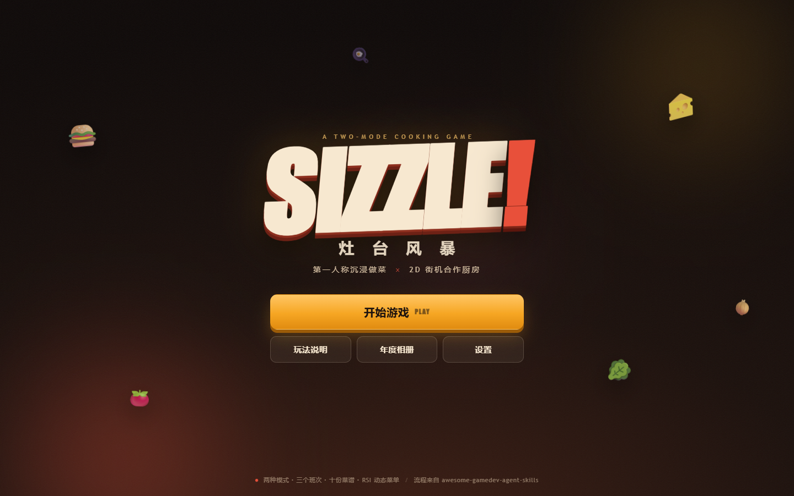

---

## 这是什么

《灶台风暴》是一款在浏览器里直接玩的做菜游戏。它不是餐厅经营模拟，也不是菜谱收集器，而是把“抓料、切菜、煎肉、摆盘、出餐”这一套动作做成手感明确的街机循环：

- **模式 01 · 沉浸厨房**：第一人称走进 3D 厨房。鼠标转头，WASD 走位，亲手把食材放上砧板、按住左键切碎、盯着肉饼从生到熟再到焦，端起盘子冲到上菜窗口。
- **模式 02 · 街机厨房**：俯视视角的经典厨房乱斗。同样的厨房、同样的订单，但节奏更快；支持 **本地双人**，一个切菜一个煎肉，或者互相把对方的路堵死。

两种模式共用同一套 `Kitchen` 规则和 `GameSession`，所以你在 3D 里学会的流程，在 2D 里立刻能用，反之亦然。

**RSI 厨房大脑** 让菜单活起来：城市、天气和你的口味会改变今日推荐；推荐菜有额外积分；每班收工后厨房回放历史、改进下一班的推荐。年底，所有做过的菜会变成一本可导出的相册和回忆录。

| 沉浸厨房 | 街机厨房 |
|---|---|
| 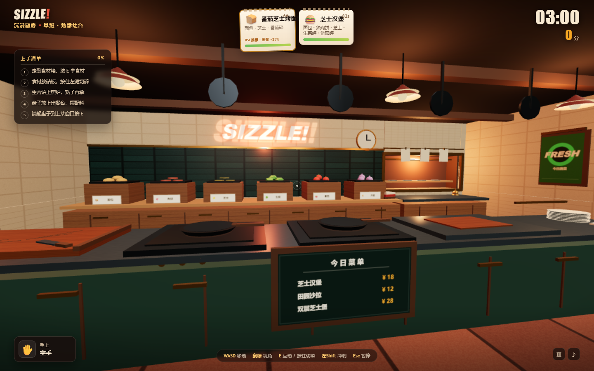 | 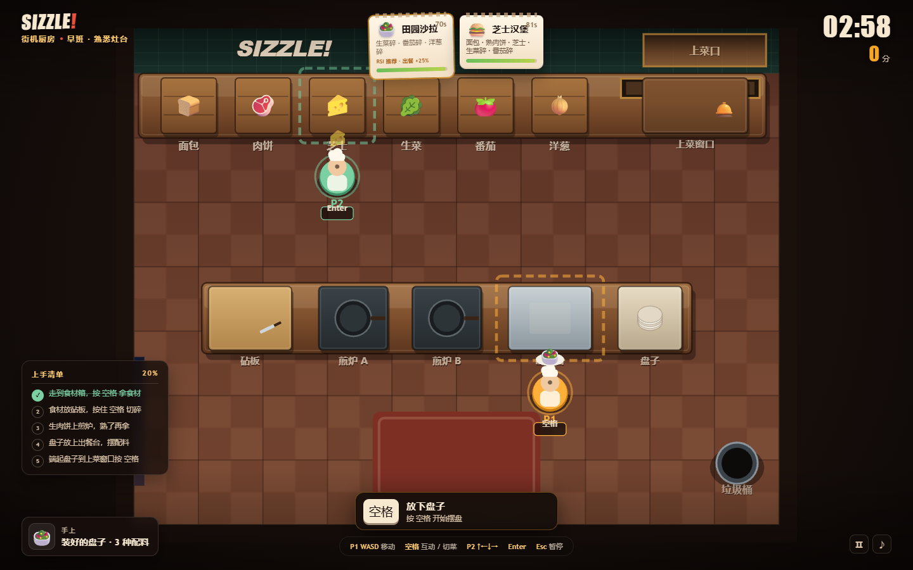 |
| 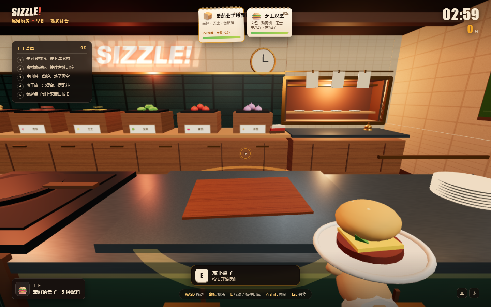 | 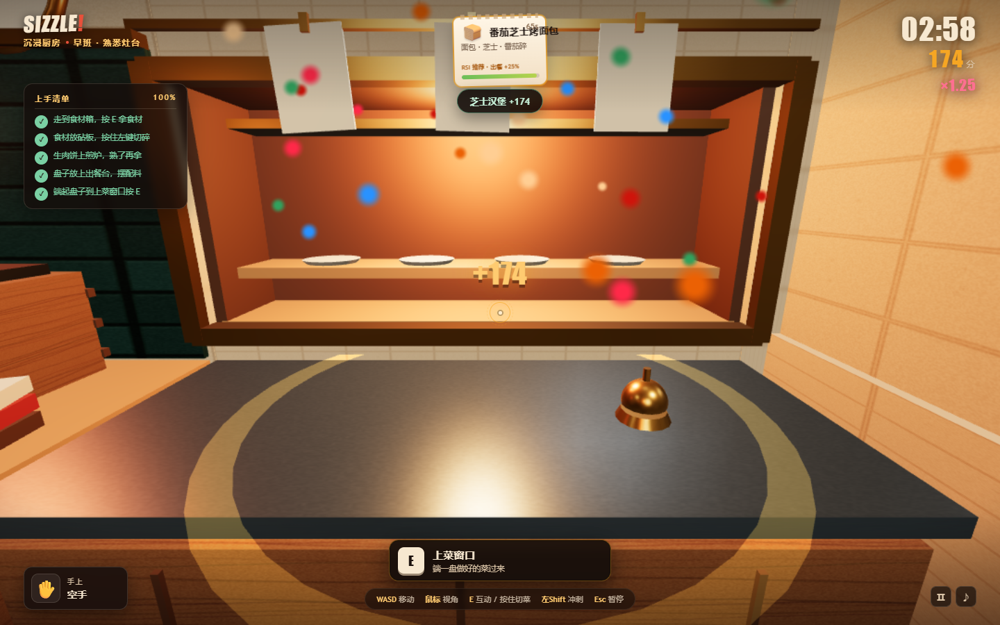 |

---

## 立即开玩

### 方式 A：直接打开（最快）

用 Chrome 或 Edge 打开：

```text
dist/index.html
```

也可以打开项目根目录的 `index.html`（会自动跳转到 `dist/index.html`）。

双击即可。构建产物是一个经典 `<script>` 单文件包（不依赖 ES Module / 本地服务器），因此 `file://` 也能正常运行。首次点击“开始游戏”后浏览器才会解锁音频（这是浏览器的自动播放策略，不是 bug）。

### 方式 B：本地静态服务器

```bash
npm install
npm run build
npm run serve
# http://127.0.0.1:5173
```

开发时用：

```bash
npm run dev        # esbuild watch + 静态服务器
```

> 说明：Windows + Chrome/Edge 是主要验证环境；Firefox/Safari 未做完整回归。

---

## 操作

### 沉浸厨房（第一人称）

| 按键 | 动作 |
|---|---|
| `W` `A` `S` `D` | 移动 |
| 鼠标移动 | 转头 / 瞄准（点击画面锁定鼠标） |
| `E` | 拿起 / 放下 / 摆配料 / 上菜 |
| 按住鼠标左键 或 按住 `E` | 在砧板上切菜 |
| `Shift` | 冲刺 |
| `Esc` | 暂停 / 释放鼠标 |

在画面中央出现准星提示时按 `E`。靠近设备时底部会出现当前可做的动作；准星变成琥珀色圆环表示可以互动。
按键可在 **设置 → 按键绑定** 中重绑（Esc 保留给暂停）；提示、手册和 HUD 会同步显示新键位。

### 街机厨房（俯视 / 本地双人）

| 玩家 | 移动 | 互动 / 按住切菜 |
|---|---|---|
| P1 | `W` `A` `S` `D` | `空格` |
| P2 | `↑` `↓` `←` `→` | `Enter` |

单人游玩时只使用 P1。`Esc` 随时暂停。P1/P2 键位也可在设置中分别重绑。

### 手柄（标准映射）

| 输入 | 沉浸厨房 | 街机厨房 |
|---|---|---|
| 左摇杆 / 十字键 | 移动 | P1 移动（第二个手柄控制 P2） |
| 右摇杆 | 视角 | — |
| `A` | 互动 / 按住切菜 | P1 互动 / 按住切菜 |
| `X` / `RB` | 切菜 | P1 切菜 |
| `RT` / `L3` | 冲刺 | — |
| `Start` | 暂停 | 暂停 |

手柄即插即用，不需要设置；HUD 会自动切换成手柄提示。

### 触屏（2D 街机）

检测到触屏设备时默认进入街机厨房，并显示 **左下虚拟摇杆 + 右下互动键 + 暂停键**。触屏只控制 P1；P2 仍可用键盘。可在 **设置 → 触屏控制** 中选择“自动 / 开启 / 关闭”，桌面调试也可在 URL 后加 `?touch=1` 强制开启。

---

## 菜谱

| 菜 | 需要 | 基础分 |
|---|---|---:|
| 🥗 田园沙拉 | 生菜碎 + 番茄碎 + 洋葱碎 | 90 |
| 🥬 番茄生菜杯 | 生菜碎 + 番茄碎 | 65 |
| 🍞 番茄芝士烤面包 | 面包 + 芝士 + 番茄碎 | 80 |
| 🍔 芝士汉堡 | 面包 + **熟**肉饼 + 芝士 + 生菜碎 + 番茄碎 | 130 |
| 🥙 田园素堡 | 面包 + 芝士 + 生菜碎 + 番茄碎 + 洋葱碎 | 110 |
| 🍔 洋葱牛肉堡 | 面包 + **熟**肉饼 + 芝士 + 洋葱碎 | 125 |
| 🥗 芝士脆蔬 | 生菜碎 + 番茄碎 + 洋葱碎 + 芝士 | 115 |
| 🍔 双层芝士堡 | 面包 + **熟**肉饼 ×2 + 芝士 + 生菜碎 + 番茄碎 | 185 |
| 🍔 全料豪华堡 | 面包 + **熟**肉饼 + 芝士 + 生菜碎 + 番茄碎 + 洋葱碎 | 180 |
| 🍔 洋葱双层堡 | 面包 + **熟**肉饼 ×2 + 洋葱碎 | 170 |

流程：**食材箱 → 砧板（需要切的切碎）→ 煎炉（肉饼）→ 出餐台摆盘 → 上菜窗口**。

- 肉饼下锅约 **5.5 秒**变熟，约 **10.5 秒**烧焦；焦掉的肉饼只能丢进垃圾桶。
- 盘子从右侧盘子台拿，先放到出餐台，再把配料一份份摆上去。
- 菜谱按“配料多重集合”匹配，摆盘顺序不影响结果；双人模式里两个人可以同时往同一张盘子上加料。

---

## RSI 动态菜单

参考 [Dream-RSI](https://arxiv.org/html/2609.14858v2#S3) 的“在线 rollout → 回放历史 → 离线评估 → 部署新策略”结构，做了一个游戏尺度的轻量 RSI：

- **上下文**：城市（上海/成都/广州/北京/杭州）、天气（晴/雨/雪/热浪/起风）、玩家偏好（清爽/素食/肉食/芝士/辛香/番茄/经典）。
- **在线班次**：从推荐池 + 班次底池出订单，推荐菜权重 ×2.2；带 `RSI 推荐 · 出餐 +25%` 的订单完成时额外加分。
- **历史回放**：记录每班的推荐菜、实际出餐分布、分数、星级、超时率与难度/重玩意愿。
- **策略改进**：用历史班次离线回放候选权重（逐标签扰动 + 实际出餐经验），选择 replay score 更高的策略；版本号、回放分和更新时间存本机。
- **年度相册**：按月份/季节汇总菜谱次数、城市/天气、最高分班次，生成回忆录文案，可下载独立 HTML 或打印/存 PDF。

RSI 是**本机确定性规则 + 回放评估**，没有网络、LLM 或云端调用；它模拟论文的“演化世界 + 回放选择”，不等同于复现论文实验。

---

## 订单、分数与星级

- 屏幕顶部是当前订单，每位客人都有自己的倒计时；带金色描边和“RSI 推荐”标签的是今日推荐菜。
- 上菜时：
  - **基础分** = 菜品分数
  - **小费** = 基础分 × 35% × 剩余时间比例
  - **连击倍率** = `1 + min(连击, 4) × 0.25`（最高 ×2.00）
  - **RSI 推荐加成** = 若该菜在今日推荐中，再 +25%
  - 连续出餐会叠倍率；订单超时或烧焦会打掉连击。
- 订单超时不扣分，但客人会走，连击清零。
- 送错菜 / 乱配的盘子不会被接收，也不会消耗订单。
- 结算按班次目标给 **1–3 星**，最佳分数和星级会存进 `localStorage`。

### 班次

| Shift | 时长 | 同时订单 | 订单间隔 | 菜谱 | 1★ / 2★ / 3★ |
|---|---:|---:|---:|---|---|
| 01 早班 · 熟悉灶台 | 180s | 2 | 7.0s | RSI 推荐 + 基础三样 | 300 / 475 / 625 |
| 02 午市 · 客流高峰 | 210s | 2 | 7.0s | RSI 推荐 + 全部 | 300 / 425 / 800 |
| 03 夜宵 · 极限出餐 | 180s | 2 | 6.0s | RSI 推荐 + 全部 | 225 / 375 / 625 |

> 这套阈值是 **2026-11-03 的模拟校准版**，不是最终真人数据：用 `npm run balance` 让路径规划机器人在每个班次跑 80 局，按新手 p50 / 普通 p50 / 熟练 p50 取 1★/2★/3★，再手动取整。真人试玩后应按 `design/PLAYTEST-PROTOCOL.md` 重新拟合；模拟只作为“当前目标是否可达”的下限检查。
>
> **RSI 推荐菜 +25% 会提高实际分数**；上述目标尚未按 RSI 重算，仍作为旧基线。下一轮应把 RSI 加成纳入模拟/真人重标后再改目标。
>
> 调低前的旧目标（650/1000/1450 等）在模拟里熟练玩家也只有约 650 分，2★/3★ 实际上不可达；同时把 02/03 的同时订单从 3 降到 2、放宽订单耐心，避免排队订单大量超时。

---

## 功能清单

- **两种完整模式**：第一人称 3D 与俯视 2D；2D 支持单人 / 本地双人。
- **同一套模拟内核**：食材、切菜、煎制、烧焦、摆盘、菜谱匹配、订单、计分全部共享。
- **三种输入**：键鼠、标准手柄（热插拔）、2D 触屏；键位可在设置中重绑，冲突检测与恢复默认。
- **RSI 动态菜单**：城市/天气/偏好驱动推荐，推荐菜 +25% 分；每班回放历史、改进推荐策略，版本和 replay 分存本机。
- **年度相册**：按菜谱/月份/城市/天气生成回忆录，可下载独立 HTML 或打印/存 PDF。
- **试玩数据闭环**：每班结束自动记录模式、班次、人数、输入设备、参与者、经验标签、首次玩、首单时间、暂停次数、出餐/超时/浪费/烧焦、分数、星级、连击和时长；结算页可顺手点难度/重玩意愿。数据页可查看真人汇总、导入/导出 CSV/JSON、清空。数据只存本机，自动标记 `automation` 样本。
- **真人阈值分析**：`npm run analyze -- playtest.csv` 解析导出文件，按新手/普通/熟练分组，输出出餐/超时/分数百分位和 1★/2★/3★ 建议；样本不足时拒绝猜数。也可以在数据页直接“计算建议 → 应用本机覆盖”，下一班生效。
- **平衡模拟器**：`npm run balance` 用真实 `GameSession` 规则 + 网格寻路机器人，按新手/普通/熟练三档跑多局，输出分数/出餐/超时/星级分布，辅助发现不可达阈值。
- **3D 厨房**：程序化 PBR 材质、阴影、体积感灯光、霓虹招牌、吊灯、上菜窗口、菜单黑板。
- **第一人称手感**：指针锁定、加速度移动、胶囊碰撞、头部晃动、冲刺 FOV、创伤式镜头震动、切菜刀摆动。
- **食物可视化**：不同食材/切碎/熟/焦状态用低多边形模型表现；盘子会随配料堆叠；汉堡的圆面包会自动盖在顶部。
- **粒子反馈**：煎炉蒸汽、焦糊黑烟、切菜碎屑、上菜彩带、配料闪光。
- **程序化音频**：WebAudio 合成 SFX（切菜、滋滋声、上菜铃声、烧焦、脚步…）与自适应厨房律动；无外部音频文件。
- **完整 UI**：主菜单、模式/班次选择、RSI 动态菜单、玩法手册、设置、暂停、结算、星级、最佳记录、试玩数据、年度相册。
- **设置**：音量 / 音乐 / 音效 / 灵敏度 / FOV / 画面精细度 / 镜头晃动 / 反转 Y 轴 / 教学提示 / 试玩记录 / 触屏控制 / 键位绑定，立即生效并持久化。
- **上手引导**：开场班次卡、第一步清单、上下文准星提示、熟肉饼/烧焦/超时/最后 15 秒提示。
- **无外部素材依赖**：所有纹理、招牌、海报、菜单、图标均为 Canvas 程序化生成；three.js 打包进单文件。

| 结算 | 玩法手册 |
|---|---|
|  | 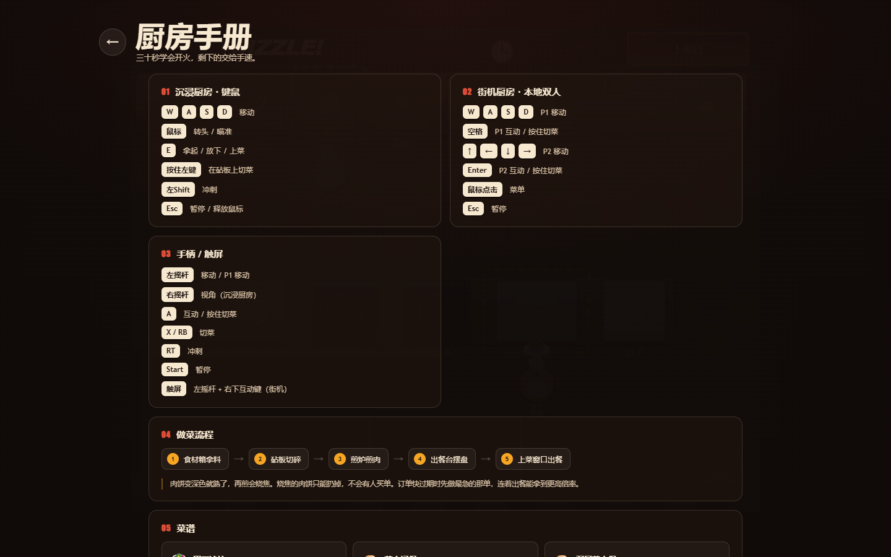 |
| 试玩数据 | 2D 触屏 |
| 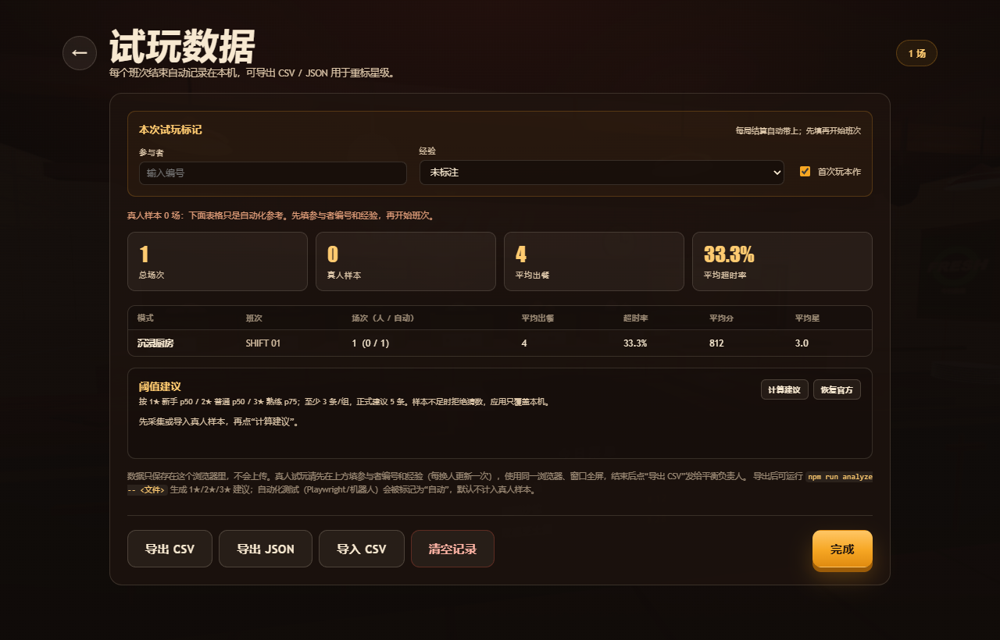 | 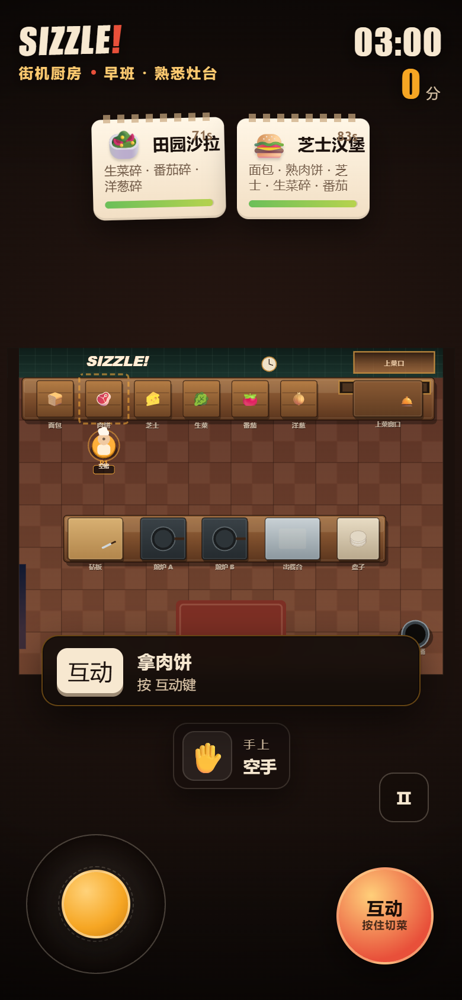 |
| 设置 | 按键绑定 |
| 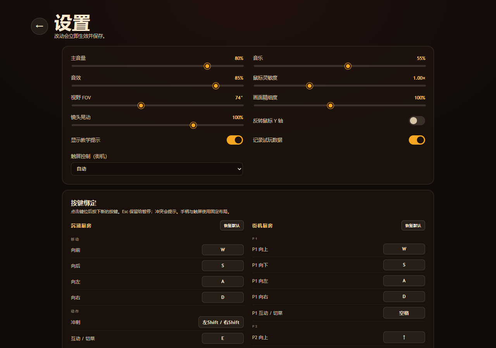 | 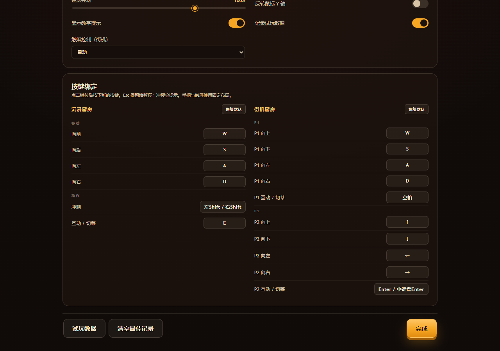 |
| RSI 动态菜单 | 年度相册（测试夹具） |
| 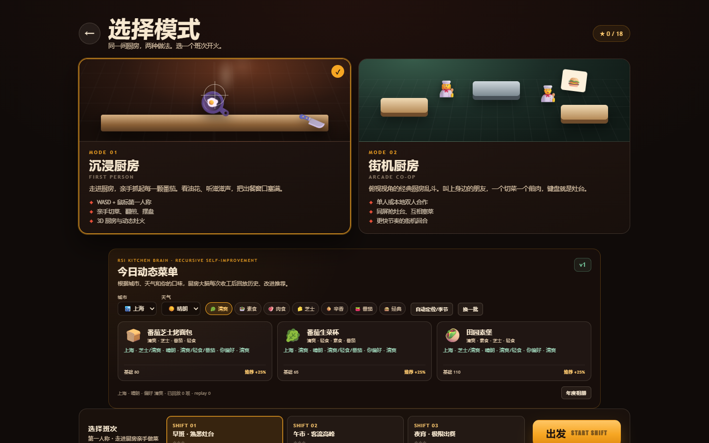 | 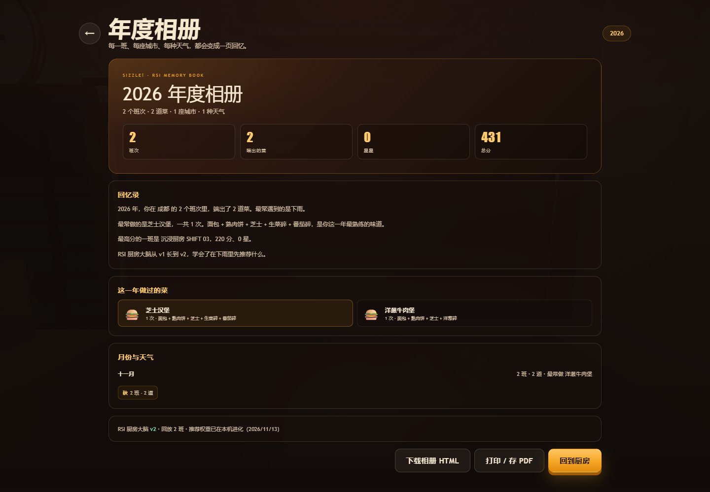 |

---

## 技术栈

- **渲染**：three.js r186（WebGLRenderer, PBR, 阴影, ACES tone mapping）
- **构建**：esbuild → 单个 IIFE `dist/game.js`，可在 `file://` 下运行
- **2D 模式**：原生 Canvas 2D
- **音频**：WebAudio API，纯合成，无采样文件
- **测试**：Node `node:test`（模拟内核 + 输入/遥测）+ Playwright（桌面键鼠、手柄注入、触屏指针、导出下载）
- **存档**：`localStorage`，设置/最佳 `sizzle-rush:v1`；键位 `sizzle-rush:bindings:v1`；试玩 `sizzle-rush:playtests:v1`

### 目录

```text
cook-game/
├─ src/
│  ├─ main.js                 # 应用外壳、模式生命周期、循环、事件→音频/UI
│  ├─ core/
│  │  ├─ data.js              # 食材、菜谱、工位布局、班次、碰撞体
│  │  ├─ kitchen.js           # 工位状态机、拿/放/切/煎/装盘/上菜
│  │  ├─ orders.js            # 订单队列与过期
│  │  ├─ session.js           # 一局：计分、连击、计时、星级
│  │  ├─ prompts.js           # 上下文提示文案
│  │  ├─ audio.js             # WebAudio 合成
│  │  ├─ save.js              # 设置与最佳成绩
│  │  ├─ input.js             # 动作映射、键位重绑、键盘/手柄输入
│  │  ├─ touch.js             # 2D 虚拟摇杆/互动键
│  │  ├─ playtest.js          # 试玩记录、汇总、CSV/JSON 导出
│  │  ├─ playtest-analysis.js # CSV 解析、分经验百分位、阈值建议
│  │  ├─ rsi.js               # 动态推荐、回放策略改进、年度相册
│  │  ├─ rng.js / events.js
│  ├─ fp/                     # 第一人称模式
│  │  ├─ fpMode.js            # 场景、交互、手持物、镜头反馈
│  │  ├─ player.js            # 指针锁定、移动、碰撞、头部晃动、手柄视角
│  │  ├─ kitchen3d.js         # 3D 厨房、工位、灯光、招牌
│  │  ├─ items3d.js           # 低多边形食物 / 盘子
│  │  ├─ textures.js          # Canvas 程序化纹理
│  │  └─ fx.js                # 粒子系统
│  ├─ arcade/arcadeMode.js    # 2D 俯视 + 本地双人 + 触屏
│  ├─ ui/ui.js                # 屏幕栈、HUD、提示、结算、绑定编辑器
│  ├─ index.html / styles.css
├─ tests/                     # core / input / playtest / analysis / save / rsi，共 41 个用例
├─ scripts/                   # 构建、静态服务器、E2E、平衡模拟、截图
├─ dist/                      # 可直接打开的游戏
└─ design/                    # GDD、流程记录、试玩报告、RSI 说明、真人试玩协议
```

---

## 开发与验证

```bash
npm test                # 内核 + 输入 + 遥测/分析/阈值/RSI 单元测试（41/41）
npm run build           # 开发构建 + 复制 HTML/CSS 到 dist/
npm run build:prod      # 压缩构建
npm run serve           # 本地静态服务器
npm run test:e2e        # Playwright：键鼠、手柄、触屏、重绑、遥测、RSI、年度相册
npm run perf            # 性能采样：FPS、帧时间、draw calls、CPU/帧
npm run balance         # 机器人平衡模拟（RUNS=80 可调）
npm run analyze -- path/to/playtest.csv   # 读真人 CSV，输出新阈值建议
npm run screenshots     # 重新生成 docs/screenshots
```

E2E 依赖本机 Chrome 和 Playwright（`npm i` 会安装 Playwright 包，不额外下载浏览器；脚本使用 `channel: "chrome"`）。

### 体积与性能

生产构建会压缩交付体积，并在第一人称模式使用低内部渲染分辨率 + 静态合批：

- `dist/game.js`：741,726 → **267,905** 字节（-63.9%），生产包为 gzip 自解压；开发构建 `npm run build` 仍是可调试的普通 JS。
- `dist` 总计：832,596 → **336,608** 字节（-59.6%）。
- SwiftShader 1440×900 基准：平均 FPS **2.13 → 3.9**（+83%），平均帧时间 **475 → 258 ms**，draw calls **455 → 52**。
- 每帧 CPU 约 **17.2 → 7.4 ms**（-57%）；固定 5 秒窗口的总 CPU **3.5% → 2.9%**（-17%）。

详见 [design/PERF.md](design/PERF.md)。压缩包使用 `DecompressionStream`（Chrome/Edge、Safari 16.4+）。

已执行的验证见 [design/PLAYTEST.md](design/PLAYTEST.md)。关键数字：

- 单元测试 **41/41** 通过（15 个内核 + 7 个输入 + 6 个遥测 + 6 个 CSV 分析 + 2 个阈值覆盖 + 5 个 RSI）。
- 浏览器 E2E（13 个脚本）：真实键盘完成“拿盘 → 切三种菜 → 摆盘 → 上菜”，推荐菜得 **150 分**；
  双人街机完成切菜、拿料、上菜，得 **170 分**；虚拟手柄完成拾取/移动/视角/暂停与 P1/P2 移动；
  触屏摇杆移动、互动键拿料、暂停均通过；重绑 `E→R` 后 R 可用、E 失效，冲突提示与恢复默认通过；
  模拟真人（覆盖 `navigator.webdriver`）的参与者/经验标签会写入 CSV，并显示真人汇总；
  导入 9 条真人样本 → 计算建议 → 应用本机阈值 → 下一班使用覆盖 → 恢复官方，全链路通过；
  城市/天气/偏好改变推荐、推荐菜 +25%、RSI 历史、年度相册与 HTML 下载均通过。
- 遥测：结算自动写入 1 条 `automation` 样本，数据面板显示 1 场、CSV 下载成功。
- CSV 分析：合成的 9 条真人样本可输出 `300 / 500 / 850` 的 1★/2★/3★ 建议，并标记样本不足的组。
- 真实指针锁定、WebAudio 解锁、烧焦→扔垃圾桶、暂停→继续、下一班次重建渲染器均通过。
- 场景静态合批后约 **52 draw calls**（优化前 455）；第一人称内部渲染分辨率 0.75；1440×900 软件渲染下平均 FPS 从 2.13 提升到 3.9，帧时间明显下降。

---

## 设计过程

这个项目的流程、技能选择、与 `awesome-gamedev-agent-skills` 的对应关系、以及和“默认引擎”的偏差，记录在：

- [design/GDD.md](design/GDD.md) — 设计文档
- [design/PROCESS.md](design/PROCESS.md) — 技能路由与实现决策
- [design/PLAYTEST.md](design/PLAYTEST.md) — 试玩与验证报告
- [design/PLAYTEST-PROTOCOL.md](design/PLAYTEST-PROTOCOL.md) — 真人试玩协议、样本量、导出与重标流程
- [design/RSI.md](design/RSI.md) — RSI 动态菜单、回放策略与年度相册说明
- [design/PERF.md](design/PERF.md) — 体积、帧率、CPU 优化记录与口径说明

简而言之：按 `router` 的技能路由思路，选择 **three.js** 作为引擎（浏览器可达、可自动截图验证、无需导出管线），组合
`threejs-scene-setup`、`threejs-materials-lighting`、`fps-shooter`、`camera-systems`、`input-systems`、
`game-ui-ux`、`game-feel`、`level-design`、`audio-design`、`create-game-assets`、`performance-optimization`，
再用 `prototype-fast` 的范围纪律把它推进到可玩原型。

> 关于第二个模式：需求里只明确了模式 1（胡闹厨房式第一人称做菜）。这里按同一套厨房规则设计了
> **2D 俯视街机 + 本地双人**作为模式 2，和第一人称形成“沉浸 vs 街机”的对照。
> 如果原本想要的是另一种模式（例如经营/剧情/联机），模拟内核和 UI 壳可以直接复用。

---

## 已知限制

- 没有在线联机；街机双人是**同键盘 / 同屏本地合作**，第二个手柄也可控制 P2。
- 触屏只覆盖 2D 街机且只控制 P1；第一人称仍需要键鼠或手柄。
- 键位重绑只覆盖键盘；手柄采用标准映射，暂不做自定义。
- 星级阈值目前是 **机器人模拟 + 纸面推算**，没有真人样本；试玩记录器、经验标签、分析脚本和本机阈值覆盖已就绪，按 [design/PLAYTEST-PROTOCOL.md](design/PLAYTEST-PROTOCOL.md) 收集后运行 `npm run analyze -- <csv>` 或在数据页“计算建议 → 应用”。本机覆盖不会改代码，换浏览器/清缓存会回到官方阈值。模拟器只代表“路径规划机器人”的下限，不能替代手感判断。
- 试玩数据只存本机 `localStorage`；换浏览器/清缓存会丢，需手动导出 CSV/JSON。自动化样本（`navigator.webdriver`）会被标记为 `automation`，不计入真人汇总。
- **RSI 是游戏尺度的规则 + 回放适配，不是论文复现**：没有神经网络/LLM；城市与天气由玩家选择，不是真实天气 API；推荐策略和相册只存本机，换浏览器会回到 v1。
- 生产包是 gzip 自解压，需要 `DecompressionStream`（Chrome/Edge、Safari 16.4+）；开发构建不压缩。第一人称内部渲染分辨率为 0.75，画面会比原生略软；体积/FPS/CPU 的测量口径见 `design/PERF.md`。
- 音频为合成音色，未在专业监听环境做混音校准；音量可在设置里调整。
- 只在 Chrome/Edge（Windows）验证；其他浏览器可能有指针锁定/音频/手柄差异。
- 3D 场景约 450 draw calls；极低端设备可通过“画面精细度”降低渲染分辨率。
- 2P 星级目标按 1P 标定，双人配合会明显更容易拿 3 星；这是刻意保留的“合作奖励”。

## 后续路线

1. **真人试玩**：按协议收集至少 5 人/班次，导出 CSV → 重算 1★/2★/3★ 与订单耐心；记录器已能自动采集。
2. 触屏扩展到第一人称（双虚拟摇杆 + 视角）或明确做成“仅街机”的移动端入口。
3. 更多设备（汤锅、炸锅、洗碗池）、厨房布局变化与可解锁班次；RSI 菜单继续扩展标签与菜系。
4. 街机模式在线合作；第一人称模式的“厨房事故”（火灾、滑倒）事件。
5. 用真实 GPU 做一次 profile，视情况合并静态网格、减少 draw calls。

---

## 许可与致谢

- 本项目代码：MIT。
- 三维引擎：[three.js](https://threejs.org/) r186，MIT。
- 游戏开发流程与技能库：[awesome-gamedev-agent-skills](https://github.com/gamedev-skills/awesome-gamedev-agent-skills)，Apache-2.0。本项目按其中的 router / 工作流与所选技能实现，未复制技能库源码。
- 全部美术纹理、招牌、UI 图形为 Canvas 程序化生成；食物为 three.js 基础几何体组合。无第三方图片/音频素材。
- 详见 [THIRD_PARTY_NOTICES.md](THIRD_PARTY_NOTICES.md)。

---

**SIZZLE! 灶台风暴** — 火开小一点，手快一点。
