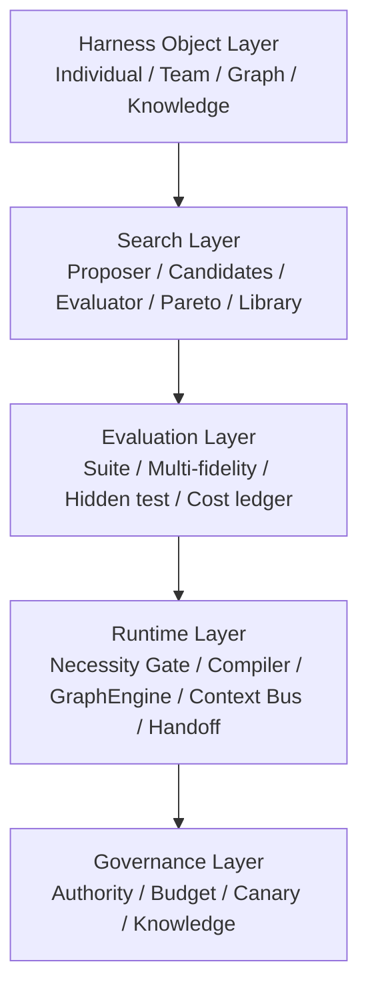
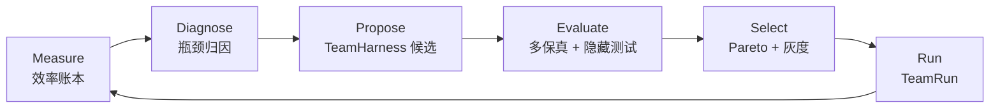

# 融合 Harness 工程体系（HES）

**HES = Team Harness Engineering System（团队 Harness 工程体系）**

> 以 Meta-Harness 为科学方法，以 AgentTeam 为效率对象，以 Ziyan 为运行底座  
> 设计文档 · v0.1 · 2026-11-03

本文基于本地 `meta-harness-main` 的 README、ONBOARDING、reference_examples 与 Harbor pilot，以及工作区已有的 Harness²、dsh-superagent、Multica、Ziyan 材料。运行底座与领域模型见 [ziyan-harness.md](ziyan-harness.md)。  
这是设计文档与实验计划，不是已完成的实现；文中的目标值是待校准的初始值，不是实验结果。  
评审记录见 [`hes/REVIEW.md`](hes/REVIEW.md)，P0/P1 参考实现见 [`hes/`](hes/)。

---

## 0. 结论

五套体系各自解决了一段，但没有一套同时回答“团队该不该存在、该多大、怎么协作、如何证明更高效”：

| 体系 | 核心贡献 | 对 AgentTeam 效率的缺口 |
| --- | --- | --- |
| **Meta-Harness** | 可执行 harness 搜索、可信评估、Pareto、预算 | 优化单 Agent harness；无团队结构、无协调成本 |
| **Harness²** | 无 ground truth 的对比学习、盲选、经验库 | 无团队；无成本模型 |
| **dsh-superagent** | 授权、注意力、恢复语义 | 一 Ticket 一 Executor；无团队搜索 |
| **Multica** | 工作区、本地 daemon、多 CLI、看板 | 协作靠看板与人；无 team harness |
| **Ziyan** | AgentTeam、GraphEngine、自愈、知识 | 有团队设计，缺自动搜索与效率度量 |

HES 的判断是：

1. **AgentTeam 的效率问题不是“让 Agent 更努力”，而是“协调成本大于分工收益”的结构问题。**
2. **Meta-Harness 的方法是对的，但搜索对象要从“单 Agent harness”升级为“TeamHarness”。**
3. **效率必须是一等目标：不是单一分数，而是“质量–成本”的 Pareto；不是总 token，而是协调税、等待、重复与返工。**
4. **融合体系 = TeamHarness 作为一等工件 + 效率感知搜索 + 运行时协调经济 + 授权/知识治理。**

一句话：

> **把团队当程序编译，把协作当成本计量，把搜索当实验治理。**

四个转变：

| 从 | 到 |
| --- | --- |
| 搜索单个 Agent 的 prompt/tools | 搜索 TeamHarness 的角色、拓扑、协议与预算 |
| 只看准确率或通过率 | 看质量–成本 Pareto 与协调开销 |
| 默认组队、越大越强 | 单 Agent 优先，按边际收益编译最小团队 |
| 事后调参、凭感觉优化 | 效率账本 + 多保真评估 + 灰度晋级 |

---

## 1. Meta-Harness 解剖

### 1.1 它到底是什么

Meta-Harness 是一个**对任务特定模型 harness 做自动搜索**的框架。模型固定，harness 是模型周围决定“存什么、取什么、给模型看什么”的代码；提案者（通常是强编码 Agent）读候选代码、分数与完整执行轨迹，写出新候选；外层循环负责基准评测、前沿维护与最终测试。

它把 harness 当成**可执行代码**，而不是一段提示词。这个转向很重要：代码可以 diff、可以测试、可以回滚、可以被搜索。

### 1.2 八个可复用机制

| 机制 | Meta-Harness 的做法 | HES 的迁移 |
| --- | --- | --- |
| 候选即代码 | 候选是 `agents/*.py`，可导入、可运行 | TeamHarness 是声明式骨架 + 沙箱 code hooks |
| 提案者读全量证据 | 读历史候选、分数、失败/成功轨迹、前沿 | 读效率账本、角色轨迹、等待/返工/交接记录 |
| 可信评估器 | 外层循环评测，候选不评审自己 | TeamBench 由可信控制器执行，团队不给自己打分 |
| 验证 / 测试分离 | 进化只用 val；finalize 后才跑 test | TeamHarness 只在隐藏团队套件上做最终比较 |
| 多目标 | 文本分类用 accuracy vs context 长度的 Pareto | 质量 vs 总成本 / 协调成本 / 时延的 Pareto |
| 预算 | 迭代数、评估预算、提案超时、成本 | 搜索预算、评估预算、团队运行预算、协调预算 |
| 反过拟合 | 不写任务名、不写数据集 hint、只写通用机制 | 不针对单任务写死拓扑；跨任务类验证 |
| 机制级变异 | 禁止只调参数；必须换机制 | 角色/拓扑/协议/调度级别的变异，而非只调 temperature |

补充事实（来自本地仓库，不是本文的实验）：

- 文本分类参考实验每轮要求 **3 个候选**，并明确反对“只改参数的变体”。
- Terminal-Bench 2 参考实验每轮 **1 个候选**，要求“一个候选只验证一个机制”，并要求预测 token / turn 影响。
- Terminal-Bench 2 默认配置（Opus 4.6、89 任务、2 trials、并发 50）在 README 中标注约 **$500 / iteration**，耗时约 4–6 小时。
- Harbor pilot 使用**可信控制器 + 隐藏套件 + 泄漏引用检查（forbidden references）+ 评估预算**；候选代码不被外层 Agent 导入。

这些事实对 HES 很关键：**团队搜索比单 Agent 搜索更贵，所以更要用多保真、预算和隐藏测试。**

### 1.3 它没有回答的问题

- **团队结构**：没有角色、拓扑、交接、负责人、团队预算。
- **协调成本**：accuracy vs context 是单 Agent 的成本，不含 handoff、wait、merge、rework。
- **授权**：没有 Mandate、效果门、审计；候选代码可以很自由。
- **运行时**：它是一个搜索/评测框架，不是团队运行时。
- **知识**：没有团队性能库、任务类迁移、过期与矛盾。
- **归因**：团队 quality 很难归因到某个角色或某条策略。

### 1.4 对 HES 的直接启示

1. **候选必须是可执行、可校验的工件**，不能只是自然语言方案。
2. **提案者必须看到失败与成功的完整轨迹**，而不只是分数。
3. **评估必须隔离**：候选不能接触最终测试，不能给自己打分。
4. **选择必须是多目标的**：质量、成本、时延、人工注意力。
5. **预算必须显式**：搜索预算、评估预算、运行预算、协调预算。
6. **变异必须机制级**：拓扑、角色、协议、调度；不是只调数字。
7. **反过拟合必须写进规则**：不写任务名，不写数据集 hint，跨任务类验证。

---

## 2. 五套体系对比

### 2.1 定位

| 体系 | 它真正解决的问题 | 优化单元 | 最强的地方 |
| --- | --- | --- | --- |
| Meta-Harness | harness 代码如何被搜索出来 | 单 Agent harness 代码 | 可执行搜索、可信评估、Pareto、预算 |
| Harness² | 无评分器时如何改 harness | 8 组件 harness 树 | 对比信号、盲选、归因纪律、经验库 |
| dsh-superagent | Agent 的行动如何被授权 | Ticket / Mandate | 确定性 Gate、注意力、恢复语义 |
| Multica | 多 Agent 如何被组织成工作区 | Workspace / Issue / Run | 本地执行、多 CLI、看板、人在回路 |
| Ziyan | 团队与图如何成为可治理的能力 | AgentTeam / GraphEngine | 团队授权衰减、图执行、自愈、知识 |

### 2.2 能力矩阵

| 维度 | Meta-Harness | Harness² | dsh | Multica | Ziyan |
| --- | --- | --- | --- | --- | --- |
| 单 Agent harness 搜索 | **强** | **强** | 弱 | 无 | 中 |
| 团队结构建模 | 无 | 弱（子代理） | 弱（单执行器） | 中（看板） | **强**（AgentTeam） |
| 协调成本计量 | 弱（context） | 弱 | 中（注意力） | 弱 | 中（设计） |
| 授权 / 治理 | 弱 | 弱（无授权） | **强** | 中 | **强** |
| 执行运行时 | 弱（bench） | 中（substrate） | **强** | **强** | **强** |
| 经验 / 迁移 | 弱 | **强** | 弱 | 弱 | 中 |
| 评估隔离 | **强** | **强** | 中 | 中 | 中 |
| 多目标优化 | 中（accuracy/context） | 弱 | 弱 | 弱 | 弱 |
| 自愈 / 知识 | 无 | 部分（经验库） | 中 | 弱 | **强** |

矩阵评价的是机制设计，不是实现成熟度。

### 2.3 各自对 AgentTeam 的贡献与缺口

**Meta-Harness**

- 贡献：搜索循环、可信评估、验证/测试隔离、Pareto、预算、反过拟合。
- 缺口：单 Agent；没有团队拓扑、交接、协调成本、授权。

**Harness²**

- 贡献：无 ground truth 的对比信号、盲选、confounded 优先、经验库。
- 缺口：任务级而非团队级；按递归预算 `k` 计的 4k rollout 成本高；没有协调成本与团队结构。

**dsh-superagent**

- 贡献：确定性 Gate + 不可变 Mandate、注意力经济、单一写者、Effects/Outbox、恢复语义。
- 缺口：一 Ticket 一 Executor；没有团队搜索与效率度量。

**Multica**

- 贡献：Workspace、本地 daemon、26 种 CLI、看板、in_review、归因回放。
- 缺口：Agent 是黑盒 CLI；没有 TeamHarness、没有搜索、没有协调经济。

**Ziyan**

- 贡献：AgentTeam 作为能力组合、GraphEngine、授权衰减、自愈、知识更新。
- 缺口：TeamHarness 不是自动搜索对象；效率没有被计量、预算化、Pareto 化。

### 2.4 缺的三块

1. **TeamHarness 作为一等工件**：角色、拓扑、交接、上下文、调度、预算、终止，必须能像代码一样被候选、校验、评测、晋级。
2. **协调经济学**：把 handoff、wait、merge、rework、context duplication 计入成本，并能归因到角色/边/策略。
3. **效率感知的搜索**：不是“多试几个 prompt”，而是分层搜索 + 多保真 + Pareto + 灰度。

### 2.5 HES 的位置

HES 不是第五个运行时，也不是 Meta-Harness 的替代品。

- **Ziyan 是运行底座**：AgentTeam、GraphEngine、Mandate、Ledger、自愈、知识。
- **Meta-Harness 是方法论**：候选、评估、Pareto、预算、隔离。
- **HES 是工程层**：把 TeamHarness 变成可搜索、可度量、可治理的工件，把 AgentTeam 的效率变成可优化目标。

---

## 3. AgentTeam 的效率问题

### 3.1 定义

设：

- `Q`：已验证结果质量（通过评审、无回滚、满足验收）。
- `C`：总成本（tokens、工具、墙钟、人工、协调、等待、返工）。
- `E = Q / C`：效率。

但 `E` 不能直接当唯一目标，因为团队可能在质量约束下追求成本，也可能在成本约束下追求质量。正确形式是约束优化或 Pareto：

```text
max Q
s.t. C ≤ B, H ≤ H_max, authority constraints
```

或：

```text
max E = Q / C
s.t. Q ≥ Q_min
```

其中 `H` 是人类注意力，`B` 是预算，`Q_min` 是质量下限。不同任务类有不同的 `Q_min` 与 `B`，所以效率是**任务类相关的**，不是全局单一数字。

`E` 只在同一任务类、同一评估协议内比较；跨类用 Pareto 或归一化，不做绝对值排名。

### 3.2 成本结构

```text
C_team = C_model + C_tool + C_coord + C_wait + C_rework + C_human + C_search
```

| 成本 | 内容 | 典型来源 |
| --- | --- | --- |
| `C_model` | 推理 tokens | 每个角色、每次 handoff 的上下文 |
| `C_tool` | 工具调用、沙箱、外部 API | 重复执行、重试 |
| `C_coord` | 交接、同步、合并、状态汇报 | 自由聊天、重复解释、会议式同步 |
| `C_wait` | 等待依赖、join、人工门 | 串行化、lead 瓶颈、审批 |
| `C_rework` | 返工、冲突、重做 | 所有权不清、接口不清、合并冲突 |
| `C_human` | 评审、回答、决策 | 过度评审、模糊问题 |
| `C_search` | 搜索与评估成本 | 候选太多、评估太贵、过拟合 |

团队溢价与质量增益：

```text
TP = (C_team - C_single) / C_single       # 团队溢价
QG = (Q_team - Q_single) / Q_single       # 质量增益
team justified iff QG ≥ 0 and (TP ≤ 0 or QG / TP ≥ λ)
```

`TP` 可能为负（团队更便宜），这时只要质量不降就值得；`TP` 为正时，质量增益必须覆盖溢价。

### 3.3 九类低效

| 类型 | 症状 | 根因 | 对策 |
| --- | --- | --- | --- |
| 过度组队 | 简单任务也开 5 个角色 | 默认团队、角色崇拜 | 单 Agent 优先 + 必要性门 |
| 团队不足 | 该并行却串行，交付慢 | 不敢分工、lead 独做 | 任务可分解性判断 + 最小团队编译 |
| 协调税 | 大量 handoff、同步、解释 | 自由聊天、接口不清 | 结构化 handoff + 上下文总线 |
| 上下文重复 | 每个角色重读同一仓库/文档 | 共享缺失、prompt 复制 | 共享工件 + 角色切片 + 缓存 |
| 串行 / 等待 | 一个分支等另一个，join 空转 | 拓扑差、lead 瓶颈 | 关键路径优先 + 投机执行 + 工作窃取 |
| 返工 / 合并冲突 | 两人改同一处、反复返工 | 所有权不清、边界不清 | 一个工作单元一个 owner + artifact 边界 |
| Lead 瓶颈 | lead 忙死，其他角色 idle | lead 既调度又干活 | lead 只调度/评审；负载上限 |
| 搜索低效 | 候选多、评估贵、只调参数 | 联合搜索、单分数 | 分层搜索 + 多保真 + Pareto |
| 治理税 | 每步都审批、每次都要人 | 审批一切 | 效果门 + 注意力预算 |

### 3.4 为什么常见解法失败

- **更多 Agent**：协调边数增长快于产出，团队溢价吞噬质量收益。
- **更多 Prompt**：上下文膨胀，always-on 文字与产出预算竞争。
- **更多搜索**：团队评估成本是单 Agent 的数倍，搜索预算先崩。
- **更多评审**：人类注意力成为新瓶颈，交付更慢。
- **更多自主**：权限与风险上升，治理成本抵消效率收益。

### 3.5 第一性原理

1. **团队只在边际质量增益大于边际协调成本时成立。**
2. **团队规模有最优值；加角色必须通过“独特能力 + 边际收益”双重检验。**
3. **每条边都是账单**：handoff、同步、合并、评审都是成本。
4. **上下文是共享缓存，不是复制品**：重复上下文是纯浪费。
5. **搜索必须分层**：先决定单/团队，再拓扑，再角色，再协议，最后才是 prompt/参数。
6. **效率是系统属性**：不是单个 Agent 的 token 数，而是整条价值流的质量/成本。

---

## 4. HES 总体设计

### 4.1 五层架构



| 层 | 职责 | 关键问题 |
| --- | --- | --- |
| Harness Object | 定义可搜索的工件 | 团队到底由什么组成？ |
| Search | 提案、评估、选择 | 下一个候选怎么来？ |
| Evaluation | 多保真、隐藏测试、成本 | 如何可信地比较？ |
| Runtime | 执行团队、协调、预算 | 如何跑得省？ |
| Governance | 授权、灰度、知识 | 如何不越权、不回退？ |

图中的箭头表示依赖/抽象层级，不是执行顺序；实际运行是搜索、运行、治理的交错循环。

### 4.2 核心对象：TeamHarness

`TeamManifest`（Ziyan 7.7）是团队的静态定义：角色、图、lead、上下文、预算、决策协议、评审。`TeamHarness` 是它的可搜索版本：运行时仍落成 Ziyan 的 `TeamManifest` / `TeamRun`，搜索时多出效率策略与沙箱 hooks。

```ts
interface TeamHarness {
  id: string;
  version: string;
  domain: string;
  manifest: TeamManifest;          // 角色、拓扑、lead、上下文、预算、决策、评审
  efficiency: EfficiencyPolicy;    // 质量下限、协调上限、终止规则
  hooks?: SandboxedHook[];         // 上下文选择、handoff 格式、调度启发
  authorityDelta: never;           // 类型层防火墙：团队不能声明授权
}
```

```ts
interface EfficiencyPolicy {
  qualityFloor: number;            // 质量下限
  coordinationMaxRatio: number;    // C_coord / C_total 上限
  costCeiling: Budget;             // 总预算
  stopRule: 'quality-plateau' | 'budget' | 'time' | 'diminishing-returns';
  teamSizeCap: number;             // 角色数上限
  baseline: 'single-agent';        // 必须先有单 Agent 基线
}

interface SandboxedHook {
  kind: 'context' | 'handoff' | 'schedule' | 'stop';
  entry: string;                   // 沙箱入口，不在编排器内执行
  hash: string;
  permissions: string[];
}
```

关键设计：**声明式骨架 + 沙箱 code hooks**。

- 声明式骨架保证可校验、可 diff、可回滚、不能声明授权。
- code hooks 保留 Meta-Harness 的“代码搜索”能力，但只在沙箱里执行，不被编排器导入。
- 这样既不是“只能调 prompt”，也不是“任意代码改运行时”。

编译链：

```text
TeamHarness
  → schema / graph / authority 校验
  → 解析角色与 AgentProfile
  → 编译 sandbox hooks
  → 生成 TeamManifest + GraphRevision pin
  → TeamRun
```

每次晋级生成不可变版本；回滚就是 pin 回上一个版本。

### 4.3 效率闭环



与 Meta-Harness 的对应：

| Meta-Harness | HES |
| --- | --- |
| 读 `evolution_summary.jsonl` | 读 `efficiency_summary.jsonl` + 角色轨迹 |
| 写 candidate `agents/*.py` | 写 `TeamHarness` 候选 |
| 跑 val benchmark | 跑团队套件（smoke → subset → full） |
| Pareto accuracy vs context | Pareto quality vs cost/coordination |
| finalize 后跑 test | 隐藏团队套件最终比较 |

### 4.4 三道门

| 门 | 问题 | 失败时 |
| --- | --- | --- |
| **Team Necessity Gate** | 这个任务真的需要团队吗？ | 单 Agent |
| **Team Size Gate** | 这个角色真的需要吗？ | 删除/合并角色 |
| **Coordination Budget Gate** | 协作成本是否超预算？ | 合并角色、减少边、回退 |

这三道门是 HES 与“多 Agent 框架”的根本区别：**默认不组队，组队要证明。**

### 4.5 与 Ziyan 的接线

| HES | Ziyan |
| --- | --- |
| `TeamHarness` | `TeamManifest` 的搜索版本，晋级后落成 TeamManifest |
| `TeamRun` | `Assignment` 的 team 模式 |
| `EfficiencyVector` | Ledger 事实的投影 |
| Team Necessity Gate | Gate / Eval 的策略输入 |
| Coordination Budget | Mandate 预算的子预算 |
| 搜索 Ticket | `harness.evolution` Ticket 的团队变体 |
| 评估器 | Promotion Gate 的可信执行 |
| Context Bus | 5.6 的共享工件 + 角色可见性 |
| Handoff Protocol | 5.6 的结构化 handoff |
| 经验库 | 知识更新（5.9）的 `lesson` / `procedure` |

### 4.6 八条设计法则

1. **单 Agent 优先**：团队是编译输出，不是默认配置。
2. **角色按能力，不按人格**：角色 = 能力 + 责任 + 接口。
3. **每条边都是账单**：handoff、同步、合并、评审都要计入成本。
4. **上下文引用，不复制**：共享工件与切片，不共享大 prompt。
5. **协作有预算**：协调成本有上限，超了要合并/回退，不是继续烧。
6. **搜索分层**：先单/团队，再拓扑，再角色，再协议，最后才是 prompt/参数。
7. **评估隔离**：候选不给自己打分，不接触最终测试。
8. **灰度晋级**：canary、回滚、审计，不直接上线。

---

## 5. 运行时效率机制

### 5.1 Single-Agent-First + Necessity Gate

任何团队任务先跑单 Agent 基线；没有基线，不允许组队。

任务特征：

| 特征 | 倾向单 Agent | 倾向团队 |
| --- | --- | --- |
| 可分解性 | 一个连续任务 | 多个独立子任务 |
| 并行性 | 强顺序依赖 | 多个分支可并行 |
| 专业化 | 通用能力足够 | 需要不同领域/工具 |
| 独立验证 | 自检足够 | 需要独立 verifier |
| 上下文规模 | 单上下文可容纳 | 需要分片/隔离 |
| 时延 | 越快越好 | 可接受并行换时延 |
| 预算 | 紧张 | 可承担团队溢价 |
| 风险 | 低 | 需要交叉检查 |

决策：

```text
team if ΔQ / ΔC ≥ λ(task_class)
```

- `ΔQ`：团队相对单 Agent 的预期质量增益。
- `ΔC`：团队相对单 Agent 的预期成本增量。
- `λ`：任务类阈值，由 SLO 与历史数据校准。
- 若 `ΔC ≤ 0`，只要 `ΔQ ≥ 0` 即成立；否则按 `ΔQ/ΔC` 比较。
- 估计方法：从团队性能库取同任务类历史；没有历史就跑 1–2 个 pilot（单 Agent vs 最小团队），记录 `ΔQ/ΔC`，不凭感觉。

### 5.2 Minimal Team Compiler

从任务需求编译最小团队，而不是从“角色清单”堆人。

步骤：

1. **能力覆盖**：任务需要哪些能力（读代码、跑测试、领域知识、评审、写文档）。
2. **最小角色集**：每个角色 = 能力 + 责任 + 接口；不允许“人格角色”。
3. **默认 3 角色**：lead / worker / verifier。
4. **按需扩展**：只有出现“独特能力 + 独立工作单元”时才加角色。
5. **合并/删除**：如果两个角色能力重叠、交接成本高于收益，合并。

角色准入：

```text
add role r iff:
  capability(r) not covered
  and ΔQ(r) / ΔC(r) ≥ λ_role
  and new_edges(r) ≤ edge_budget
```

默认上限：3–5 个角色；超过 7 个必须有强证据并改用分层子团队。

### 5.3 Work Graph Partitioning

把任务切成工作图，而不是聊天流程。

- **一个工作单元一个 owner**：避免并发写同一处。
- **按 artifact 边界切**：接口是文件/PR/报告，不是“口头说清楚”。
- **co-locate 紧耦合工作**：需要频繁来回的步骤放在同一个 Agent 内，减少 handoff。
- **parallelize 独立工作**：独立子任务并行，join 显式。
- **critical path first**：先派关键路径，避免最后才开工。
- **edge budget**：每条跨角色边都要能说出它的价值。

图的质量指标：

- 关键路径长度。
- 跨角色边数。
- 每个单元的上下文大小。
- 每个单元的验收条件。

### 5.4 Context Bus

团队共享的是**工件与引用**，不是整段 prompt。

- **Shared artifact store**：文件、diff、报告、证据包，content-addressed。
- **Role slices**：每个角色只拿自己需要的最小上下文。
- **Summary layer**：lead 维护一页状态摘要；不是每个角色重读全部历史。
- **Cache**：同一文件/检索结果在团队内复用，避免 N 次重复读取。
- **Token budget per role**：把上下文预算写进 TeamHarness。
- **No shared mega-prompt**：共享大 prompt 会泄密、膨胀、污染。

目标：`Context Duplication Ratio` 越低越好，且不牺牲质量。

### 5.5 Handoff Protocol

Handoff 是事务，不是聊天。

```ts
interface Handoff {
  from: string;
  to: string;
  intent: string;
  artifacts: string[];       // 必须可定位
  constraints: string[];
  acceptance: string[];
  openQuestions: string[];
  deadline?: string;
}
```

规则：

- 没有 artifact 的 handoff 不算交接。
- 一次最多一个阻塞性问题；其他进 openQuestions。
- 异步优先；不要为了同步开“会议”。
- 状态更新批量发送，不刷屏。
- 接收者用自己的派生 Mandate；handoff 不转移授权。

### 5.6 Scheduling & Elasticity

- **关键路径优先**：先跑最长依赖链。
- **并行分支**：独立工作并行，join 策略显式。
- **投机执行**：高延迟、可回滚的分支可以先跑，输的取消。
- **工作窃取**：idle 角色从队列取可执行单元，减少等待。
- **lead 只调度/评审**：lead 做 IC 工作会成瓶颈；设 lead 负载上限。
- **动态角色**：map 节点按需扩展，完成后回收；不长期养闲人。
- **join 策略**：all / any / quorum / first-success；部分失败要标 partial。
- **取消规则**：取消一个分支要声明是否取消兄弟；默认只取消未运行的。

### 5.7 Coordination Budget & Termination

```text
C_coord ≤ α * C_total
```

- `α` 初始建议 20%，按任务类校准。
- 超预算时：合并角色、减少边、lead 接管、升级给人；不是继续烧。
- 终止规则：边际质量增益低于边际成本、预算耗尽、墙钟到期、连续 N 轮无改进。
- 禁止无限 critique loop；最大迭代写进 TeamHarness。

### 5.8 效率模式库

| 模式 | 适用 | 效率机制 |
| --- | --- | --- |
| Single-first | 大多数任务 | 先证明团队必要 |
| Minimal pipeline | 有顺序依赖 | 最少 handoff，lead 调度 |
| Fan-out / fan-in | 独立调研/方案 | 并行 + 显式 join |
| Critique loop | 高质量写作/设计 | 有界迭代 + 只问关键问题 |
| Hierarchical | 大任务/跨域 | 子团队 + 深度上限 |
| Blackboard | 研究/分析 | 共享工件 + 按需取用 |
| Speculative | 高延迟分支 | 先跑可回滚分支 |
| Work stealing | 角色负载不均 | 空闲角色取队列任务 |

---

## 6. 效率感知的 Team Harness 搜索

### 6.1 搜索空间分层

不要联合搜索所有维度；按成本从低到高分层。

| 层 | 变量 | 例子 | 评估成本 | 方法 |
| --- | --- | --- | --- | --- |
| L0 | 单 Agent vs 团队 | 必要性门 | 低 | 基线 + 规则 |
| L1 | 拓扑 | pipeline / fan-out / critique / hierarchical | 中 | 小规模 pilot |
| L2 | 角色 | 加/删/合并/拆分 | 中 | 能力覆盖 + 边际分析 |
| L3 | 协议 | handoff / context / scheduling | 中高 | 消融 |
| L4 | prompt / tools | 角色提示词、工具集 | 高 | 候选搜索 |
| L5 | 数值参数 | 并发、重试、阈值 | 最高 | 最后，且禁止只调参数 |

组合爆炸示例：5 种角色 × 4 种拓扑 × 3 种 handoff × 3 种 context × 4 种 scheduling = 720 个结构组合，还没算 prompt 与参数。团队评估又是单 Agent 的数倍成本，所以必须分层、剪枝、多保真。

### 6.2 候选生成

- **每轮 1–3 个候选**：团队评估贵，从 1 个开始；稳定后再扩。
- **一个候选一个机制**：拓扑、角色、handoff、context、scheduling、stop rule。
- **禁止参数变体**：只改并发/重试/阈值不算机制创新。
- **不写任务名 / 数据集 hint**：团队策略必须通用。
- **必须预测效率影响**：`expected_quality_delta`、`expected_cost_delta`。
- **复制-修改**：从当前前沿复制，做最小机制改动。
- **先验证再评估**：schema 校验、图校验、import/沙箱 smoke test。

### 6.3 评估协议

| 阶段 | 规模 | 目的 |
| --- | --- | --- |
| Phase 0 | 单 Agent 基线 | 必要性门与对照 |
| Phase 1 | 1–2 个 smoke 任务 | 抓低级错误 |
| Phase 2 | 5–10 个任务子集 | 估计方向与成本 |
| Phase 3 | 全量团队套件 | 主评估 |
| Phase 4 | 隐藏团队套件 | 最终比较，冻结后跑 |

要求：

- 同一任务、同一输入、同一随机种子做配对比较。
- 记录质量、tokens、墙钟、工具调用、人工分钟、协调/等待/返工。
- 至少 2 次重复；报告置信区间，不只报均值。
- 失败也是证据；超时/崩溃不能静默当 0 分或满分。
- 最终测试只在候选冻结后跑；跑完不能继续用同一 run 搜索。

### 6.4 选择与晋级

- **Pareto 前沿**：质量 vs 总成本；必要时加协调成本/时延第三维。
- **Knee point**：在质量下限之上，选边际收益最高的点。
- **约束**：`Q ≥ Q_min`、`C ≤ B`、`C_coord ≤ α C_total`。
- **晋级门**：小流量 canary、自动回滚、人工确认（L2+）。
- **监控**：7 天内质量/成本回归即回滚；同签名复发触发自愈。

### 6.5 搜索效率

- **多保真**：smoke → subset → full，逐级加预算。
- **Successive halving**：先用小任务淘汰大多数候选，再给少数候选全量预算。
- **Warm start**：从团队性能库按任务类取初始 TeamHarness。
- **迁移**：同域复用拓扑/协议；跨域只复用模式，不复用 prompt。
- **早停**：成本超预算、质量明显落后、连续无改进就停。
- **搜索成本核算**：`SearchCostPerAdoption = 总搜索成本 / 晋级数`。

### 6.6 信任边界与泄漏

- **可信评估器**：候选不导入编排器；评估在沙箱/子进程执行。
- **隐藏套件**：最终测试不暴露给提案者与候选。
- **禁止引用**：候选不能引用测试、verifier、solution、任务名、数据集名。
- **沙箱**：候选 hooks 默认无网络、受限文件系统、权限白名单；不接触密钥。
- **能力不变式**：TeamHarness 不能新增工具/权限；需要新能力就是 Policy 变更，不是搜索候选。
- **预算**：评估调用次数上限；候选不能无限试。
- **冻结**：最终测试前冻结 run；测试后不能在同一 run 继续搜索。
- **审计**：候选源码、哈希、评估历史、成本全部落账。

### 6.7 与 Meta-Harness 的差异

| Meta-Harness | HES |
| --- | --- |
| 搜索单 Agent harness 代码 | 搜索 TeamHarness（角色/拓扑/协议/预算） |
| accuracy vs context | quality vs cost / coordination |
| 隐藏 benchmark 套件 | 隐藏团队套件 + 运行账本 |
| 提案者读代码与轨迹 | 提案者读效率账本、角色轨迹、等待/返工 |
| 评估预算 | 评估 + 搜索 + 协调预算 |
| 无授权模型 | 授权防火墙 + canary + 审计 |
| 无运行时 | Ziyan TeamRun / GraphEngine |
| 无知识库 | 团队性能库 + 知识更新 |

### 6.8 关键取舍

| 决策 | 选择 | 备选 | 理由 | 代价 |
| --- | --- | --- | --- | --- |
| TeamHarness 形态 | 声明式骨架 + 沙箱 hooks | 任意代码 / 纯配置 | 兼顾可搜索与可治理 | hooks 表达力受 schema 限制 |
| 默认团队 | 单 Agent 优先 | 默认多 Agent | 避免过度组队 | 需要必要性判断 |
| 选择目标 | 质量–成本 Pareto | 单一分数 | 防止用成本换虚假质量 | 选择更复杂 |
| 评估策略 | 多保真 + 隐藏测试 | 全量快速迭代 | 控制搜索成本与泄漏 | 早期信号有噪声 |
| 评估者 | 可信控制器 | 提案者自评 | 防自证与泄漏 | 评估吞吐较低 |
| 搜索治理 | 搜索即 Ticket | 自由优化器 | 预算、审计、回滚 | 搜索速度受调度影响 |
| 迁移 | 团队性能库 | 每任务重搜 | 复用拓扑/协议 | 需防止负迁移 |

---

## 7. 契约

### 7.1 TeamHarness

```ts
interface TeamHarness {
  id: string;
  version: string;
  domain: string;
  manifest: TeamManifest;
  efficiency: EfficiencyPolicy;
  hooks?: SandboxedHook[];
  authorityDelta: never;
}
```

`TeamManifest` 沿用 Ziyan 7.7：角色、图、lead、上下文、预算、决策协议、评审。`TeamHarness` 只加“搜索所需的效率策略”和“沙箱 hooks”，不重复定义团队。

`TeamHarness` 不新增领域概念：它是 Registry 工件；运行时不直接消费它，而是编译成 `TeamManifest` / `TeamRun`。`manifest.budget` 是角色分配，`efficiency.costCeiling` 是搜索与晋级的硬上限。

### 7.2 EfficiencyVector

```ts
interface EfficiencyVector {
  quality: number;             // 0..1 或任务定义的量表
  tokens: number;
  wallClockMs: number;
  toolCalls: number;
  humanMinutes: number;
  coordinationTokens: number;
  waitMs: number;
  reworkCount: number;
  searchCostUsd: number;
}
```

### 7.3 TeamCandidate

```ts
interface TeamCandidate {
  harness: TeamHarness;
  mechanism: string;           // 一个机制：topology / role / handoff / context / schedule
  hypothesis: string;          // 可证伪
  expected: {
    qualityDelta: number;
    costDelta: number;
  };
  evidence: string[];          // Ledger 事实 / 轨迹引用
}
```

### 7.4 EvaluationPlan

```ts
interface EvaluationPlan {
  suite: string;
  fidelity: 'smoke' | 'subset' | 'full';
  trials: number;
  hidden: boolean;
  budgetUsd: number;
  pareto: boolean;
  seed: number;
}
```

---

## 8. 度量与实验

### 8.1 指标

| 指标 | 定义 | 初始目标（按基线校准） |
| --- | --- | --- |
| Quality | 通过评审的已验证结果 | 不低于单 Agent 基线 |
| Cost per verified outcome | 总成本 / 已验证结果 | 持续下降 |
| Coordination Overhead Ratio | 协调 tokens / 总 tokens | < 20% |
| Useful Work Ratio | 有效工作时间 / 团队墙钟 | > 70% |
| Handoff latency | handoff 发出到接收者开始处理 | 持续下降 |
| Idle ratio | 角色空闲时间 / 团队墙钟 | < 15% |
| Context Duplication Ratio | 1 - 唯一上下文 / 总上下文 | < 15% |
| Rework ratio | 返工工件 / 总工件 | < 10% |
| Team premium | (C_team - C_single) / C_single | 必须由质量增益证明 |
| Search cost per adoption | 搜索成本 / 晋级数 | 可计量、逐轮下降 |
| Time to first useful result | 任务开始到首个可评审产出 | p95 达标 |
| Human attention per outcome | 人工分钟 / 已验证结果 | 持续下降 |

这些是**初始目标**，不是实验结果；需要按任务类基线校准。

### 8.2 效率账本

在 Ziyan Ledger 上增加团队效率事实：

```text
team.run.started
role.assigned
handoff.sent
context.fetched
node.wait.started
node.wait.ended
artifact.reworked
team.run.completed
efficiency.measured
```

每个事实带：team / ticket / role / node / tokens / wall-clock / tool calls / human minutes。

输出 `efficiency_summary.jsonl`，字段与 Meta-Harness 的 `evolution_summary.jsonl` 对齐，但多团队维度。

### 8.3 可证伪假设

| 编号 | 假设 | 对照 |
| --- | --- | --- |
| H1 | Necessity Gate 能在不降质量的前提下降成本 | 固定组队 vs 门控 |
| H2 | 最小团队编译优于固定 5 角色 | 编译团队 vs 固定团队 |
| H3 | Context Bus 降低重复上下文与 tokens | 共享工件 vs 各自重读 |
| H4 | Coordination Budget 能阻止团队失控 | 有/无协调上限 |
| H5 | Pareto 搜索优于单分数搜索 | Pareto vs 单指标 |
| H6 | 团队性能库能降低搜索成本 | 冷启动 vs warm start |

### 8.4 团队套件（TeamBench）

任务类：

- **独立并行**：多源调研、方案对比、批量分析。
- **依赖流水线**：实现 → 测试 → 修复 → 评审。
- **验证密集**：需要独立 verifier 的高风险改动。
- **综合写作**：多角色起草、批评、合并。
- **权威密集**：需要人工门/合规检查的任务。

候选套件：

- Terminal-Bench 2 子集（编码/终端）。
- JobBench / LAB / WorkBuddy 子集（专业工作）。
- 自建团队任务（多源调研、跨文件重构、事故复盘）。

每个任务需要：单 Agent 基线、团队基线、验收标准、隐藏测试、成本预算。

### 8.5 消融

- 单 Agent vs 固定团队 vs 编译团队。
- 有/无 Context Bus。
- 有/无 Coordination Budget。
- 同步 handoff vs 异步结构化 handoff。
- 固定拓扑 vs 搜索拓扑。
- 单分数选择 vs Pareto 选择。
- 冷启动 vs 团队性能库 warm start。

### 8.6 验收标准

第一阶段（P0–P2）验收：

1. 能在 30+ 任务上计算 `EfficiencyVector`。
2. 能给出“单 Agent vs 团队”的可解释决策。
3. 协调开销、等待、重复、返工可归因到角色/边/节点。
4. 至少一个团队模式在等质量下成本低于固定团队基线。
5. 所有晋级都有 canary、回滚与审计。

第二阶段（P3–P4）：

1. 至少一个 TeamHarness 通过 Pareto 搜索晋级。
2. 搜索成本/晋级可计量。
3. 团队性能库能 warm start 并降低搜索成本。
4. 无质量回归、无未授权效果。

### 8.7 埋点

- 每个 role/node 的 tokens、墙钟、工具调用。
- 每次 handoff 的发送/接收/等待时间。
- 每次 context fetch 的字节/tokens 与重复率。
- 每次返工/冲突/重试。
- 每次人工评审的分钟数。
- 每次搜索的提案/评估/晋级成本。

---

## 9. 路线图

| 阶段 | 交付 | 退出标准 |
| --- | --- | --- |
| P0 度量 | 效率账本、EfficiencyVector、基线 | 30+ 任务可算 E；单 Agent/团队基线可复现 |
| P1 决策 | Necessity Gate、Minimal Team Compiler | 能解释“为什么组队/为什么这么大”；固定团队基线可对照 |
| P2 运行时 | Context Bus、Handoff Protocol、Scheduling、Coordination Budget | 协调开销/等待/重复可测量并下降 |
| P3 搜索 | TeamHarness 候选、分层搜索、Pareto、canary | 至少一个团队 harness 晋级；搜索成本可算 |
| P4 复利 | 团队性能库、迁移、自愈/知识接线 | warm start 降低搜索成本；回归可自愈 |

顺序不能反：**先能测量，再能决策，再能优化，最后才是自动搜索。**

---

## 10. 风险与反模式

| 风险 / 反模式 | 症状 | 防线 |
| --- | --- | --- |
| 过度组队 | 简单任务也开团队 | Necessity Gate + 单 Agent 基线 |
| 团队不足 | 该并行却串行 | 可分解性判断 + 编译团队 |
| 参数式搜索 | 只调并发/重试/阈值 | 机制级候选 + 反参数规则 |
| 搜索过拟合 | 只在少数任务上好 | 隐藏测试 + 跨任务类 + 禁用任务名 |
| 泄漏 | 候选引用测试/答案 | 可信评估器 + 禁用引用 + 沙箱 |
| 协调预算过紧 | 该协作时被掐死 | 按任务类校准 α；允许升级 |
| 度量失真 | 指标好看、真实变差 | 配对试验 + 人工抽审 + 护栏 |
| TeamHarness 膨胀 | 角色/协议越加越多 | 概念预算 + 默认最小 + 删除机制 |
| 权限漂移 | 团队顺手扩权 | 授权防火墙 + capability manifest |
| 评估成本失控 | 每个候选都全量跑 | 多保真 + successive halving + 评估预算 |
| 群体思维 | 团队互相附和 | 独立 verifier + 盲选 + 反方角色 |
| 搜索自证 | 提案者/评估者同一模型同一偏见 | 评估隔离 + 独立评估者 + 审计 |

---

## 11. 开放问题

1. **质量如何归因到角色？** 需要反事实消融、角色移除实验、贡献分解；否则无法判断“这个角色是否值得”。
2. **协调成本如何精确计量？** tokens/时间可测，但“解释成本”“上下文切换”难以完全货币化。
3. **动态拓扑是否必要？** 任务中途发现需要新角色时，是重编译团队，还是允许弹性扩展？扩展需要新的授权切片。
4. **跨域迁移的边界在哪？** 拓扑/协议可能迁移，prompt/领域知识不能直接迁移；需要知识过期与重验证。
5. **人类注意力怎么计价？** 分钟、打断次数、决策次数，还是机会成本？计价方式会改变优化目标。
6. **团队评估会不会奖励“表演式协作”？** 需要隐藏测试、结果导向、反群体思维机制。
7. **搜索预算与团队预算如何分配？** 搜索本身也是成本；需要 `SearchCostPerAdoption` 与止损规则。

---

## 12. 结论

HES 的核心不是“再做一个多 Agent 框架”，而是把 AgentTeam 的效率变成**可编译、可计量、可搜索、可治理**的工程对象：

- **可编译**：从任务能力需求编译最小团队，而不是默认堆角色。
- **可计量**：协调、等待、重复、返工进入效率账本，而不是只看总 token。
- **可搜索**：TeamHarness 作为候选，分层搜索 + 多保真 + Pareto，而不是凭感觉调参。
- **可治理**：授权防火墙、隐藏测试、canary、回滚、知识更新，而不是“搜出来就上线”。

一句话：

> **单 Agent 优先，最小团队编译，协作成本入账，质量–成本 Pareto 选型，灰度晋级，知识复利。**
