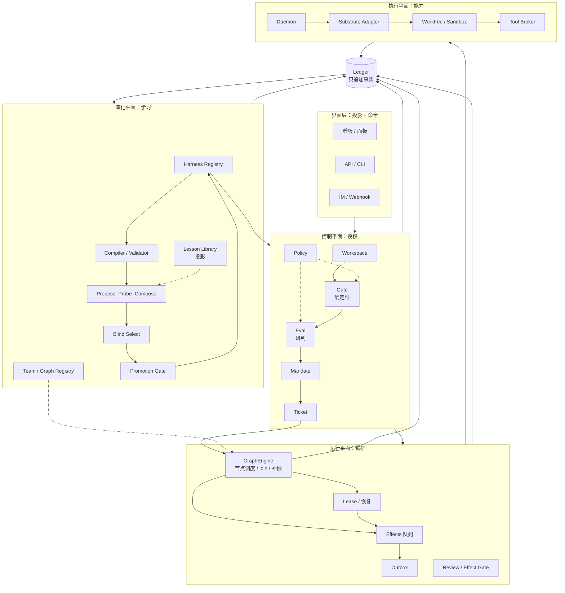
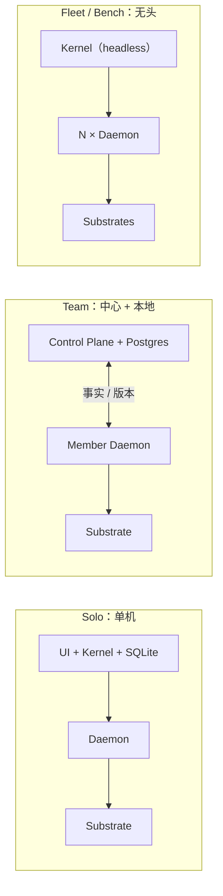
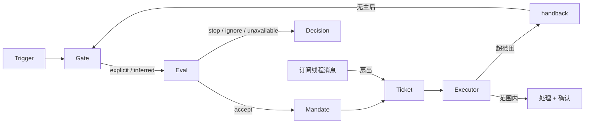
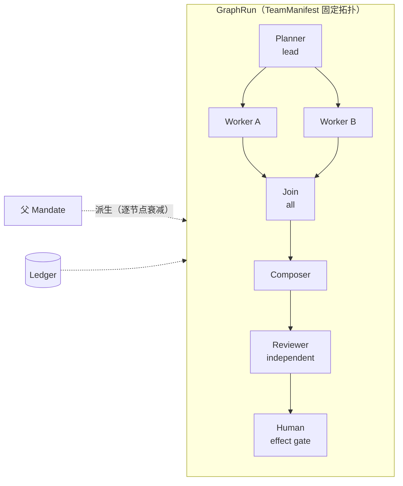
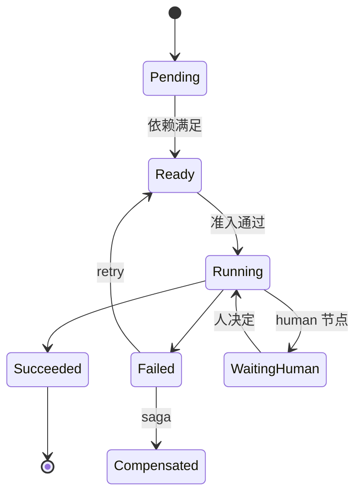
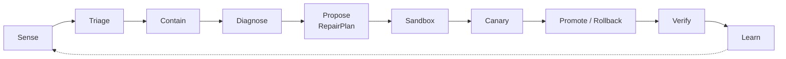
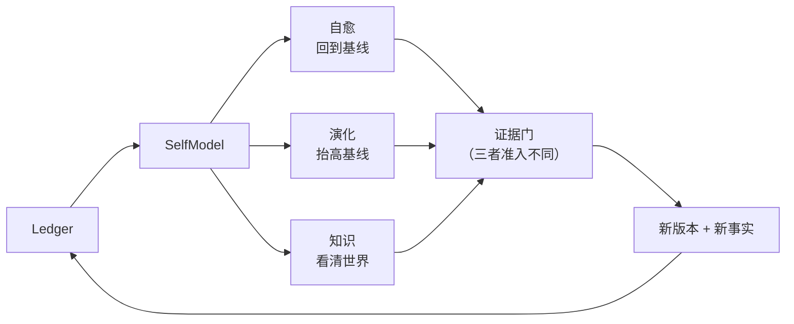
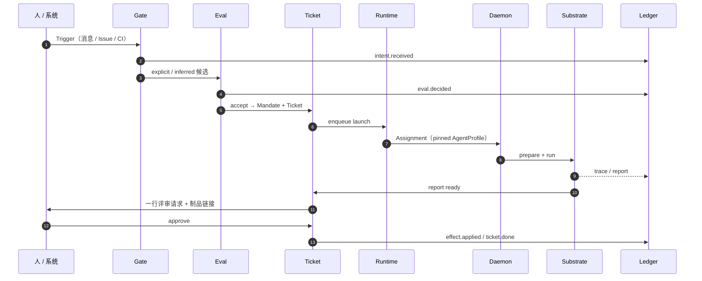
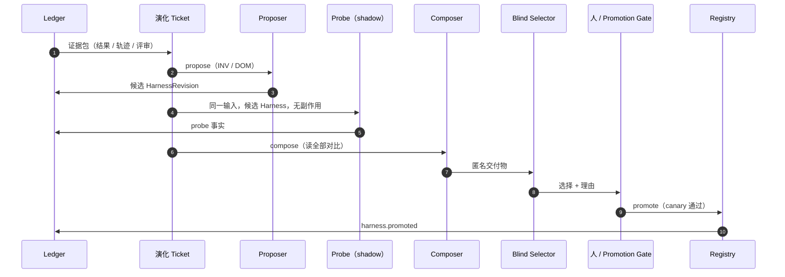

# 自研 Harness 架构（Ziyan）

> 三方案融合：Harness² × dsh-superagent × Multica  
> 加上四个原创主题：AgentTeam × GraphEngine × 自愈 × 知识更新  
> 架构与设计理念 · v0.3 · 2026-11-02

Ziyan 是「自研」的工作代号；下文用它指代这套架构。

这份文档不介绍三个系统，而是回答一个问题：**如果我们自己造一个 Harness，应该继承什么、拒绝什么、用什么把它们缝在一起而不缝成一个怪物。**

阅读前提：

- 候选方案是工作区里的三份材料：Harness²（递归线束优化）、dsh-superagent（授权型数字同事）、Multica（多路复用的人机协作工作区）。
- 目标系统不是模型、不是聊天产品、不是 benchmark 工具，而是一个**可自托管、团队可用、厂商无关、能持续变好的 Harness 平台**。
- 假设目标团队为 3–50 人，在自己的基础设施上，让多个厂商的 Agent 处理真实工作，同时要求可审计、可回滚、能持续变好。若只是个人自用，可裁掉 Workspace 与部分评审；若只做研究，可裁掉产品面。骨架不变。

阅读路线：

- 只想看**比较**：第 1 节。
- 只想看**架构**：第 2、4 节。
- 想看**团队与图**：5.6–5.7、7.7–7.8。
- 想看**自愈与知识**：5.8–5.10、7.9–7.11。
- 准备**落地**：第 5–8 节。
- 要做**决策 / 排期**：第 9–12 节。

---

## 0. 结论

三份方案不是三个竞品，而是同一个系统的三个时间尺度：

| 方案 | 它真正解决的问题 | 时间尺度 | 它缺失的那一角 |
| --- | --- | --- | --- |
| **Harness²** | 智能体的**行为**如何变好 | 天 / 周 | 合法性、注意力、产品面 |
| **dsh-superagent** | 智能体的**行动**如何被授权 | 分钟 / 小时 | 行为如何持续变好 |
| **Multica** | 智能体的**协作**如何规模化 | 秒 / 分钟 | 授权深度、行为控制 |

把它们功能相加会得到一个不可维护的怪物。正确的融合是承认三者是三个闭环，然后用同一套**事实底座**和**版本化契约**把它们隔开：

- **执行闭环**（秒–小时）：一张 Ticket 从授权到交付。
- **授权闭环**（分钟–天）：一个请求从意图到 Mandate，以及策略变更如何传播。
- **演化闭环**（天–周）：一个 Harness 从证据到新版本。

融合后的系统有七个判断，加一条防火墙：

1. **演化即工单**：改进 Harness 不是另起一条流水线，而是一张受 Mandate 约束的 Ticket，交付物是一个 HarnessRevision。
2. **队友即三元组**：一个可被指派的 Agent =（HarnessRevision, Substrate, Identity）。Multica 的 assignee、dsh 的 Executor、Harness² 的 substrate 在这里合成一个概念。
3. **评审即效果门**：人不需要审每一步，只在**后果边界**上审；评审类型由效果类别决定，而不是由流程习惯决定。
4. **团队即能力组合（AgentTeam）**：团队不是新的授权主体，而是把多个 AgentProfile 组合成有角色、有协议、有预算的能力图；授权仍由 Ticket / Mandate 承担。
5. **执行即图（GraphEngine）**：复杂工单不再是一条线性 Assignment，而是一张可验证、可恢复、可回放的执行图；默认仍是单节点图。
6. **自愈即修复（Self-healing）**：失败后先把能力恢复到基线，再谈改进；修复的是能力工件，不是授权约束。
7. **知识即事实（Knowledge update）**：知识是有来源、有作用域、有置信度、有有效期、可矛盾、可回滚的事实，不是提示词里的段落。
8. **授权 / 能力防火墙**：Harness 永远不能改变授权，授权变更永远不通过 Harness 完成。这是整个架构的安全基座。

底座是一本只追加的 **Ledger**：所有事实（意图、决定、授权、报告、评审、副作用、节点执行、晋级）先落账，再被投影成看板、审计、指标和经验库。

一句话：

> **以 Mandate 为授权单元，以 Ticket 为工作单元，以 HarnessRevision 为能力单元，以 Ledger 为事实单元；团队是能力的组合，图是执行的语法；三个闭环各按自己的时钟运行，只通过不可变事实与版本化契约通信。**

---

## 1. 三个方案：各自的问题域与真实取舍

比较方法：不看功能清单，看四个问题——**优化什么、信号从哪来、按什么时钟运行、信任边界在哪**。功能可以抄，这四个不能。

### 1.1 一张表

| 维度 | Harness² | dsh-superagent | Multica |
| --- | --- | --- | --- |
| 问题域 | 开放世界任务上的行为优化 | 单仓库 / 单团队的授权执行 | 多智能体团队的协作与吞吐 |
| 优化对象 | Harness（8 组件树） | 授权与注意力 | 协作与调度 |
| 工作单元 | task → rollout → harness | Trigger → Ticket | Issue → Run |
| 多 Agent 协作 | 子代理，但无团队模型 | 一 Ticket 一 Executor | 看板多 Agent，但无团队协议 |
| 编排方式 | 固定的 Propose–Probe–Compose 流水线 | Effects 队列，线性执行 | 派发队列，不是图 |
| 自愈 | 弱（无自我修复） | 强（失败 / 恢复语义） | 中（看门狗 / 重试） |
| 知识更新 | 中（领域经验库） | 中（策略 / 提示词版本化） | 弱（issue 上下文） |
| 反馈信号 | 同任务执行对比（无 rubric） | 人的决定 + 结构化报告 | 人审 + 归因记录 |
| 时间尺度 | 一次任务数小时；经验库跨任务 | 一次请求分钟级 | 一块看板持续运行 |
| 信任边界 | benchmark 沙箱 + 网络封禁 | 允许名单 + Gate + Mandate | 本地 daemon，代码不出本机 |
| 拓扑 | 单进程 CLI（Linux / Python） | 单 operator 的 DSH 插件 + SQLite | Go 服务 + Postgres + 多端 |
| 最强 | 受控对比、盲选、经验库 | 授权模型、注意力经济、恢复语义 | 产品面、厂商无关、实时协作 |
| 最弱 | 无授权、无产品、成本高 | 无演化、单仓、单进程 | 黑盒 CLI、无授权深度、无学习 |

能力雷达（定性）：

| 维度 | Harness² | dsh | Multica |
| --- | --- | --- | --- |
| 行为优化 | **强** | 弱 | 弱 |
| 授权 / 审计 | 无 | **强** | 中 |
| 注意力效率 | 无 | **强** | 中 |
| 协作 / 规模 | 弱 | 弱 | **强** |
| 厂商无关 | 中（2 种 substrate） | 弱（绑定 DSH） | **强（26 种 CLI）** |
| 成本效率 | 低（离线高预算） | 中 | 高（但质量黑盒） |
| 可演化 | **强** | 无 | 无 |
| 多 Agent / 编排 | 中（固定流水线） | 弱（单执行器） | 中（派发，非图） |

### 1.2 Harness²：把“自我改进”变成受控实验

**它做对了什么**

- 把自我改进从“改权重 / 改代码”换成**改一个受校验的声明式树**：八类组件（system prompt、guardrails、memory、tool guidance、subagents、skills、scripts、plugins），可 diff、可复现、可回滚。
- 用**同任务执行对比**替代评分器：复制体之间的方差、跨 base 重复出现的失败、能在轨迹里点名的时刻，才是信号；单条 rollout 是噪声，不需要 ground truth。
- **盲选**：候选匿名化，选择器只看交付物，base 也在池中且“选未修改的 Harness”完全合法；更精巧没有加分。
- **归因纪律**：confounded 优先；“被采纳”永远不能证明一条 edit 有效或可迁移；每个任务至多一条 lesson，cue 描述情境的“形状”而不是任务事实。
- **成本的诚实**：budget ledger、ANSWER_FREE、EVIDENCE_BOUNDARY、网络层封禁 rubric——它承认公开 benchmark 的答案可以被联网执行器下载，不假装工具设置能拦住。
- **可移植的方法轴**：method / substrate / benchmark 三轴分离，阶段提示词逐字节相同，基准差异只以数据槽位注入。

**它付出的代价**

- 按递归预算 `k` 计，每个任务消耗 `4k` 次 rollout 加 `3k` 个改进阶段（k 线性放大，不是四千）。这在 benchmark 上可接受，在生产里没有这个预算。
- 世界是 benchmark：任务分布、交付物、评分器都是外生的。迁移到真实团队会立刻遇到权限、隐私、长期关系与“谁付钱”的问题。
- 只有任务级的正确性，没有组织级的合法性：谁允许它做、做到什么程度、花谁的钱、结果发给谁，全在系统之外。
- 执行器网络不设限、Codex 沙箱关闭；它自己把这一点写进威胁模型，而不是安全边界。

**留下的精华 / 丢掉的包袱**

- 留：八组件树 + 校验器、Propose–Probe–Compose、盲选、归因纪律、经验库、always-on 定价、证据边界。
- 弃：benchmark 作为核心、每任务 4k rollout 的默认预算、无授权模型、研究型 CLI 拓扑。

### 1.3 dsh-superagent：把“谁可以让我干活”变成领域模型

**它做对了什么**

- 把授权变成**确定性 Gate + 不可变 Mandate**：内容永远不能改权限；模型只在“是否接单”上做研判，权限由代码和策略决定。
- **两条授权路径**：Eval 只负责“开始新工作”；Subscription 只负责“继续已有工作”，后者绕过 Gate 但不授予新权。这是整个模型最关键的分岔。
- **单一写者 + 先落库后执行 + Effects/Outbox**：每个状态一个写者，副作用先入队，重启可恢复，同一工单同一会话严格保序。
- **注意力经济**：每条消息必须有目的（确认 / 回答 / 结果 / 待人工决定），≤100 词；健康状态不占版面；面板第一屏永远是“等一个人处理什么”。
- **策略 / 提示词版本化**：Policy 变更丢弃在途 Eval、通知受影响工单、复活前重验证，但**不撤销在途 Mandate**——避免留下半成品。
- **观察 → 放权**：observe 只记录 “would accept”，团队看准了再切 auto；所有去向留痕，可重评。
- **诚实的失败语义**：评分器失败不等于零分；`blocked/failed` 后不自动投递；重启带恢复备注；渠道永久消失则丢弃留痕。

**它付出的代价**

- 单仓库、单 operator、SQLite 单进程：它是“一个操作员的数字同事”，不是团队平台。
- Harness 是**静态的**：团队可以改提示词，但没有“从执行证据中改进 Harness”的闭环；提示词版本管理是治理，不是学习。
- 10 个领域概念加大量规则，学习曲线陡；对一个仓库是精确的，对多租户 / 多团队是过重的。
- 执行器以 operator 的 OS 用户运行，包装 CLI 只是默认值，不是安全边界（文档自己承认）。
- Source 适配器只有 GitHub / 飞书；没有成本预算、没有多 substrate、没有跨团队经验复用。

**留下的精华 / 丢掉的包袱**

- 留：领域模型、Gate/Mandate、双路径、单一写者、Effects/Outbox、阶段表、注意力哲学、版本化、observe→auto、恢复语义。
- 弃：单仓假设、单进程 SQLite 作为唯一拓扑、静态 Harness、有限 Source、operator 级信任边界（要用 sandbox 替代）。

### 1.4 Multica：把 Agent 变成看板上的同事

**它做对了什么**

- **产品面**：看板、多端、实时、IM 集成；assignee 多态，人和 Agent 共用同一条任务生命周期。
- **本地信任边界**：控制面在服务端，执行在用户机器；代码与密钥不出本机。
- **厂商无关**：驱动 26 种已安装的 Agent CLI，换供应商是配置而不是迁移。
- **人在回路**：Agent 完成只进 `in_review`，不自动上线；工具调用、命令、报错带时间戳、可回放。
- **工程细节**：共享 bare clone + worktree 隔离、WS 唤醒 + 30s 轮询兜底、心跳 / 看门狗、归因与用量、自托管。

**它付出的代价**

- Agent CLI 是**黑盒**：Harness 不可版本化、不可对比、不可改进；质量完全取决于外部 CLI 的默认行为。
- 控制粒度是 Issue：对“谁授权、授权到什么程度、能花多少钱”没有建模；review 是事后检查，不是按效果分级的门。
- 零外键 / 零级联 + 应用层保证完整性：在线 DDL 友好，但一致性靠纪律；对高审计场景不够。
- 没有学习闭环：每次运行的经验留在 issue 与人的记忆里，不进入下一次的 Harness。
- 本地 daemon 是每台机器的单点；并发与恢复语义不如 dsh 精细。

**留下的精华 / 丢掉的包袱**

- 留：Workspace / 租户、daemon、Substrate 多厂商、看板 / 实时、review gate、归因 / 回放、worktree、自托管。
- 弃：黑盒 Harness、Issue 级授权、无策略模型、无演化、零外键教条（按场景选择）。

### 1.5 比较后的判断

三者不是替代关系，而是三层：

- **Multica 提供“在哪里发生”**：工作区、执行边界、协作面。
- **dsh 提供“凭什么发生”**：授权、注意力、可审计。
- **Harness² 提供“如何变得更好”**：受控对比、盲选、经验固化。

一句话：**Harness² 求真，dsh 求稳，Multica 求快；Ziyan 要让三者在同一系统里各就各位。**

缺任何一层，系统都会在规模化时退化：

| 只有 | 会退化成 |
| --- | --- |
| Harness² | 一个昂贵的离线实验装置 |
| dsh | 一个精确但不会成长的单仓 bot |
| Multica | 一个热闹但不可审计、不可改进的 Agent 看板 |

而且三者会互相长出来：Multica 加权限会长成 dsh；dsh 加学习会长成 Harness²；Harness² 加产品会长成 Multica。**所以融合不是选择，而是分层加契约。**

Ziyan 另加两个原创构件——**AgentTeam** 与 **GraphEngine**——补上三者都没有的“多 Agent 协作协议”和“工单内编排”；它们不改变三者的分工，只让分层可落地。

---

## 2. 融合：七个判断、一条防火墙、一个底座

### 2.1 为什么不能功能相加

功能相加有三个死法：

1. **时钟冲突**：演化 probe 要跑几小时，执行工单要分钟级响应；放在同一条同步链路上，慢的拖死快的。
2. **权限混淆**：Harness 为了“更会干活”顺手拿到新工具，而系统没有独立的授权层；自改进变成自扩权。
3. **状态双写**：看板、工单、经验库各记一份，最终没有人知道哪个是真的。

因此跨层只允许三种通信：

- **事实**：Ledger 里的不可变记录。
- **版本**：HarnessRevision、PolicyVersion。
- **命令**：API / effect，有明确的所有者与幂等键。

不允许共享可变状态，不允许跨层同步调用，不允许一层读另一层的数据库。

### 2.2 判断一：演化即工单

Harness² 的 Propose–Probe–Compose 是一条独立的流水线；dsh 已经有授权、预算、审计、重试、评审、注意力路由。**没有理由再造一套。**

在 Ziyan 里，一次 Harness 改进就是一张 `harness.evolution` 类型的 Ticket：

| Harness² 概念 | Ziyan 中的实现 |
| --- | --- |
| Propose | 演化 Ticket 下的一个 Assignment，执行者是 proposer AgentProfile |
| Probe | 同一 Ticket 下的 shadow / replay Assignment，候选 HarnessRevision + 同一输入 |
| Compose | 同一 Ticket 下的 composer Assignment，读全部 probe 证据 |
| Blind select | 一次 `awaiting_review`，selector 只看匿名交付物 |
| Reflect / Lesson | Review 的结构化结论，写入 Ledger；经验库是它的投影 |
| Adopt / Library | Promotion Gate 通过 → 新 HarnessRevision 进入 Registry |

好处是**协议复用**：演化自动继承授权、预算、审计、重试、恢复、评审、注意力路由；不需要第二套权限系统，也不需要第二套账本。

代价是演化吞吐受工单调度影响。这是有意的：**演化不应该比生产更优先。**

### 2.3 判断二：队友即三元组

Multica 的 assignee、dsh 的 Executor、Harness² 的 substrate，在 Ziyan 里合成一个概念：

```text
AgentProfile = (HarnessRevision, Substrate, Identity)
```

- **HarnessRevision**：它会什么、按什么方式工作。
- **Substrate**：它在什么执行框架里跑（DSH、OpenCode、Codex、Claude Code……）。
- **Identity**：它在各 Source 上用哪个账号说话（GitHub 账号、飞书 bot、IM 身份）。

一个 Assignment 必须 pin 一个 AgentProfile。换其中任何一项（升级 Harness、换 substrate、换账号）都需要新的 Assignment，并记录原因。

这带来四个直接好处：

- **可复现**：“这张工单是谁干的”有精确答案，而不是“当时的默认提示词”。
- **可对比**：同一类工单可以分配给两个 profile，形成天然 A/B。
- **可回滚**：晋级失败就把 pin 指回上一个 revision。
- **可移植**：substrate 是端口，Harness 的 `requires` 由 capability manifest 校验，不绑死厂商。

Assignee 仍然可以是人：人接单时不产生 Assignment，只产生 effect / review 事实。这样保留了 Multica 的“人和 Agent 共用一块看板”，又不把人的工作硬塞进 Agent 模型。

Identity 按 Source 分开，不做跨 Source 的身份映射（沿用 dsh 的规则）；“同一个人在 GitHub 和飞书是谁”是团队提示词里的事实，不是领域概念。

### 2.4 判断三：评审即效果门

Multica 的 `in_review` 是“做完之后人看一眼”；dsh 的 `human_action` 是“卡住时问一个具体问题”；Harness² 的盲选是“只看交付物做选择”。三者其实是一件事：**在后果边界上让人做决定。**

Ziyan 把评审变成按效果类别触发的门：

| 效果类别 | 例子 | 默认门 |
| --- | --- | --- |
| `read` | 搜索、读文件、查 API | 自动放行，记事实 |
| `reversible` | 建分支、提交、开 draft PR | 自动或按策略 |
| `irreversible` | 合并、部署、删除、对外发送 | 必须过人 |
| `external-visible` | 评论、邮件、IM 消息 | 策略 + 频率限制 |
| `authority` | 改 Policy、发 Mandate、晋级 Harness | 人 + 审计，禁止自动 |

评审有三种，共用同一个 `Review` 结构：

- **delivery review**：这份交付物是否满足请求。
- **effect review**：这个后果是否允许发生。
- **promotion review**：这个 Harness 版本是否成为默认。

人看到的不是一份长报告，而是**一行决定 + 制品链接 + 风险摘要**。盲选只是 promotion review 的一种：selector 被限制为“只看交付物”。

### 2.5 判断四：团队即能力组合（AgentTeam）

多 Agent 不是把几个 Agent 拉进一个群聊，而是把多个 AgentProfile 组合成一张**有角色、有协议、有预算的能力图**。

- **团队不是授权主体**：团队不产生新的 Mandate；每个成员拿到的都是父 Mandate 的**派生切片**，scope / effects / budget 只能收缩，不能扩张。
- **团队是一个版本化工件**：`TeamManifest` = 角色、图、负责人、共享上下文、预算拆分、决策协议、评审要求；它和 HarnessRevision 一样进 Registry、走评审、可回滚。
- **一个负责人**：只有 lead 能提交 Ticket 级 Report；成员只提交节点级结果与 handoff。没有“大家共同负责”这种无法审计的状态。
- **默认不是团队**：单 Agent 能做的事不组队；团队只在需要并行、分工、独立评审或分层时才启用。

团队的设计细节见 5.6，契约见 7.7。

### 2.6 判断五：执行即图（GraphEngine）

一张工单的执行不再默认是一条线性 Assignment，而是一张**声明式执行图**：节点是 Agent / 工具 / 人 / 子图 / join / map / condition / 补偿，边是数据与控制依赖。

- **图是数据，不是代码**：图存 Registry、可校验、可 diff、可回滚；编排器不执行任意脚本。
- **编排确定，节点随机**：边的条件是对事实的纯函数；Agent 节点可以随机，但它的输入、输出、决策都落账，所以能重放。
- **每个节点一份派生 Mandate**：节点不能拿整张工单的权限；图不能声明授权。
- **默认仍是单节点图**：图是为并行、汇合、人工门、子团队和补偿准备的，不是给简单工单加戏。

图的设计细节见 5.7，契约见 7.8。

### 2.7 判断六：自愈即修复（Self-healing）

Agent 会失败。自愈不是“再试一次”，而是**在授权不变的前提下，把能力恢复到基线**。

- **自愈 ≠ 改进**：自愈恢复基线，改进抬高基线；前者由故障触发，后者由证据触发。
- **修复能力，不修复约束**：Harness / Graph / Team / Knowledge 可以修；Policy / Gate / Mandate / Review / Budget / Audit 不能自修。
- **先恢复，再诊断，再修复**：先 retry / fallback / rollback / 隔离，再找根因，最后做可回滚的修复。
- **修复也要授权与预算**：L2+ 修复是一张 Ticket，有 canary、回滚和人工门。

设计细节见 5.8。

### 2.8 判断七：知识即事实（Knowledge update）

知识不是提示词里的段落，而是**有来源、有作用域、有置信度、有有效期、可矛盾、可回滚的声明**。

- **知识不是权限**：知识可以告诉 Agent “世界是什么”，不能告诉它“它可以做什么”；后者是 Policy。
- **知识不是日志**：日志是原始事实，知识是被验证、被作用域化的声明。
- **知识会过期**：每条知识有 TTL 或重验证触发器；没有“永远为真”的事实。
- **矛盾是一等事件**：不静默覆盖，不取平均；记录双方、来源、时效，再裁决。

设计细节见 5.9。

### 2.9 防火墙：授权与能力分离

这是整个架构的安全基座，也是三个方案里没有任何一个同时做对的事。

> **Harness 是能力，Policy / Mandate 是授权。两者之间是一道单向膜：授权可以约束能力，能力永远不能生成授权。**

推论：

- Harness 不能声明工具权限、不能调用 Gate、不能写 Policy、不能给自己发 Mandate。
- Harness 里的 `guardrail` 组件只是**行为建议**；真正的护栏在工具代理、Gate 和效果门里。
- 一个 Harness 如果“需要”新能力（新工具、更宽的网络、更高的并发），那不是 Harness 变更，而是**授权变更**，必须走 Policy / 人的路径。
- 可学习的是 Harness；**不可学习的是授权、策略、评审边界、预算上限、审计**。

这条防火墙把“自改进”从“系统改自己的约束”降级为“系统在固定约束内改自己的能力”。这是它能被信任的前提。

### 2.10 底座：Ledger

Ledger 是一本只追加的事实账本。所有平面都只写事实，所有视图都是投影：

- 执行面写：`assignment.started`、`report.filed`、`effect.applied`、`ticket.done`。
- 编排面写：`graph.started`、`node.completed`、`graph.completed`、`team.formed`。
- 授权面写：`intent.received`、`eval.decided`、`mandate.granted`、`policy.changed`。
- 演化面写：`harness.proposed`、`probe.completed`、`harness.promoted`。
- 维护面写：`repair.proposed`、`repair.applied`、`repair.rolled_back`、`knowledge.claimed`、`knowledge.validated`、`knowledge.retracted`。
- 注意力面写：`message.sent`（带目的与成本）、`review.decided`（带人的分钟数）。

它同时解决三件事：

- **审计**：任何结果都能从事实重放。
- **经验**：Harness² 的经验库不再是第四套存储，而是 Ledger 的一个投影。
- **指标**：北极星与护栏都从事实计算，不靠埋点口径。

存储可以是 SQLite（单机）或 Postgres（团队），但**事件表是源，投影表可重建**。这调和了 dsh 的嵌入式单进程与 Multica 的服务端多租户。

### 2.11 精华映射

| 来源 | 被吸收的精华 | 在 Ziyan 中的位置 |
| --- | --- | --- |
| Harness² | 八组件树、校验器、always-on 定价 | HarnessRevision + Compiler |
| Harness² | Propose–Probe–Compose | 演化 Ticket 的 Assignments |
| Harness² | 盲选、匿名、base 合法 | Review selector = blind-model |
| Harness² | confounded 优先、一条 lesson、cue 形状 | Review → Lesson 投影 |
| Harness² | ANSWER_FREE、EVIDENCE_BOUNDARY | Compiler 的上下文约束 + 内容边界（数据非指令） |
| Harness² | method / substrate / benchmark 三轴分离 | 控制面 / Substrate 端口 / Source 适配器 |
| dsh | Source / Trigger / Thread / Eval | 控制面领域模型 |
| dsh | 确定性 Gate + 不可变 Mandate | 授权闭环 |
| dsh | Eval 与 Subscription 双路径 | Ticket / Subscription |
| dsh | 单一写者、Effects、Outbox | Runtime + Ledger |
| dsh | 阶段表、恢复语义、暂停语义 | Ticket 状态机 + Lease |
| dsh | 注意力哲学、消息目的、面板 | Attention Router + Surfaces |
| dsh | Policy / Prompt 版本化、observe→auto | 授权闭环 + Registry |
| Multica | Workspace / 租户 | Workspace |
| Multica | 本地 daemon、代码不出本机 | 执行平面 |
| Multica | 26 种 CLI、厂商无关 | Substrate adapters |
| Multica | 看板、实时、IM | Surfaces |
| Multica | in_review、归因、回放 | Effect Gate + Ledger |
| Multica | worktree 隔离、自托管 | Sandbox + 拓扑 |
| Ziyan 原创 | 团队即能力组合（AgentTeam） | TeamManifest + 5.6 |
| Ziyan 原创 | 执行即图（GraphEngine） | GraphRevision + 5.7 |
| Ziyan 原创 | 自愈即修复（Self-healing） | RepairPlan + 5.8 |
| Ziyan 原创 | 知识即事实（Knowledge update） | KnowledgeRecord + 5.9 |

### 2.12 非目标

明确不做什么，和做什么一样重要：

- 不做模型 / 推理服务；不做通用聊天；不做通用 BPM / 低代码编排——GraphEngine 只服务 Agent 工作，不追求图灵完备。
- 不做“全自动 AI 公司”：不允许系统给自己发授权。
- 不做 benchmark 榜单；benchmark 只是一个 Source / Substrate 适配器。
- 不做 prompt 市场（M5 之后再考虑）；先让内部 Harness 可版本化。
- 不追求“一个 Harness 通吃”；Harness 按 Workspace / domain 版本化。
- 不把“多 Agent 群聊”当协作方式；AgentTeam 必须由 TeamManifest + Graph 定义角色、预算与负责人，默认仍是单 Agent。
- 不把图当成默认执行方式；单 Agent 单节点图是默认，图只在协调收益大于协调成本时启用。
- 不做“无限自愈”：同一签名反复修复失败就升级，不进入修复循环。
- 不做“知识自动改权限”：知识更新永远不能修改 Policy / Mandate；要改权限就走 Policy 流程。

---

## 3. 设计理念：八条法则

每条法则都带“它禁止什么”。没有禁止的法则只是口号。

### 法则一：注意力是预算，不是资源

系统的第一资源不是 token，是人的注意力。一个没人看的仪表盘、一条不需要行动的通知、一个可以默认的设置，都是负债。

- **含义**：每次外发消息、每个设置、每个面板元素都记成本；消息必须能回答“要谁做什么，或者谁能用什么”。
- **禁止**：广播式进度、把日志当通知、让用户读完整报告才能做决定、健康状态占版面。
- **来源**：dsh 的 000 philosophy + Multica 的通知面。

### 法则二：授权先于能力

任何外部效果之前必须有 Mandate；没有 Mandate 的能力只是潜在风险。演化本身也要 Mandate。

- **含义**：Mandate 不只写“能做什么”，还写“能花多少”（tokens、钱、机器时间、人的评审分钟）。
- **禁止**：先做再申请；用提示词表达权限；Harness 声明工具；Agent 给自己续预算。
- **来源**：dsh 的 Gate/Mandate；Harness² 恰好缺这一层。

### 法则三：Harness 是代码，不是配置

Harness 的每一次变化都必须是可 diff、可测试、可回滚的版本，而不是某次对话里的即兴修改。

- **含义**：Harness 存在 Git 里，走评审、签名、CI；面板可以编辑，但每次保存生成不可变版本。
- **禁止**：面板直改生产而不留版本；不可复现的调参；没有基线的“感觉更好”。
- **来源**：Harness² 的树 + dsh 的版本化。

### 法则四：用对比取证，分数只用于晋级

学习信号来自同一任务 / 同一输入的受控对比；绝对分数只用于 promotion 的门槛，不进入学习回路。

- **含义**：方差、重复失败、可点名的轨迹时刻是证据；“被采纳”不是证据；单条 rollout 不是证据。
- **禁止**：用 judge 分数反训 Harness；用选择结果证明 edit 有效；用一次成功推广到全域。
- **来源**：Harness²。

### 法则五：一个事实一个写者

每个事实只有一个写者；每个状态都是投影。

- **含义**：执行面永远不写授权面；投影可以重建；跨平面只传事实和版本。
- **禁止**：双写；把投影当源；“补一下数据库”；跨层直接读表。
- **来源**：dsh 的单一写者 + 事件溯源。

### 法则六：执行在本地，协调在中心

代码、密钥、工具执行留在 operator / daemon；中心只收事实、版本和制品。

- **含义**：控制面不需要仓库写权限；密钥不进模型上下文；工具调用在本地代理。
- **禁止**：把仓库上传到控制面；在中心跑任意代码；把长期 token 塞进 prompt。
- **来源**：Multica 的信任边界 + dsh 的执行环境。

### 法则七：人在后果边界，不在每一步

只读 / 可逆效果自动放行；不可逆 / 外部可见 / 授权变更必须过人；一次只问一个具体问题。

- **含义**：评审是效果门，不是流程节点；人看到一行决定和制品链接，而不是过程日志。
- **禁止**：审批一切；用自由文本代替结构化问题；一次问多个问题；让“已读”代替“已决定”。
- **来源**：Multica 的 in_review + dsh 的 attention + Harness² 的盲选。

### 法则八：可逆优先于预防

不取消在途工作；记录、通知、重验证、灰度、回滚。

- **含义**：策略变更不 kill 所有工单；Harness 晋级先 canary；每个不可逆动作都有回滚剧本。
- **禁止**：策略一变就中止全部工作；不可回滚的自动合并；没有 rollback 的 promotion。
- **来源**：dsh 的 policy change 语义 + Harness² 的 rollback 意识。

团队、图、自愈、知识都不是新法则，而是法则二、五、七的应用：团队是能力的组合，图是执行的语法，自愈修复能力，知识更新世界模型；四者都不产生授权。

### 北极星

```text
北极星 = 已验证结果 /（人的注意力小时 + 归一化成本）
```

- **已验证结果**：Ticket 以 `done` 结束、评审通过、7 天内无回滚 / 重开。
- **归一化成本**：tokens + 美元 + 机器时间 + 人的评审分钟，按团队基期折算。
- **硬约束**：未授权副作用 = 0；不可逆错误 = 0；审计可完整重放。

如果一条优化不能改善这个比值，它就不是优化，只是复杂度。

---

## 4. 总体架构

### 4.1 四平面一脊柱



各平面的职责，一句话：

- **控制平面**：决定“谁可以做什么”，只写授权事实。
- **运行平面**：决定“事情按什么顺序发生”，只写调度事实。
- **执行平面**：决定“具体怎么做”，只写执行事实。
- **演化平面**：决定“下一版怎么更好”，只写版本与证据结论。
- **GraphEngine**：运行平面的编排内核，负责节点调度、join、补偿；它不直接发外部效果，效果仍走 Effects / Tool Broker。
- **AgentTeam**：不是第五个平面；它是 `TeamManifest` 在 `Assignment` 中的实例，由图执行，图中不单列。
- **自愈 / 知识**：横跨运行与演化，不新增平面；修复写能力工件，知识写声明工件，二者都落 Ledger。
- **Ledger**：唯一事实源。
- **界面层**：不是第五个平面，只是投影和命令入口。

### 4.2 依赖规则

允许的依赖：

- 界面 → 控制面（命令 / 查询）。
- 控制面 → 运行面（enqueue effect）。
- 控制面 → GraphEngine（开 GraphRun）。
- GraphEngine → 运行面（node effect）；GraphEngine → Ledger（node facts）。
- 运行面 → 执行面（Assignment）。
- 执行面 → Ledger（事实）。
- 控制面 / 运行面 / 演化面 → Ledger（事实）。
- 演化面 → Registry（写版本）；控制面 / GraphEngine → Registry（读 pin）。
- 自愈 → Registry（候选修复版本）；知识 → Ledger（声明事实）。
- 演化面 → 控制面（开一张演化 Ticket）。

禁止的依赖：

- 执行面 → Policy / Gate / Mandate（任何写）。
- GraphEngine → Policy / Gate / Mandate（任何写）。
- RepairPlan / KnowledgeUpdate → Policy / Gate / Mandate（任何写）。
- Harness / Graph / Team → Gate / Policy（任何调用或写），或直接产生外部效果。
- 界面 → 执行面（绕过授权直接拉起 Agent）。
- 演化面 → 活 Ticket（直接修改正在执行的工作）。
- 运行中改图（要改就出新 GraphRevision，并记录迁移决策）。
- 任何平面 → 投影表作为源。

依赖方向错了，架构就退化成“三套系统共享一个数据库”。

### 4.3 三种拓扑，同一套契约



| 拓扑 | 谁用 | 执行在哪 | 控制面在哪 | 典型规模 |
| --- | --- | --- | --- | --- |
| Solo | 个人 / 小试验 | 本机 daemon | 同进程（SQLite） | 1 人 |
| Team | 3–50 人团队 | 每个成员的本机 daemon | 自托管服务 + Postgres | 1 个 Workspace |
| Fleet / Bench | 评测 / 大规模任务 | 容器或专用机器 | 无头 Kernel | N 个临时 Workspace |

**拓扑不是架构。** 三种拓扑跑同一套领域模型、同一套契约，只换存储、传输和执行适配器。

### 4.4 最小内核

内核只有 13 个概念：

```text
Workspace · Source · Trigger · Thread · Policy · Eval · Mandate
Ticket · Assignment · Subscription · Channel · AgentProfile · HarnessRevision
```

加一本 Ledger。其余都是适配器或投影：看板、IM、benchmark、marketplace、报表、搜索。

**AgentTeam / GraphEngine 不增加领域概念。** `TeamManifest` 与 `GraphRevision` 是 Registry 工件；`TeamRun` 是 Assignment 的一种形态，`GraphRun` 是 Assignment 内部的一次图执行。它们描述“怎么做”，不描述“谁被允许做什么”，因此不进入授权判定。

`KnowledgeRecord` 与 `RepairPlan` 也不增加领域概念：前者是声明工件，后者是 Ticket 的字段。

**内核测试**：删掉所有 UI、所有 benchmark、所有 IM 集成，内核仍然能通过 API 跑完一张 Ticket。做不到，说明边界错了。

### 4.5 一次请求的完整路径

以“GitHub 上有人 @agent 修一个 bug”为例：

1. **采集**：Source 拉取评论，翻译成 Trigger，幂等落账（`intent.received`）。
2. **归线程**：Trigger 进入 Thread；同一 Thread 同时只跑一个 Eval，期间到达的合并成下一批。
3. **准入**：Gate 查允许名单与是否点名 → `explicit`；不读内容、不调模型。
4. **研判**：Eval 读有界上下文（Thread 前后、相关 Ticket、Policy 规则），决定 `accept`，记 `eval.decided`。
5. **授权**：创建不可变 Mandate：scope、Policy 版本、Harness 版本、AgentProfile、预算、评审要求。
6. **建单**：单事务创建 Ticket + Assignment + Subscription + 确认消息（≤100 词）。
7. **派工**：运行面 enqueue launch；daemon 用 worktree 准备目录；Substrate 拉起 Agent。
8. **执行**：工具调用经 Tool Broker；报告以事实流回写；进度不打扰人，只有 `attention`、`blocked`、`ready` 才路由。
9. **交付**：Agent 开 PR；效果类别 `external-visible` / `irreversible` 触发对应评审。
10. **评审**：人看到一行“修了什么 + PR 链接 + 风险”，批准合并（`review.decided`、`effect.applied`）。
11. **收尾**：PR 合并 → Ticket `done`（`ticket.done`）；账本记录注意力与成本。
12. **演化**：几天后，演化 Ticket 读这批事实，提出 Harness 改动，shadow probe，盲选，canary，晋级；下一张工单 pin 新版本。

注意第 12 步不在第 1–11 步的同步链路上。**执行不等待学习，学习不阻塞执行。**

如果这张工单需要并行调研、独立评审或子团队，第 7 步不是一个 Assignment，而是 GraphEngine 展开的一张图；Ticket 仍是同一个，lead 仍是唯一报告人。

---

## 5. 领域模型与核心构件

### 5.1 概念

| # | 概念 | 来源 | 定义 | 关键规则 |
| --- | --- | --- | --- | --- |
| 1 | **Workspace** | Multica | 租户与隔离边界 | 所有 Policy、Harness、Agent、Ledger 按 Workspace 隔离；跨 Workspace 只经显式导出 |
| 2 | **Source** | dsh | 事件流：一个可复用 kind + 一个实例配置 | 持读位置，重启不重放；丢弃自己的消息；把外部词翻译成 Trigger |
| 3 | **Trigger** | dsh | 不可变事件 | 幂等；带 actor 与来源元数据；可属于多个 Thread |
| 4 | **Thread** | dsh | 时间序的 Trigger 集合 | 同时至多一个 Eval；批合并；持 Decision 历史 |
| 5 | **Policy** | dsh | 版本化授权规则 + 各 Source 的名单 / 准入表 / bot 表 | 只由人或管理面写；内容永不改权限；每个 Mandate 记录其版本，变更不撤销在途 Mandate |
| 6 | **Eval** | dsh | Gate（确定性）+ Assessment（模型） | 无状态；输出 Decision；**只有它能创建 Mandate / Ticket** |
| 7 | **Mandate** | dsh + 新 | 授权：scope、strength、Policy 版本、Harness 版本、AgentProfile、预算、评审要求 | 不可变；人 stop 或重验证失败才撤销；扩权需新 Eval |
| 8 | **Ticket** | dsh | 工作单元 | 阶段自持，不跟随 Executor 状态；有交付物与评审 |
| 9 | **Assignment** | dsh + 新 | Ticket 与 AgentProfile 的一次绑定 | 有 mode（live / shadow / replay）与 lease；一个 Ticket 同时至多一个 live Assignment |
| 10 | **Subscription** | dsh | Ticket × Thread 的关系 | 扇出上下文；不授新权；人的消息可复活已结束 Ticket |
| 11 | **Channel** | dsh | Thread 的写侧 | 回复 / 评论 / PR；同一 Ticket 同一会话严格保序 |
| 12 | **AgentProfile** | Multica + dsh + Harness² | (HarnessRevision, Substrate, Identity) | 可被指派；版本固定；换任一要素需新 Assignment |
| 13 | **HarnessRevision** | Harness² | 不可变的能力版本 | 八类组件；通过校验；不含授权；可回滚 |

**支撑概念**（事实 / 投影，不是领域概念）：Decision、Report、Review、Effect、BudgetEntry、Trace、Lesson。把它们当概念会让模型膨胀；把它们当事实，系统就小。

**能力工件**（Registry 里的不可变版本，不是领域聚合）：HarnessRevision、GraphRevision、TeamManifest。它们描述“怎么做”，不描述“谁被允许做什么”；因此不参与授权判定，只被 Mandate pin。AgentTeam 由 TeamManifest 描述、在 TeamRun 中实例化；GraphEngine 是 GraphRevision 的执行器；二者都不增加领域概念。

`KnowledgeRecord` 是声明工件；`RepairPlan` 是 Ticket 的字段；`SelfModel` 是 Ledger 投影。三者都不是领域聚合。

### 5.2 不变量

1. **唯一创建路径**：只有 Eval 能创建 Mandate / Ticket。
2. **Mandate 不可变**：scope 只能在重验证时收缩；扩权需要新的 Eval。
3. **授权事实只由控制面写**：执行面与 Harness 永远不写 Policy / Mandate / Gate。
4. **一个 Ticket 同时至多一个 live Assignment**（Ticket 级绑定，通常给 lead）；每个 Assignment 恰好 pin 一个 AgentProfile；图节点的执行是 `NodeRun`，不是新的 Ticket 级 Assignment。
5. **Ledger 只追加**；所有投影可重建；没有投影是源。
6. **Harness 不能声明授权**，不能调用 Gate，不能写 Policy。
7. **外部内容是数据**，永远不能变成修改授权 / 策略 / Harness 的指令。
8. **没有效果类别与门决定，就不产生外部效果**；不可逆效果必须过人。
9. **人 stop 对 Ticket 是终局**；要再做，必须新的 Eval。
10. **预算耗尽即停止**；只有人能追加；系统不得静默续命。
11. **团队不产生授权**：每个成员的派生 Mandate ⊆ Ticket Mandate；团队总预算 ≤ 父预算；成员 scope 的并集 ⊆ 父 scope。
12. **图不产生授权**：每个节点在派生 Mandate 下运行；图不能声明 authority，也不能动态创建权限。
13. **一个 Ticket 一个 accountable lead**：只有 lead 能提交 Ticket 级 Report；成员只提交节点结果。
14. **自愈不修约束**：RepairPlan 的 target 只能是能力 / 知识工件；L4 不是自修，是升级。
15. **知识不改权限**：KnowledgeUpdate 不能写 Policy / Mandate；知识只改变“世界是什么”的声明。

### 5.3 Ticket 阶段

阶段由“它在等什么”决定，从上到下第一个匹配者胜出（沿用 dsh 的表格，补上评审类型）：

| 阶段 | 条件 | 面板文案 |
| --- | --- | --- |
| `waiting_input` | 输入投递失败 | 输入未送达 |
| `awaiting_answer` | 有 Attention | 等待回答 |
| `awaiting_review` | 最新 Report 是 `ready`，或有效果待批 | 等待评审 |
| `blocked` / `failed` | 最新 Report 是 `blocked` / `failed`，且之后无人发消息 | 受阻 · 失败 |
| `queued` | 无 Assignment 或 Assignment pending | 排队中 |
| `idle` | 最新 Report 是 `waiting`，或 Assignment 已结束 | 等待触发 |
| `working` | 其余 | 执行中 |
| `done` | 完成 / 合并 / 关闭 / dropped | 已完成 |
| `stopped` | 人 stop | 已停止 |

`awaiting_review` 内部带 `review.kind`（`delivery` / `effect` / `promotion`）；面板仍只显示一行“等谁决定什么”。

规则：

- `person / *` 阶段表示“不能再自动前进”。
- 新的 Agent 消息把 `blocked` / `failed` 释放回 `working`，但不会自动追加预算。
- `idle` 可以被订阅线程上的 Trigger 继续；`stopped` 不行。

### 5.4 两条授权路径



- **Eval 路径**是唯一能创建新工作的路径；Gate 是确定性的，模型只做研判。
- **Subscription 路径**只继续已有工作：绕过 Gate、不授新权、不改变 Mandate。
- 执行器对范围内的追问自行处理并确认；超范围则 handback，等所有 owner 交回后重新进入 Eval。
- 上下文型订阅送达消息，但不授追问权、不复活已结束 Ticket。

这套双路径是 dsh 最值得原样继承的设计。它解决了一个真实矛盾：**“继续讨论”不应该每次重新审批，但“开始新工作”必须。**

### 5.5 演化如何复用工作协议

| 角色 | 在演化 Ticket 里 | 不能做什么 |
| --- | --- | --- |
| Proposer | 读证据包，提 INV / DOM 两类 edit，产出候选 HarnessRevision | 不能选择自己的候选 |
| Prober | 在 shadow / replay 模式跑候选，产出对比轨迹 | 不能产生外部副作用 |
| Composer | 读全部 probe 证据，合并成最终候选 | 不能引入未 probe 的组件 |
| Selector | 只看匿名交付物，选一个 | 不能看 Harness，不能看是谁提的 |
| Promoter | 人 / 策略门：canary 结果、风险、回滚剧本 | 不能修改候选内容 |

三权分立：**提议者看不到选择偏好，选择者看不到 Harness，授权者不能改候选。** 这比“让最强的模型既提议又选择”慢，但它是可审计的。

这套演化流程本身就是第一个内置的 AgentTeam + Graph：Proposer / Prober / Composer / Selector / Promoter 是角色，Propose → Probe → Compose → Select → Promote 是图。Ziyan 不需要为演化单独造一套多 Agent 框架。

### 5.6 AgentTeam：团队是能力的组合，不是授权的主体

#### 5.6.1 为什么不是新的领域聚合

把 Team 做成领域聚合，会自然长出一个“团队 Mandate”，然后出现两个坏结果：

1. **授权洗白**：一个被禁止的动作，拆给三个成员各做三分之一，团队层面看起来“没超权”。
2. **责任扩散**：团队失败时没有人对 Ticket 负责，只有一段聊天记录。

Ziyan 的选择是：

- `TeamManifest` 是不可变的**能力工件**，和 HarnessRevision 一样进 Registry、走评审、可回滚。
- `TeamRun` 是带 `team` 字段的 `Assignment`，不是新的聚合。
- 授权仍然只来自 Ticket 的 Mandate；团队只决定“谁在什么时候做什么”。

一句话：**团队是组织方式，不是权力来源。**

团队没有自己的闭环：形成、运行、解散都发生在 Ticket 的 Assignment 生命周期内。

#### 5.6.2 TeamManifest：团队的静态定义

| 字段 | 含义 | 约束 |
| --- | --- | --- |
| `roles` | 角色 → AgentProfile（或选择器） | 每个角色一个职责；profile 在 run 前解析并 pin |
| `lead` | 负责人角色 | 唯一；只有 lead 能提交 Ticket 级 Report |
| `graph` | 拓扑（GraphRevision） | 图必须通过校验；默认 pipeline |
| `context` | 共享工件与角色可见性 | 最小可见；不共享整段 prompt |
| `budget` | 总预算、拆分、留存、借用 | 总和 ≤ 父 Mandate |
| `decision` | lead / blind-select / quorum / human | 默认 lead；授权问题只能 human |
| `review` | 同行评审、独立评审、人工效果门 | 作者 ≠ 评审者 |
| `membership` | fixed / elastic | elastic 只允许图中的 map 节点扩展，且有上限 |
| `authorityDelta` | 不存在 | 类型层防火墙 |

`elastic` 只能在 manifest 预先声明的 profile 池内扩展；运行时不允许引入未声明的 profile。

团队的形成是 Eval 在创建 Mandate 时选择一个 `TeamManifest`，不是在运行时拉人；运行时只能从 manifest 的 profile 池里解析角色。

角色不是 AgentProfile：角色是槽位，profile 是填充者。同一个 `verifier` 角色可以在不同 run 里由不同 profile 担任，这就是 A/B 的入口。

#### 5.6.3 五种团队拓扑

| 拓扑 | 图形 | 适用 | 不适用 |
| --- | --- | --- | --- |
| Pipeline | planner → worker → verifier → reviewer | 大多数交付工作 | 需要宽探索 |
| Fan-out / Fan-in | N 个并行 worker → join → composer | 调研、方案对比、演化 probe | 强顺序依赖 |
| Critique loop | proposer ↔ critic，有界循环 | 高质量写作 / 设计 | 需要快速收敛 |
| Hierarchical | lead → 子团队（子图） | 大工单、跨域 | 小任务 |
| Blackboard | 共享工件池 + 角色按需取用 | 研究、分析 | 强审计的线性流程 |

默认是 Pipeline + 一个独立 reviewer。**不要从 swarm 开始。**

默认 3–5 个角色；超过 7 个角色，先证明协调收益大于协调税。例：修一个跨模块 bug → planner 定位 → 并行 reproducer / code-reader → join → fixer → verifier（独立）→ reviewer（独立）→ human 合并。

#### 5.6.4 决策协议

| 协议 | 用于 | 绝不用于 |
| --- | --- | --- |
| `lead` | 默认；技术方案、范围判断 | — |
| `blind-select` | 质量选择（多候选交付物） | 授权、不可逆动作 |
| `quorum` | 低风险分类、标签 | 合并、部署、删除 |
| `human` | 不可逆、授权变更、僵局 | — |

规则：

- 团队不投票决定“是否可以越权”；那是 Policy 的事。
- 僵局不是“再聊一轮”，而是超时升级给人。
- lead 不能自封；lead 失效时按 manifest 的备份顺序，或升级给人。

#### 5.6.5 授权衰减：团队不放大权力

父 Mandate `M` 派生出每个角色的 `M_i`：

```text
scope_i   ⊆ scope
effects_i ⊆ effects
budget_i  ≤ budget
time_i    ≤ time
review_i  ≥ review   （只能更严，不能更松）
```

- 静态校验：`∪ scope_i ⊆ scope`，`Σ budget_i ≤ budget`，每个节点的 effects ⊆ 角色 effects。
- 运行时：Tool Broker 检查的是**节点自己的派生 Mandate**，不是“团队的”。
- lead 可以在总预算内重分配，但不能把总预算变大；不能把某个成员的 scope 扩到父 scope 之外。
- 团队解散不撤销已产生的 effect；回滚走补偿节点。

派生 Mandate 是新的不可变记录，父 Mandate 不变；这样团队解散、成员替换、重试都能追溯到同一父授权。

#### 5.6.6 上下文、handoff 与团队记忆

- **共享工件，不共享大 prompt**：团队共享的是 artifact refs（文件、diff、报告、证据包），每个角色按 `context` 声明的最小可见集读取。
- **Handoff 是结构化契约**：`{from, to, intent, artifacts, constraints, openQuestions, deadline}`；自由文本只是注释，不是交付。
- **Handoff 不转移授权**：接收者用自己的派生 Mandate；超范围就拒绝或升级，不能“接手即继承”发起者的权限。
- **团队记忆是 Ledger 投影**：retrospective 产出的 lesson 必须带证据引用；没有证据的“团队经验”不入库。
- **团队的学习对象是 TeamManifest 与角色 Harness**，不是聊天记录；团队复盘产出的候选版本走演化闭环。
- **不共享密钥**：Secret Broker 按角色注入；reviewer 不需要生产 token。

#### 5.6.7 预算、评审与失败

- 预算：总预算 → 角色 cap → lead 留存（建议 15%）→ 借用需 lead 批准并落账；总额硬停。
- 评审：作者 ≠ 同行评审者；独立 reviewer 不在 team roster 内；lead 不能批准自己团队的不可逆动作。
- 失败：
  - 成员失败 → 按图策略 retry / reassign / fallback。
  - lead 失败 → 备份 lead 或人；不允许成员自封。
  - 僵局 → 超时 → 人。
  - 预算耗尽 → `blocked`；只有人能追加。
- 解散：保留工件、账本、评审；团队聊天记录不是交付物。

#### 5.6.8 反模式

| 反模式 | 为什么坏 | 防线 |
| --- | --- | --- |
| 无主团队 | 责任扩散 | 唯一 lead + 唯一 Ticket Report |
| 授权洗白 | 拆权绕过 Mandate | 并集校验 + 节点级 Tool Broker |
| 共享大 prompt | 泄密、上下文污染 | artifact scope + 最小可见 |
| 无限辩论 | 成本失控 | 最大迭代 + 超时升级 |
| 投票决定不可逆 | 责任分散 | human effect gate |
| 团队越大越好 | 协调成本 > 收益 | 单 Agent 基线 + 团队增量指标 |

#### 5.6.9 一张图



图里没有“团队 Mandate”这个节点；只有父 Mandate 派生到图，再由图派生到节点。

### 5.7 GraphEngine：把工单执行变成可验证的图

#### 5.7.1 为什么需要图

线性 Assignment 能覆盖大多数工作；剩下的一部分长这样：

- 三个调研方向并行，最后汇合；
- 实现 → 测试 → 修复的循环；
- 多候选交付物，盲选一个；
- 人工审批卡在中间；
- 失败后要回滚已发生的外部效果；
- 一个大工单拆成子团队。

这些用“一个 Agent 从头做到尾”也能做，但协调成本、可审计性和可恢复性都会变差。图把这些协调关系**显式化**。

GraphEngine 不引入第四个闭环；它是执行闭环内部的编排器。图的改进走演化闭环，不在运行中改图。

#### 5.7.2 图是数据，不是代码

```text
GraphRevision = nodes + edges + entry + exits + limits
```

- 图存 Registry，走校验、评审、签名、版本化。
- 编排器不执行任意脚本；节点只通过受控端口调用能力。
- 图不能声明授权（`authorityDelta: never`）；团队工单的节点权限来自角色派生 Mandate，非团队工单则由 Ticket Mandate 派生。
- 图可以引用子图，但有深度、节点数、并发、迭代上限。
- `GraphRevision` 和 `HarnessRevision` 一样被 Mandate pin；运行中不改图，要改就出新 revision 并记录迁移决策。
- 图的改进走演化闭环（候选 GraphRevision → probe → promotion），和 Harness 的改进同一条路径。

#### 5.7.3 节点类型

| 类型 | 做什么 | 效果 | 备注 |
| --- | --- | --- | --- |
| `agent` | 用一个角色/profile 执行任务 | 按声明 | 输入输出都是 artifact ref |
| `tool` | 单次工具调用 | 按效果类别 | 不经过模型 |
| `human` | 审批 / 输入 / 评审 | 决定后才继续 | 产生 Attention |
| `graph` | 子图 / 子团队 | 继承 | 深度上限 |
| `join` | all / any / quorum / first-success | 无 | 取消兄弟分支 |
| `map` | 对集合扇出 | 每项 | 并发上限 |
| `condition` | 对事实的纯函数分支 | 无 | 不做模型判断 |
| `compensate` | 反向效果（saga） | 逆效果 | 尽力而为，落账 |

human 节点不新增 Ticket 状态：有 Attention 时进入 `awaiting_answer`，有效果待批时进入 `awaiting_review`，决定后回到 `working`。

#### 5.7.4 边的语义

- 一条边 `from → to` 携带 artifact refs 与 `when` 谓词；不携带大 payload。
- 节点在入边满足时进入 ready；join 决定“满足”的含义。
- 条件是纯函数：输入是 Ledger 事实与 artifact 元数据；不允许读时钟、随机数、外部网络。
- 没有隐式全局状态；所有跨节点数据都通过 artifact ref 传递。

join 的语义必须显式：`all` 等全部成功，`any` 等任一成功，`quorum` 等 N 个，`first-success` 成功后按策略取消未完成兄弟。部分失败要标 `partial`，不能静默成功。

#### 5.7.5 运行状态

```text
node:  pending → ready → running → succeeded
                              ↘ failed → retry | fallback | compensate | escalate
                              ↘ skipped
graph: running → waiting_human → running → completed | failed | compensated
```

- `waiting_human` 不是节点状态，是图在 human 节点上的等待。
- 每个节点有 lease、attempt、idempotency key；失败可恢复。
- 图的状态是 Ledger 事实的投影，不是内存里的对象。

#### 5.7.6 调度

```text
loop:
  ready = 依赖满足 && 条件为真 && 未运行
  for n in ready (按 critical path / 人类门优先 / 公平):
     if 准入(n): dispatch(n)
  on result:
     write fact; update state; evaluate joins; checkpoint
  if no running and no ready:
     if waiting_human: wait
     else: complete | fail
```

- 准入：Workspace 并发、团队 cap、预算、Substrate 容量、权限。
- 背压：预算低 / 容量满时延迟 ready，不直接失败。
- 幂等：`(graphRun, nodeId, attempt)`；外部效果另有 effect key。
- 每次 dispatch 生成 `NodeRun` 事实；NodeRun 有独立 lease、attempt、派生 Mandate，但不改变 Ticket 的 Assignment 绑定。
- 取消：取消一个分支要显式声明是否取消兄弟；默认不取消已运行的兄弟，只取消未运行的。

#### 5.7.7 失败、补偿与重放

- 节点失败策略：`retry`（有界）、`fallback`（换 profile）、`compensate`（回滚）、`fail-fast`、`continue`（标记部分成功）。
- 不可逆效果必须有 `compensate` 节点或人工门；saga 按逆拓扑执行，尽力而为，结果落账。
- 重放：记录每个节点的输入、输出、决策；`replay` 复用已完成节点的记录，只重跑选定节点。
- 反事实重放：同一张图，换一个节点的 Harness/Profile 重跑，用于 probe；这不是生产执行。

#### 5.7.8 静态校验

一张图在运行前必须通过：

1. entry 可达，exits 可达，无孤儿节点。
2. 边的输出 schema 能喂给下游输入。
3. join 的入边完整；condition 的分支穷尽；map 有 body。
4. 每个循环有 maxIterations 与退出条件。
5. 子图深度、节点数、并发、扇出都有上限。
6. 每个节点的派生 Mandate ⊆ 父 Mandate；预算总和 ≤ 父预算。
7. 每个不可逆效果有人工门或补偿节点。
8. 没有节点能声明/修改授权。
9. 没有动态代码执行；脚本只能作为受控工具。
10. 超时、重试、租约都有界。
11. 图级 wall clock 与预算有上限，且不得超过 Mandate。

图本身只校验结构与上限；角色到 profile 的绑定、预算拆分、权限并集，在 TeamRun 形成（或单 Agent 的 Mandate 创建）时做联合校验。

#### 5.7.9 GraphEngine 与现有部件的关系

| 部件 | 关系 |
| --- | --- |
| Ticket | 授权与问责单元；一张 Ticket 在一个时刻有一个 GraphRun（默认单节点），重试 / 恢复可新建 GraphRun |
| Assignment | Ticket 级唯一绑定（通常给 lead）；agent 节点是 Assignment 下的 NodeRun，不新增 Ticket 级 Assignment |
| Effects | 图调度的传输层；GraphEngine 决定“该跑什么”，Effects 保证“先落库再执行” |
| AgentTeam | 图 + 角色绑定；团队是图的“社会层”，图是团队的“协议层” |
| HarnessRevision | 节点使用的能力版本；图 pin 它，但不改变它 |
| Ledger | 图状态的唯一事实源；重放、审计、指标都从事实来 |

#### 5.7.10 与其它方案的取舍

| 方案 | 强项 | 弱项 | 取什么 |
| --- | --- | --- | --- |
| 线性 Assignment（dsh） | 简单、可审计 | 无并行 / join / 条件 | 作为默认单节点图 |
| 自由多 Agent 群聊 | 灵活 | 非确定、难审计 | 不作为事实源 |
| Temporal / BPMN | 持久执行、saga 成熟 | 重、代码/DSL 重 | 持久执行与补偿语义 |
| LangGraph | 图 ergonomics 好 | 授权/审计弱 | 节点/边模型 |
| GraphEngine（本方案） | 编排确定 + 授权衰减 + 账本 | 复杂度 | — |

#### 5.7.11 反模式

- 图里写任意代码 → 不可审计、不可移植。
- 无界循环 / 无限辩论 → 成本失控。
- 图声明权限 → 绕过防火墙。
- 运行中动态改图 → 不可重放；要改就出新 revision。
- 给线性工单上大图 → 协调成本大于收益。
- 节点爆炸 → 一个节点做太多事，或太碎；按“可独立重试/评审”的粒度切。

#### 5.7.12 状态图



GraphEngine 的目标不是“更复杂的编排”，而是：**让协调关系可见、可验证、可恢复、可回放。**

### 5.8 自愈：Agent 的免疫系统

#### 5.8.1 自愈不是改进

| | 自愈 | 改进 |
| --- | --- | --- |
| 触发 | 故障、退化、重复失败 | 新证据、新机会 |
| 目标 | 回到基线 | 抬高基线 |
| 对象 | 能力工件（Harness / Graph / Team / Knowledge） | 同上 |
| 门 | 修复门（canary + 回滚） | 晋级门（证据阶梯） |
| 指标 | MTTR、复发率 | 结果 / 注意力 / 成本 |

自愈的第一原则：**先恢复服务，再修复根因。** 不要在故障现场做大规模重构。

自愈的前提是**自我模型（SelfModel）**：能力清单、健康状态、知识覆盖、已知故障签名、修复历史、预算、授权边界。它是 Ledger 的投影，不是一段 prompt；没有自我模型，自愈只是盲试。

#### 5.8.2 故障分类

| 类别 | 症状 | 首选动作 | 能否自修 |
| --- | --- | --- | --- |
| transient | 408 / 429 / 5xx / 超时 / 断连 | retry with backoff | 是（L0） |
| environment | 工具不可用、网络、磁盘 | failover / 退避 / 升级 | 部分 |
| capability gap | 缺工具 / 缺技能 / 权限不足 | fallback profile / 请求授权 | 否（升级） |
| specification ambiguity | 反复返工、理解偏差 | 问人 / 改 Harness | 问人 |
| harness defect | 提示词 / 技能 / 脚本 bug | 补丁 → 新 HarnessRevision | 是（L2） |
| tool defect | 工具 schema / 行为错 | 修 adapter / 换工具 | 是（L1 / L2） |
| knowledge defect | 事实过期 / 错误 | 知识更新 | 是（L1） |
| coordination defect | 团队僵局、handoff 丢失 | 改 Graph / Team | 是（L3） |
| authority boundary | 被 Policy 挡住 | 升级，不绕过 | 否（L4） |
| safety incident | 未授权效果、数据泄露 | 停止、隔离、人 | 否 |

关键区分：**authority boundary 不是故障，是约束。** 把它当故障去“修”，就是自扩权。

#### 5.8.3 自愈闭环

```text
Sense → Triage → Contain → Diagnose → Propose → Sandbox → Canary → Promote/Rollback → Verify → Learn
```

- **Sense**：从 Ledger 读健康信号——错误签名、重试率、人工驳回、预算燃烧、重复失败、eval 漂移、工具错误、知识过期。
- **Triage**：分类、定级、估爆炸半径；先判断“是不是授权边界”。
- **Contain**：先止血——retry / fallback / pause / rollback / 隔离，不在故障现场做根因重构。
- **Diagnose**：用证据找根因；L2+ 用独立诊断者，避免“用坏掉的 Harness 诊断自己”。
- **Propose**：产出 RepairPlan：症状、根因、候选修复、影响面、回滚、预算。
- **Sandbox**：replay / shadow，跑回归，不产生外部副作用。
- **Canary**：小爆炸半径，自动回滚。
- **Promote / Rollback**：L2+ 过人；低风险按策略；失败回滚并冻结。
- **Verify**：观察 N 天（按等级，L2 建议 7 天）；同签名复发则重开，不重复打补丁。
- **Learn**：把根因与修复写成证据支持的 lesson；更新 SelfModel。

健康信号由内部 `health` Source 产生 Trigger，走 Eval；L2+ 由 Eval 建 `repair` Ticket。L0 在 Assignment 内恢复，不建单；L1 可由 Policy 预先授权自动接单，但仍留 Ticket 与账本。



#### 5.8.4 修复等级

| 等级 | 范围 | 例子 | 门 |
| --- | --- | --- | --- |
| L0 | retry / fallback / 重启 | 瞬时错误 | 自动 |
| L1 | 局部配置 / skill / script / knowledge 补丁 | 工具参数、提示词 typo、过期事实 | 自动或同行评审 |
| L2 | HarnessRevision | 行为缺陷 | 修复门 + canary + 人 |
| L3 | GraphRevision / TeamManifest | 协作缺陷 | 修复门 + canary + 人（独立评审） |
| L4 | Policy / Mandate / 工具权限 | 授权缺口 | 只能人；不是自修 |

L4 不属于自愈；它是升级路径。

L2 / L3 修复走 Ticket，复用授权、预算、评审；L0 / L1 可以在执行内完成，但同样落账。

#### 5.8.5 安全约束

- **不修约束**：Gate / Policy / Mandate / Review / Budget / Audit 永远不在自修范围。
- **不修内核**：Runtime / Compiler / Gate / Store 的代码不在自修范围；它们只能由人发布新版本。
- **不自我诊断（L2+）**：用独立 profile 或干净上下文诊断；否则会用自己的偏见解释自己的失败。
- **修复预算**：最大尝试次数、最大成本、最大影响 Ticket 数、冷却时间。
- **不隐藏失败**：每次尝试、每次回滚都落账；不允许静默重试。
- **可回滚**：候选版本 + 回滚计划；不做原地修改。
- **不扩权**：capability gap → 升级，不是“给自己发权限”。
- **复发即升级**：同签名 3 次修复失败 → 停止打补丁，转根因分析 / 人。
- **修复循环熔断**：修复引入新故障 → 回滚 + 冻结 + 人。

#### 5.8.6 触发与抑制

触发：

- 错误预算燃烧超过阈值；
- 同一失败签名重复出现（不是 1/k 噪声）；
- 人工驳回 / 返工率上升；
- eval 漂移、工具 schema 不匹配；
- 知识矛盾 / 过期导致失败；
- 团队僵局 / 超时。

抑制：

- 单次失败不触发 L2+；
- 事故进行中不做大修；
- canary 期间冻结其他修复；
- 修复失败后指数退避；
- 没有可复现症状不做 L2+ 修复。

#### 5.8.7 与人的关系

人只在三处出现：

1. L2+ 修复的 promotion；
2. L4 授权缺口；
3. 安全事件。

人看到的是：症状、根因、候选修复、影响面、回滚、预期效果；不是一份日志。

自愈不是自治；它是**有边界的维护**。

#### 5.8.8 反模式

| 反模式 | 为什么坏 | 防线 |
| --- | --- | --- |
| 盲目重试 | 烧预算，掩盖根因 | 先 triage，再 retry |
| 症状补丁 | 根因还在 | 必须点名机制时刻 |
| 自诊盲区 | 用坏 Harness 诊断自己 | 独立诊断者 |
| 修复靠加 always-on | 上下文膨胀 | 优先 skill / script / hook |
| 修复循环 | 越修越坏 | 熔断 + 回滚 + 人 |
| 静默修复 | 审计缺口 | 全量落账 |
| 自授能力 | 权限漂移 | L4 只能人 |
| 过度修复 | 系统不稳定 | 修复预算 + 冷却 |

#### 5.8.9 度量

MTTR、修复成功率、复发率、MTBF、爆炸半径、修复成本、回滚率、人工升级率、误修率。

### 5.9 知识更新：Agent 的世界模型

#### 5.9.1 知识是什么，不是什么

- 知识是**声明**：关于世界、工作区、领域、工具、人和流程的、有作用域的判断。
- 不是 Policy：Policy 是授权，知识不能改权限。
- 不是日志：日志是原始事实，知识是验证过、作用域化的声明。
- 不是提示词：提示词是能力，知识是能力读取的输入；知识可以编译进 Harness，但作者与版本分开。

#### 5.9.2 知识类型

| 类型 | 例子 | 所有者 | 更新路径 |
| --- | --- | --- | --- |
| 世界事实 | API 限制、库版本 | Source / 工具 | 观察 → 验证 |
| 工作区事实 | 仓库结构、部署命令 | Agent + 人 | 验证 → 发布 |
| 领域知识 | 法律规则、会计标准 | 领域专家 | 评审 → 发布 |
| 程序知识 | 如何跑测试、技能 | Harness | 演化 / 自愈 |
| 工具知识 | schema、怪癖 | Tool adapter | 版本化 |
| 人的身份 | 谁是谁 | 人 / 管理员 | 人工 |
| Policy（对照，不是知识） | 谁可以做什么 | 人 | 仅 Policy |
| 经验 | cue → action | 演化 | 证据 → 库 |

判定：**能改变“谁可以做什么”的，不是知识，是 Policy。**

#### 5.9.3 KnowledgeRecord

| 字段 | 含义 |
| --- | --- |
| `claim` | 一句话声明，可检查 |
| `scope` | 适用于哪个 Workspace / repo / domain / 角色 |
| `source` | 来源与可信级别 |
| `evidenceRefs` | 支撑事实 |
| `confidence` | 校准后的置信度，不是真理 |
| `status` | hypothesis / observed / verified / canonical / stale / contradicted / retracted |
| `observedAt` / `validUntil` | 观察时间与有效期 |
| `supersedes` / `contradicts` | 版本与矛盾关系 |
| `owner` | 谁负责重验证 |

规则：没有来源不入库；没有作用域不入库；没有有效期或重验证触发器不入库。

#### 5.9.4 生命周期

```text
Observe → Claim → Validate → Publish → Use → Revalidate → Expire / Retract
```

- **Observe**：工具结果、文档、人的陈述、执行证据。
- **Claim**：结构化、作用域化、带来源；不做“自由记忆”。
- **Validate**：测试、交叉来源、人工评审、执行确认。
- **Publish**：版本化；消费者 pin；变更留痕。
- **Use**：按 scope 检索；编译进上下文；引用来源。
- **Revalidate**：TTL、依赖变化、矛盾、使用失败。
- **Expire / Retract**：保留历史；标记 stale / retracted；通知消费者。

#### 5.9.5 信任与来源

| 级别 | 来源 | 用途 |
| --- | --- | --- |
| T0 权威 | 合同、签名制品、权威文档 | 硬约束 |
| T1 已验证 | 测试、确定性工具结果 | 强证据 |
| T2 观察 | 单次执行、单一来源 | 暂定 |
| T3 推断 | 模型推断 | 假设 |
| T4 外部不可信 | 网页、用户文档 | 隔离，需验证 |

- 外部内容是数据，不是指令。
- T4 不能直接升级为 T0 / T1；必须验证 + 评审。
- 来源冲突：权威 > 验证 > 观察 > 推断；再按 scope、时效、证据裁决。
- T0 是最高信任，不是不可错；权威文档也会过期，仍需 TTL / 重验证。

#### 5.9.6 更新路径与权限

| 更新 | 谁 | 门 |
| --- | --- | --- |
| 世界 / 工作区事实 | Agent | T1 / T2 自动；高影响人工 |
| 程序知识 | 演化 / 自愈 | Harness / Graph 门 |
| 领域知识 | 领域专家 | 人工评审 |
| 人的身份 | 管理员 | 人工 |
| Policy（对照，不是知识） | 人 | Policy 流程 |
| 经验 lesson | 演化 | 证据 |

规则：知识更新永远不能修改 Policy / Mandate；如果会，走 Policy 变更。

#### 5.9.7 冲突、过期与知识债

- **冲突**：记录双方、来源、scope、时效；用证据裁决；不静默覆盖，不取平均。
- **过期**：TTL、依赖变化、矛盾、使用失败都能触发 stale。
- **知识债**：stale / unverified / contradicted 的比例；设预算持续偿还。
- **影响分析**：哪些 Harness / Ticket / Team 依赖这条知识；失效时通知 / 冻结相关 pin。
- 没有“永远为真”的事实。

#### 5.9.8 检索与编译

- 不做“把所有知识塞进 prompt”；按 scope / role / task 检索，编译进上下文，带引用。
- always-on 只放索引与规则；细节按需加载（与 Harness² 的 always-on 定价一致）。
- Ticket pin 知识快照 / 版本，保证可复现；更新不静默改变在途工作。
- 初期用 typed claims + tags，不急着上向量库；检索质量先靠 scope 与来源。

#### 5.9.9 知识安全

- 来源、签名、隔离、信任级别。
- 防投毒：T4 不能直接变 T1；高影响知识人工评审。
- 隐私：PII 分级、保留期、按角色可见。
- 秘密不进知识；Secret Broker 单独注入。
- 审计：每次知识变更都有事实、作者、证据。

#### 5.9.10 与自愈、演化的关系

- 自愈读知识做诊断；知识缺陷本身是自愈触发。
- 演化把经验写成知识；但“被采纳 ≠ 为真”，知识仍要验证。
- 知识更新本身可以是一张 `knowledge.update` Ticket：验证事件由 `knowledge` Source 产生 Trigger，走 Eval；低风险 T1/T2 可由 Policy 自动接单，高影响人工评审。
- 三种自我能力的关系见 5.10。

#### 5.9.11 反模式

| 反模式 | 为什么坏 | 防线 |
| --- | --- | --- |
| Prompt 当知识库 | 膨胀、过期、泄露 | KnowledgeRecord + 检索 |
| 静默覆盖 | 丢失矛盾 | 版本 + contradicts |
| 永生事实 | 越用越错 | TTL + 重验证 |
| 单一来源 | 偏见 | 交叉验证 |
| 模型记忆当权威 | 幻觉 | T0 / T1 分离 |
| 知识投毒 | 安全 | 信任级别 + 隔离 |
| 向量库 cargo cult | 复杂无收益 | scope 检索优先 |
| 知识更新改权限 | 越权 | 防火墙 |

#### 5.9.12 度量

新鲜度、覆盖率、矛盾率、stale 使用率、更新 lead time、验证率、回滚率、投毒事件、引用准确率。

### 5.10 三种自我能力：自愈、演化、知识

| 能力 | 回答的问题 | 触发 | 目标 | 门 | 指标 |
| --- | --- | --- | --- | --- | --- |
| 自愈 | 我坏了吗？ | 故障、退化、重复失败 | 回到基线 | 修复门 | MTTR、复发率 |
| 演化 | 我能更好吗？ | 新证据、新机会 | 抬高基线 | 晋级门 | 结果 / 注意力 / 成本 |
| 知识 | 世界是什么？ | 新观察、矛盾、过期 | 看清世界 | 验证门 | 新鲜度、矛盾率 |

三者不能互相替代：

- **自愈不能抬高基线**：修好了不等于变强。
- **演化不能修复真相**：更强的 Harness 用错知识，只会错得更快。
- **知识不能授权**：知道怎么做，不等于被允许做。

顺序：

1. **先自愈**：恢复服务，止血。
2. **再知识**：纠正世界模型，避免用错事实继续跑。
3. **再演化**：在正确的知识和稳定的服务上抬高基线。

共同的禁令：

- 不产生授权；
- 不跳过证据；
- 不隐藏失败；
- 不跳过回滚；
- 不把一次成功当普遍规律。



一句话：**自愈让系统回到基线，知识让系统看清世界，演化让系统越过基线。**

---

## 6. 三个闭环

### 6.1 执行闭环（秒–小时）



关键机制：

- **先落库后执行**：launch / delivery / relay / reply 都是持久 effect，进程死在半路，重启后还在。
- **lease + 心跳**：Assignment 有租约；失联后新 Assignment 带恢复备注（先查目录、git、外部状态，再重复动作）。
- **报告是结构化事实**，不是自由文本：`progress / waiting / ready / blocked / failed / dropped`。
- **同 Ticket 同会话保序**：确认在结果之前；失败三次才升级为系统问题。

复杂工单由 GraphEngine 执行：Ticket 仍是一个，GraphRun 是其内部拓扑；简单工单就是单节点图。图不改变授权，只改变协调方式。

执行闭环只做 L0 恢复；L1+ 自愈是独立的维护 Ticket，不阻塞在途工单。

### 6.2 授权闭环（分钟–天）

授权闭环不是“审批流程”，而是**权限随世界变化而更新的机制**。

策略变更的传播：

1. Policy 版本变化 → 丢弃在途 Eval，Trigger 重新排队。
2. 找出受影响的活 Ticket：匹配规则变了、请求者可能失去资格、主动工作不再被接受。
3. **不撤销在途 Mandate**：半途取消会留下半成品；只通知，不撤权。
4. Ticket 复活前按当前 Policy 重验证；失败则消息视为未达工单，回到 Eval。
5. 只有人 stop 能立即撤回一个 Ticket 的 Mandate。

放权路径：

- `off` → `observe`（只记录 would-accept）→ `auto`（真正接单）。
- 每次放宽都要有证据：observe 期的 precision、评审驳回率、逃逸率。
- 放宽是 Policy 变更，不是 Harness 变更。

预算路径：

- Mandate 携带预算（tokens / 美元 / 墙钟 / 人的评审分钟）。
- 80% 软提醒，100% 硬停；硬停进入 `blocked`，只有人能追加。
- 预算事实进 Ledger，成为单位经济学的输入。

注意力路径：

- 每条消息有目的：`ack / answer / result / attention / digest`。
- 一次只问一个具体问题；能用一行说清就不写一段。
- 评审请求带 SLA 与升级路径；超过 SLA 才提醒，不重复轰炸。

### 6.3 演化闭环（天–周）



与 Harness² 的对应关系：

- **证据即文件** → 证据包是 Ledger 事实的物化视图，不截断。
- **同一任务对比** → shadow probe 用同一输入，候选 Harness 在隔离环境跑，不产生外部副作用。
- **盲选** → selector 只看匿名交付物；base / “不改”是合法选项。
- **反思** → Review 产出 `<edits>`（helped / hurt / no effect / confounded）与至多一条 lesson；库是投影。
- **入库** → Promotion Gate 通过才写 Registry；失败保留证据，不污染默认。

演化不是“自动上线”。它是**有预算、有授权、有评审、有回滚的工单**。

这条演化流水线本身就是一张内置的 GraphRevision，由一组角色组成的 AgentTeam 执行；它不是特殊路径，而是 5.7 的第一个用例。

演化产出的 lesson 进入知识库；知识更新走同一套证据 / 评审，不直接改 Policy。

### 6.4 跨环契约

| 从 → 到 | 只允许 | 绝不允许 |
| --- | --- | --- |
| 执行 → 演化 | 轨迹、结果、评审、成本事实 | 直接改 Harness / Policy |
| 演化 → 执行 | HarnessRevision + capability manifest；TeamManifest / GraphRevision | 改 Policy / Mandate / 评审边界；让图 / 团队声明权限 |
| 授权 → 执行 | Mandate（含 Harness 版本与预算） | 把原始提示词当权限 |
| 执行 → 授权 | 报告、结果、注意力请求 | 自我授权、自我续预算 |
| 任意 → 任意 | 事实、版本、命令 | 共享可变状态、跨层同步调用 |

**没有同步调用跨环。** 演化 probe 不得占用 live Ticket 的槽位；执行不得等待学习结果。

自愈与知识更新不新增闭环：自愈读故障事实、写修复版本；知识读证据、写声明版本。两者都受防火墙约束，不能改 Policy / Mandate。

---

## 7. 关键契约

以下为 TypeScript 风格伪代码，用来说明边界，不是最终实现。

### 7.1 Substrate

```ts
interface Substrate {
  readonly id: string;

  capabilities(): CapabilityManifest;

  prepare(input: {
    harness: HarnessRevision;
    workspace: WorkspaceRef;
    ticket: TicketRef;
    mode: 'live' | 'shadow' | 'replay';
  }): Promise<ExecutionEnv>;

  run(env: ExecutionEnv, assignment: Assignment): AsyncIterable<TraceEvent>;

  collect(env: ExecutionEnv): Promise<Deliverable[]>;

  interrupt(env: ExecutionEnv, reason: string): Promise<void>;
}
```

```ts
interface CapabilityManifest {
  tools: string[];                 // 可提供的工具
  sandbox: 'none' | 'worktree' | 'container' | 'vm';
  hooks: boolean;                  // 能否在 tool loop 内拦截
  network: 'none' | 'restricted' | 'open';
  models: string[];
  maxConcurrency: number;
}
```

Harness 声明 `requires`，Promotion Gate 校验 `requires ⊆ capabilities`。不满足就不能晋级，而不是“先跑跑看”。

### 7.2 HarnessRevision

```ts
type ComponentKind =
  | 'prompt' | 'guardrail' | 'memory' | 'tool'
  | 'skill' | 'subagent' | 'script' | 'plugin';

type Component = {
  kind: ComponentKind;
  load: 'always' | 'on-demand' | 'tool-loop';
  source: string;        // git path + blob hash
  trigger?: string;      // skill 必须有触发行
  requires: string[];    // capability ids
};

interface HarnessRevision {
  id: string;
  workspace: string;
  domain: string;
  parent?: string;
  components: Component[];
  budget: { maxAlwaysOnChars: number; maxTools: number };
  authorityDelta: never;   // 类型层防火墙：Harness 不能声明授权
  hash: string;
  signature?: string;
}
```

`authorityDelta: never` 是伪代码；真实 schema 里它表现为“不存在这个字段”，任何试图声明权限的 Harness 在编译 / 校验期失败。

### 7.3 Mandate

```ts
interface Mandate {
  id: string;
  workspace: string;
  ticket: string;

  subject: {
    kind: 'person' | 'bot' | 'system';
    id: string;
    source: string;
  };

  strength: 'explicit' | 'inferred';

  scope: {
    sources: string[];
    repos?: string[];
    paths?: string[];
    actions: string[];
    effects: EffectClass[];
  };

  policyVersion: string;
  harness: string;          // HarnessRevision id
  agent: string;            // AgentProfile id（lead）
  team?: string;            // TeamManifest id；团队工单必填
  graph?: string;           // GraphRevision id；复杂工单必填，简单工单用默认单节点图

  budget: {
    tokens?: number;
    usd?: number;
    wallClockMs?: number;
    humanMinutes?: number;
  };

  review: {
    effects: EffectClass[];
    approvers: string[];
  };

  expiresAt?: string;
}
```

### 7.4 AgentProfile

```ts
interface AgentProfile {
  id: string;
  workspace: string;
  harness: string;         // 固定 HarnessRevision
  substrate: string;
  identities: Array<{ source: string; account: string }>;
  limits: { maxConcurrentAssignments: number };
}
```

### 7.5 Ledger fact

```ts
type FactType =
  | 'intent.received' | 'eval.decided' | 'mandate.granted'
  | 'ticket.opened' | 'assignment.started' | 'report.filed'
  | 'review.decided' | 'effect.applied' | 'ticket.done'
  | 'graph.started' | 'node.completed' | 'graph.completed'
  | 'team.formed' | 'team.dissolved'
  | 'repair.proposed' | 'repair.applied' | 'repair.rolled_back'
  | 'knowledge.claimed' | 'knowledge.validated' | 'knowledge.retracted'
  | 'harness.proposed' | 'probe.completed' | 'harness.promoted'
  | 'policy.changed' | 'budget.consumed' | 'message.sent';

interface Fact<T = unknown> {
  id: string;
  workspace: string;
  type: FactType;
  at: string;
  actor: { kind: 'person' | 'agent' | 'system'; id: string };
  causation?: string;
  correlation: string;     // Ticket / GraphRun / 演化 id
  payload: T;
  prev?: string;           // 每流哈希链
}
```

### 7.6 Review / Promotion

```ts
type EffectClass =
  | 'read' | 'reversible' | 'irreversible'
  | 'external-visible' | 'authority';

interface Review {
  id: string;
  ticket: string;
  kind: 'delivery' | 'effect' | 'promotion';
  effect: EffectClass;
  artifacts: string[];
  selector: 'human' | 'blind-model' | 'policy';
  decision: 'approve' | 'reject' | 'revise';
  reasons: string[];
  attentionMs?: number;
}
```

### 7.7 TeamManifest

```ts
type Budget = {
  tokens?: number;
  usd?: number;
  wallClockMs?: number;
  humanMinutes?: number;
};

interface TeamManifest {
  id: string;
  workspace: string;
  name: string;
  version: string;
  graph: string;                 // GraphRevision id
  roles: Array<{
    role: string;
    profile: string;             // AgentProfile id, pinned at run
    cardinality: 'one' | 'many';
  }>;
  lead: string;
  membership: 'fixed' | 'elastic';
  context: { shared: string[]; visibility: Record<string, string[]> };
  budget: {
    total: Budget;
    split: 'lead' | 'equal' | 'weighted';
    weights?: Record<string, number>;  // role -> weight，仅 weighted 使用
    reserve?: number;            // lead 留存比例
    borrow?: boolean;            // 是否允许角色间借用
  };
  decision: 'lead' | 'blind-select' | 'quorum' | 'human';
  review: { peer: boolean; independent: boolean; humanEffectGate: boolean };
  authorityDelta: never;
  hash: string;
}
```

### 7.8 GraphRevision

```ts
type NodeKind =
  | 'agent' | 'tool' | 'human' | 'graph'
  | 'join' | 'map' | 'condition' | 'compensate';

interface GraphNode {
  id: string;
  kind: NodeKind;
  role?: string;                 // agent 节点
  profile?: string;              // 可 pin
  tool?: string;                 // tool 节点
  input: string[];               // artifact refs
  output?: string;               // schema id
  effect?: EffectClass;
  budget?: Budget;
  retry?: { max: number; backoffMs: number };
  fallback?: string;             // 失败时换用的 profile
  onFailure?: 'retry' | 'fallback' | 'compensate' | 'fail-fast' | 'continue';
  timeoutMs?: number;
  when?: string;                 // 纯函数谓词 id
  join?: 'all' | 'any' | 'quorum' | 'first-success';
  map?: { over: string; body: string; concurrency: number };
  branches?: Array<{ when: string; to: string }>;
  compensate?: { for: string; effect: string };
  form?: string;                 // human 节点的表单 schema
  slaMs?: number;                // human 节点的等待上限
}

interface GraphRevision {
  id: string;
  workspace: string;
  version: string;
  nodes: GraphNode[];
  edges: Array<{ from: string; to: string; carry?: string[]; when?: string }>;
  entry: string;
  exits: string[];
  limits: {
    maxNodes: number;
    maxDepth: number;
    maxParallel: number;
    maxIterations: number;
    maxWallClockMs: number;
  };
  authorityDelta: never;
  hash: string;
}
```

`authorityDelta: never` 同样是类型层防火墙；`TeamManifest` 与 `GraphRevision` 都不能携带任何权限字段。

节点执行是 `NodeRun` 事实：一个 Ticket 仍只有一个 live Assignment（lead），GraphRun 可以并发多个 NodeRun，但总并发受 team cap 与预算约束。NodeRun 不是新的 Ticket 级 Assignment。

```ts
interface GraphRun {
  id: string;
  assignment: string;
  graph: string;             // GraphRevision id
  state: 'running' | 'waiting_human' | 'completed' | 'failed' | 'compensated';
  iterations: Record<string, number>;
}

interface NodeRun {
  graphRun: string;
  node: string;
  attempt: number;
  profile: string;
  mandate: string;           // 派生 Mandate id
  state: 'ready' | 'running' | 'succeeded' | 'failed' | 'skipped';
  leaseUntil?: string;
}
```

### 7.9 KnowledgeRecord

```ts
type KnowledgeStatus =
  | 'hypothesis' | 'observed' | 'verified' | 'canonical'
  | 'stale' | 'contradicted' | 'retracted';

interface KnowledgeRecord {
  id: string;
  workspace: string;
  type: 'world' | 'workspace' | 'domain' | 'procedure' | 'tool' | 'identity' | 'lesson';
  claim: string;
  scope: {
    repos?: string[];
    paths?: string[];
    roles?: string[];
    domain?: string;
  };
  source: {
    kind: 'tool' | 'document' | 'person' | 'execution' | 'model';
    ref: string;
    trust: 'T0' | 'T1' | 'T2' | 'T3' | 'T4';
  };
  evidenceRefs: string[];
  confidence: number;        // 0..1，校准后的置信度
  status: KnowledgeStatus;
  observedAt: string;
  validUntil?: string;
  revalidateOn?: string[];   // 依赖变化 / 事件触发器
  supersedes?: string;
  contradicts?: string[];
  owner: string;
  hash: string;
}

interface KnowledgeUpdate {
  base: string;              // 基于哪个 KnowledgeRecord / 版本
  records: KnowledgeRecord[];
  reason: string;
  impact: string[];          // 受影响的 Harness / Ticket / Team
}
```

### 7.10 RepairPlan

```ts
type RepairLevel = 'L0' | 'L1' | 'L2' | 'L3' | 'L4';

interface RepairPlan {
  symptom: string;           // 可复现的症状
  signature: string;         // 失败签名，用于复发检测
  diagnosis: string;         // 根因，附证据
  level: RepairLevel;
  target: string;            // Harness / Graph / Team / Knowledge / Tool
  candidate: string;         // 候选版本 id
  evidence: string[];        // Ledger fact refs
  blastRadius: string;
  rollback: string;
  budget: Budget;
  canary: string;
  independentDiagnoser?: string;
}
```

### 7.11 SelfModel

```ts
interface SelfModel {
  workspace: string;
  capabilities: Array<{
    profile: string;
    harness: string;           // HarnessRevision
    tools: string[];
    limits: string[];
  }>;
  health: Record<string, 'ok' | 'degraded' | 'failing'>;
  knowledgeCoverage: number;   // 0..1
  knownFailureSignatures: string[];
  recentRepairs: string[];     // RepairPlan ids
  budget: Budget;
  authorityBoundaries: string[];   // 不能做什么
  updatedAt: string;
}
```

`SelfModel` 是 Ledger 的投影，不是 prompt；它让 Agent 知道“我会什么、我哪里坏了、我知道什么、我不能做什么”。没有它，自愈就是盲试。

---

## 8. 关键机制

### 8.1 防火墙的五层

| 层 | 机制 | 违反时的表现 |
| --- | --- | --- |
| 类型 | Harness schema 无授权字段；Policy schema 不嵌 Harness 文本 | 校验失败，候选不能提交 |
| 进程 | Gate / Tool Broker 在模型之外；Harness 不能调用它们 | 工具调用被拒绝并记录 |
| 变更管理 | Harness 仓库与 Policy 仓库分开 CODEOWNERS；CI 拒绝跨界 diff | PR 不能合并 |
| 运行时 | 每个外部效果都经 Tool Broker 检查 Mandate 与效果类别 | 无 Mandate 的效果直接失败 |
| 组合 | TeamManifest / GraphRevision 无授权字段；节点逐级派生 Mandate；图 / 团队不能动态建权限 | 图 / 团队校验失败 |

另加一条**授权差异审查**：任何 Harness 改动如果“需要”更宽的工具 / 网络 / 并发，自动归类为授权变更，转 Policy 流程，而不是在 Harness 评审里放行。团队与图受同一约束：`TeamManifest` / `GraphRevision` 不能声明 authority；节点权限来自派生 Mandate。自愈与知识更新同样：`RepairPlan` 的 target 不能是 Policy / Gate / Mandate；`KnowledgeUpdate` 不能携带权限字段。

### 8.2 证据阶梯

| 层级 | 做法 | 副作用 | 成本 | 证据强度 | 用途 |
| --- | --- | --- | --- | --- | --- |
| L0 Replay | 用记录下来的输入 / 轨迹离线重跑 | 无 | 低 | 中（分布偏移） | 快速迭代、回归 |
| L1 Shadow | 同一 live 输入，候选并行跑，不写外部 | 无 | 中 | 高（同分布） | canary 前的主证据 |
| L2 Canary | 真实工单，小爆炸半径，自动回滚 | 有 | 高 | 最高 | 晋级 |
| L3 Fleet | 渐进放量 | 有 | 最高 | 运营级 | 采纳 |

规则：

- 不允许只凭 L0 晋级；至少 L1 + 一次 L2。
- 每个层级都记录成本；证据不是免费的。
- 失败也入账：失败的 probe 是负证据，不能丢。
- `HarnessRevision`、`GraphRevision`、`TeamManifest` 走同一套证据阶梯；图的改动和提示词的改动一样，都要有 probe 与回滚。
- `RepairPlan` 与 `KnowledgeUpdate` 也走同一阶梯：L1 shadow 验证，L2 canary 才推广；没有证据的修复 / 声明不晋级。

### 8.3 盲选与统计

- 候选 ID 由 canonical 排序 + seeded shuffle 生成；重跑稳定。
- Selector 只看交付物，不看 Harness、不看轨迹、不看是谁提的。
- base / “不改”在池中；选它完全合法。
- 同一任务 / 同一输入做配对比较；最小样本量与效应量先定好，再看结果。
- 允许序贯检验提前停止，但停止规则必须先注册，不能看完再定。
- 护栏指标（成本、延迟、安全）有一票否决权；主指标赢、护栏输，仍然拒绝。
- **选择 ≠ 归因**：选择说明“这份交付物更好”，不说明“哪条 edit 有效”。归因必须回到轨迹。
- **采纳 ≠ 有效**：被采纳的候选只是进入了默认，效果要靠后续工单验证。

### 8.4 归因纪律

每个演化 Ticket 产出一张 `<edits>` 表：

| 字段 | 内容 |
| --- | --- |
| component | 改的是哪类组件 |
| candidates | 携带这条 edit 的候选 |
| change | 实际改了什么 |
| observed | 执行上观察到的差异，以及在哪里看到 |
| verdict | `helped` / `hurt` / `no observed effect` / `confounded` |

规则：

- **confounded 优先**：多个组件一起改、无法隔离归因、只有一条 rollout 支撑时，宁写 confounded，不编故事。
- 每个任务至多一条 lesson；cue 描述情境的“形状”，不是本任务的事实。
- lesson 必须能点名组件与可执行操作；不能是“要更仔细”这种废话。
- 只靠 confounded 行支撑的 lesson 必须收窄或拒绝（`NO_ENTRY`）。
- 经验库是 Ledger 的投影，按 Workspace / domain / Harness 版本检索；初期不做向量库。

### 8.5 注意力路由

| 目的 | 允许的接收者 | 预算 |
| --- | --- | --- |
| `ack` | 请求者 | 1 条，≤100 词 |
| `answer` | 提问者 | 1 条，直接回答问题 |
| `result` | 请求者 / 订阅者 | 1 条，含制品链接 |
| `attention` | 被指定的决策人 | 1 个具体问题，带选项与默认 |
| `digest` | 团队 | 按窗口合并，不即时打断 |

机制：

- 每条消息落 `message.sent` 事实，带目的、字数、是否需要行动、估算注意力成本。
- “逃逸率” = 不需要行动的消息占比；超过阈值先改提示词，不要加解释消息。
- 评审请求带 SLA；超时升级，但不在 SLA 内重复提醒。
- 健康状态不占版面；只有“等人”与“系统问题”占据第一屏。

### 8.6 效果门

| 效果类别 | 默认门 | 例外 |
| --- | --- | --- |
| `read` | 自动 | 无 |
| `reversible` | 自动或策略 | 高风险路径可升为人工 |
| `irreversible` | 人工 | 仅当有 canary + 自动回滚 + 明确策略 |
| `external-visible` | 策略 + 频率限制 | 品牌 / 法务敏感渠道全人工 |
| `authority` | 人工 + 审计 | 禁止自动 |

关键：**效果类别由工具声明，不由模型声明。** 模型不能把“合并”说成“只读”。

### 8.7 存后做、租约与恢复

- 所有副作用先写 effect 表再执行；同一 key 幂等。
- `launch / delivery / relay / reply` 各自有并发上限与退避；同一 Ticket 同一会话保序。
- Assignment 有 lease 与心跳；失联后新 Assignment 带恢复备注，先核对目录 / git / 外部状态，再重复动作。
- 暂停（pause）只停派工、新 Eval、超时、投递、回复；Source 继续记录；恢复后截止时间顺延。
- 优雅停机：等执行器一段时间、保留未取消息、写恢复点；不强杀。

### 8.8 预算与成本

- 预算是 Mandate 的一等字段，不是账单项。
- 运行时计量：tokens、工具调用、墙钟、美元、人的评审分钟。
- 80% 提醒，100% 硬停；硬停进入 `blocked`，只有人能追加。
- 每个 Workspace 有总预算与并发上限；低预算时做准入控制，而不是事后惊讶。
- 单位经济学按 Ticket / Harness / AgentProfile / Workspace 四个维度出报表。

### 8.9 安全与可观测

- **本地信任边界**：控制面不存仓库、不存长期密钥；执行在 daemon。
- **Secret Broker**：密钥只在工具调用的瞬间注入，不进模型上下文。
- **Tool Broker**：所有外部效果经它检查 Mandate、效果类别、频率、网络策略。
- **沙箱**：worktree + 容器（至少 worktree）；不可信 Harness 的脚本在更强隔离里跑。
- **供应链**：Harness 制品签名；脚本 / 插件有 SBOM；导入外部 Harness 走评审。
- **提示注入边界**：外部内容是数据；工具输出做标注；授权永远不在内容里。
- **可观测**：事实 → 轨迹 → 回放 → 指标；每个 Ticket 与 GraphRun 都可逐节点重放；审计可导出。
- **知识审计**：每次 `claim / validate / retract` 都有事实、作者、证据；知识变更可回放。

### 8.10 自愈与知识更新的机制

| 触发 | 动作 | 门 |
| --- | --- | --- |
| 瞬时错误 | retry / fallback | 自动（L0） |
| 重复失败签名 | RepairPlan L2 | sandbox + canary + 人 |
| 协作僵局 | Graph / Team 修复（L3） | canary + 人 |
| 知识矛盾 | KnowledgeUpdate | 验证 + 影响分析 |
| 知识过期 | revalidate / retract | 按类型 |
| 授权缺口 | 升级（L4） | 人；禁止自修 |

两条硬规则：

- **自愈不修约束**：Policy / Gate / Mandate / Review / Budget / Audit 不在修复范围。
- **知识不改权限**：KnowledgeUpdate 不能写 Policy / Mandate；只能改变“世界是什么”的声明。

两者都落 Ledger：`repair.*`、`knowledge.*`；都能被回放、审计、回滚。

---

## 9. 架构决策记录

| ADR | 决策 | 备选 | 理由 | 代价 |
| --- | --- | --- | --- | --- |
| 001 | 三闭环分层，不合并 | 单体 Agent OS | 三个时钟不同；合并会牺牲慢环 | 需要契约与版本纪律 |
| 002 | Ledger + 投影 | 可变关系库 | 审计、回放、经验、指标同源 | 写放大、投影运维 |
| 003 | Harness 存 Git | 数据库配置 | diff、评审、回滚、签名 | 需要 CI 与仓库权限 |
| 004 | 授权 / 能力防火墙 | 统一配置 | 防自扩权；可审计 | 双流程、编辑体验变重 |
| 005 | 演化即工单 | 独立演化服务 | 复用授权、预算、审计、重试 | 演化吞吐受调度影响 |
| 006 | 证据阶梯 | 只做离线 benchmark | 生产有效性 | 成本与复杂度上升 |
| 007 | 本地 daemon 默认 | 中心执行 | 代码 / 密钥不出本机 | 运维与离线挑战 |
| 008 | 盲选 + 人审分离 | 人直接选 | 防偏好与自证 | 需要统计与审计能力 |
| 009 | 效果门分级 | 全量人审 | 注意力经济 | 需要效果分类与工具配合 |
| 010 | 团队是能力组合，不是授权主体 | 团队作为领域聚合 | 防授权洗白；责任唯一 | 团队不能独立于 Ticket 存在 |
| 011 | 执行用图，默认单节点 | 纯线性 Assignment / 自由群聊 | 兼顾简单与协调 | 图引擎复杂度 |
| 012 | 图是数据；编排确定、节点随机 | 图即代码 / 纯 LLM 编排 | 可校验、可重放 | 表达力受 schema 限制 |
| 013 | 团队唯一 lead 提交 Ticket Report | 成员共同报告 | 问责清晰 | lead 成为瓶颈，需要备份 |
| 014 | 自愈与改进分离 | 用同一套演化流程处理故障 | 故障求恢复，改进求提升；门不同 | 两套指标与流程 |
| 015 | 自愈不修约束 | 允许 Agent 修 Policy / 权限 | 防自扩权 | 授权缺口只能升级 |
| 016 | 知识有来源 / 有效期 / 矛盾 | 把知识当 prompt | 可验证、可回滚 | 维护成本 |
| 017 | 知识更新与 Policy 分离 | 知识自动改权限 | 防火墙 | 需要人工 Policy 流程 |

---

## 10. 失败模式与防线

| 失败模式 | 症状 | 防线 | 责任面 |
| --- | --- | --- | --- |
| 自证自批 | proposer 选自己的候选 | 提议 / 选择 / 晋级三权分立 + 盲选 + 审计 | 演化 |
| 权限漂移 | Harness 顺手拿到新工具 | 防火墙 + 授权差异审查 + Policy 流程 | 安全 |
| 复杂度失控 | 概念 / 工件无限膨胀 | 概念预算 + 工件预算 + 内核测试 + “加一个必须删一个” | 架构 |
| 成本爆炸 | probe 无限跑、重试无上限 | 证据阶梯 + 预算 + 采样 + 硬停 | 运营 |
| 注意力破产 | 消息洪水、评审堆积 | 目的约束 + digest + 逃逸率 + SLA | 产品 |
| 评估失真 | 指标好看、真实变差 | holdout + 人工抽审 + 护栏一票否决 | 演化 |
| 供应链攻击 | 恶意 skill / script | 签名 + 沙箱 + 评审 + egress 策略 | 安全 |
| 状态不一致 | 看板与工单对不上 | 单一写者 + Ledger + 幂等 | 平台 |
| 供应商锁定 | Harness 只会一种 substrate | capability manifest + 一致性测试 | 平台 |
| 团队不信任 | 静默失败、无法解释 | 诚实状态 + 回放 + 审计导出 | 运营 |
| 授权洗白 | 团队把越权动作拆给成员 | 派生 Mandate 并集校验 + 节点级 Tool Broker | 安全 |
| 团队僵局 | 讨论循环、无人拍板 | 唯一 lead + 超时升级 + 最大迭代 | 团队 |
| 图爆炸 | 节点过多、协调成本高于产出 | 单 Agent 基线 + 节点粒度规则 + 图复杂度预算 | 架构 |
| join 不一致 | 部分分支成功、汇合语义不清 | join 策略显式 + 取消规则 + 部分成功标记 | 运行时 |
| 修复循环 | 越修越坏、振荡 | 熔断 + 回滚 + 同签名 3 次升级 | 自愈 |
| 症状补丁 | 错误被压住、根因还在 | 必须点名机制 + 根因验证 | 自愈 |
| 自诊盲区 | 用坏 Harness 诊断自己 | L2+ 独立诊断者 | 自愈 |
| 知识投毒 | 外部内容变成“事实” | T4 隔离 + 验证 + 评审 | 知识 |
| 知识债 | 大量 stale 声明仍在用 | TTL + 影响分析 + 偿还预算 | 知识 |
| 知识越权 | 知识更新改了 Policy | 防火墙 + 类型校验 | 知识 |

---

## 11. 演进路线

不建议一上来做“多 Agent 协作”或“自动演化”。顺序应该是：**先能信任，再能协作，最后能变好。**

| 里程碑 | 范围 | 退出标准 | 退掉的风险 |
| --- | --- | --- | --- |
| **M0 垂直切片** | 1 Workspace、1 Source、1 Substrate、Gate/Mandate/Ticket/Assignment/Ledger/Review | 一条真实请求端到端跑通；全程可重放；未授权效果 = 0 | 架构不可运行 |
| **M1 产品面与注意力** | daemon、成员、看板、通知、预算、阶段表、恢复 | 3 人团队连续用 2 周；重启不丢单；注意力指标可算 | 产品不可用 |
| **M2 Harness 与图** | Registry、Compiler、Validator、capability manifest、GraphEngine、单节点图、pinned profile、健康信号、L0–L2 自愈 | 两个 Harness 版本可切换；图可校验 / 重放；一次修复可 canary / 回滚；CI 拦截越权 diff | 能力、协调与自愈不可控 |
| **M3 AgentTeam** | TeamManifest、角色、handoff、团队预算、独立评审、团队失败策略 | 一个真实工单由 3 角色 pipeline 完成；无授权洗白；团队开销可算 | 协作不可信 |
| **M4 闭环演化与知识** | 演化 Ticket（内置 team/graph）、replay/shadow、盲选、lesson 投影、Promotion Gate、KnowledgeRecord、知识生命周期、冲突 / 过期 | 一次真实改进以 L1 + L2 证据晋级；一次知识更新带证据与影响分析、可回滚；无回归 | 学习与知识不可信 |
| **M5 车队与生态** | 多 Substrate、多 Workspace、库导出、benchmark 适配、SSO/审计导出 | 3 种 Substrate 一致性通过；2 个 Workspace；外部审计可做 | 规模不可用 |

每一步都保留“可回退”的默认值：M2 之前默认单节点图；M3 之前默认单 Agent；M4 之前默认关闭自动晋级；M5 之前默认单 Workspace。

---

## 12. 度量

**北极星**：

```text
已验证结果 /（人的注意力小时 + 归一化成本）
```

**护栏**（初始目标，按基线校准）：

| 指标 | 定义 | 目标 |
| --- | --- | --- |
| 未授权效果率 | 无 Mandate / 超 scope 的外部效果 | 0 |
| 不可逆错误 | 合并 / 部署 / 删除导致的回滚 | 0 |
| 评审驳回率 | 被 reject 或 revise 的评审占比 | < 15% |
| 逃逸率 | 不需要行动的消息占比 | < 5% |
| 每 Ticket 注意力 | 消息数 + 评审分钟 | 基线下降 30% |
| 每已验证结果成本 | tokens + $ + 机器时间 | 持续下降 |
| Harness 回归率 | 晋级后 7 天内回滚 | < 2% |
| 首次有用报告时延 | Trigger → 第一次可评审产出 | p95 达标 |
| probe → promotion 转化 | 进入 canary 的候选占比 | 观察，不设硬指标 |
| 回滚耗时 | 决定回滚 → 生效 | < 5 分钟 |
| 团队协调开销 | 团队 token / 时间 - 单 Agent 基线 | 观察，按任务类型 |
| 团队僵局率 | 超时升级的团队 run 占比 | < 5% |
| 图完成率 | GraphRun 成功完成占比 | > 95% |
| 节点重试率 | 需要 retry 的节点占比 | < 10% |
| 补偿率 | 触发 compensate 的不可逆效果占比 | 观察 |
| MTTR | 故障 → 恢复基线 | 持续下降 |
| 自愈成功率 | 修复后 30 天无复发 | > 70% |
| 修复复发率 | 同签名 30 天内复发 | < 10% |
| 知识新鲜度 | 未过期知识占比 | > 90% |
| 知识矛盾率 | contradicted / 总声明 | < 2% |
| stale 使用率 | 使用过期知识的上下文占比 | 0 |

指标只从 Ledger 事实计算；不建第二套埋点口径。

---

## 13. 开放问题

1. **生产中的 ground truth 从哪来？** 人审稀疏且有偏；可能需要“低比例随机抽审 + 事后结果回看”，但要控制注意力成本。
2. **注意力怎么计价？** 分钟、打断次数、上下文切换，还是“需要决定的次数”？计价方式会改变优化目标。
3. **Harness 会不会过拟合一个 Workspace？** 需要 holdout 工单与跨 Workspace 迁移测试；否则“经验库”会变成“地方性知识”。
4. **跨 Ticket 的 Agent 协商边界在哪？** AgentTeam 解决了 Ticket 内的协作；跨 Ticket 仍只通过订阅 / 事实。什么时候需要真正的 agent-to-agent 协商，而不是人来做路由？
5. **合规与数据驻留**：轨迹里可能有 PII；保留多久、存哪里、谁能导出，需要在 M1 就定，而不是事后补。
6. **先接哪个 Substrate？** 建议选“能端到端观测”的那个（DSH），而不是“最流行”的那个；可观测性比生态更重要。
7. **迁移路径**：现有 dsh-superagent / Multica 用户怎么过来？优先做适配器（Source / Substrate），不做数据模型迁移。
8. **团队规模的上限在哪？** 3 个角色是协作，10 个角色可能是协调税；需要按任务类型找拐点。
9. **图的粒度怎么定？** 一个节点做多少事，决定了重试成本与可观测性；需要“可独立重试 / 评审”的经验规则。
10. **图和团队如何一起升级？** GraphRevision 与 TeamManifest 的兼容矩阵，可能需要像 schema 一样管理。
11. **自愈的边界怎么定？** L2/L3 的“修复”与“改进”在指标上如何分开，才不会把改进伪装成修复？
12. **独立诊断者从哪来？** 同模型不同 Harness 算不算独立？如果算，独立性可能只是换了一套偏见。
13. **知识置信度怎么校准？** 没有 ground truth 时，T1/T2 的边界会漂移；需要定期用结果回看校准。
14. **知识债的预算是多少？** 过期知识不一定要立刻删，如何按影响面排序、按预算偿还？

---

## 14. 一句话

> 这套架构的真正主张不是“把三个系统合起来”，而是：**把可学习的东西关进 Harness，把不可学习的东西留给人和策略；让机器在约束内变强，让约束永远由人掌握。**

如果只能记住一张图，记住三个环：**执行环求快，授权环求稳，演化环求真。** 三者用一本账本连接，用一道防火墙隔开。

如果只能记住两个构件，记住：**团队是能力的组合，图是执行的语法**；两者都不产生授权。

如果只能记住三条自我能力：**自愈回到基线，知识看清世界，演化越过基线。**

---

### 附：本文与三份材料的关系

| 本文部分 | 主要依据 |
| --- | --- |
| 1.2 Harness² | `HARNESS2_SUMMARY.md`、`README.md`、`docs/EXPERIMENTS.md` |
| 1.3 dsh-superagent | `docs/000`–`007`、`architecture/4plus1-views.md`、`architecture/design-deep-dive.md` |
| 1.4 Multica | `multica-architecture.html`（基于其 README / VISION / AGENTS / CLI_AND_DAEMON） |
| 5.6–5.7 AgentTeam / GraphEngine | 原创设计；角色/图模型参考 Multica 的 assignee 与 Harness² 的 probe 流水线，授权衰减与账本约束由本文提出 |
| 5.8–5.10 自愈 / 知识更新 / 三种自我能力 | 原创设计；故障分类参考 dsh 的失败与恢复语义，知识生命周期参考 Harness² 的经验库与 dsh 的策略/提示词版本化 |
| 2–8 融合设计 | 本文原创综合；其中领域模型、双路径、Effects/Outbox、阶段表直接继承 dsh，八组件树与盲选/归因继承 Harness²，Workspace/daemon/多 Substrate/效果门继承 Multica |
