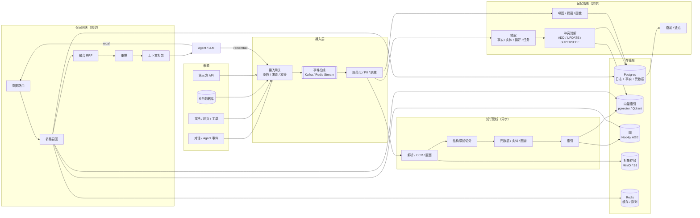

# Agent 记忆系统与知识库系统
## 架构方案、开源选型与落地路线（v1.0）

**日期** 2026-11-04 ｜ **适用** 自建 Agent 平台 / 企业知识库 / 多租户 SaaS ｜ **读者** 架构师、后端、算法、SRE

> **一句话结论**：不要把"记忆"做成一个向量库，也不要把"知识库"做成一个网盘。二者共用一条 **上下文供应链（Context Supply Chain）**，但必须走 **两条写路径**、共享 **一个召回网关**、沉淀 **一套评测**。

---

## 0. 结论先行（TL;DR）

### 0.1 五条不可妥协的原则

1. **日志即真相，视图可重建**：事件日志是唯一的 source of truth；向量、图、画像、摘要都是派生视图，随时可以重建。
2. **双时态**：区分"事实何时为真（valid time）"与"系统何时知道（transaction time）"。事实只追加、不覆盖。
3. **写时抽取 + 读时组装 + 后台巩固**：三条链路分离，同步路径只做"取"，异步路径做"想"。
4. **作用域先行**：`tenant → workspace → user → agent → session` 贯穿每一次写入与召回，ACL 在 SQL/索引层过滤，绝不后置。
5. **删除是一等公民**：`forget` 与 `remember` 同级；可审计、可传播、可证明。

### 0.2 三套推荐组合

| 场景 | 记忆 | 知识库 | 存储底座 | 周期/人力 |
|---|---|---|---|---|
| **A. MVP / 个人助手** | 自研薄记忆服务（Mem0 作参考实现） | RAGFlow 或 Dify 接入文档 | Postgres + pgvector + Redis | 2–6 周 / 1–2 人 |
| **B. 生产 / 中型团队** | 自研记忆服务 + Graphiti 可选图 | RAGFlow 解析 + 自研召回网关 | PG + Qdrant + Neo4j + MinIO | 3 个月 / 4–6 人 |
| **C. 企业 / 多租户** | 记忆平台（策略引擎 + 审计） | Onyx（企业搜索）+ 自研索引 | PG + 专用检索（Vespa/ES）+ 图 + KMS | 6 个月+ / 8–12 人 |

### 0.3 开源选型的一句话版

- **要快**：Mem0（个性化记忆）、RAGFlow（脏文档解析）、Dify（应用编排）。
- **要时间正确性与多跳**：Zep / Graphiti（双时态知识图谱）。
- **要 Agent 自主管理记忆**：Letta（MemGPT 路线，sleep-time 巩固）。
- **要长期可控**：Postgres + pgvector（+ 需要时 Qdrant / Neo4j），框架只做参考，不做出题人。

---

## 1. 先把问题定义清楚

### 1.1 记忆 vs 知识库：同一条供应链，两条写路径

| 维度 | Agent 记忆 | 知识库 |
|---|---|---|
| 写入频率 | 高（每轮对话/每次工具调用） | 低（文档导入、增量同步） |
| 写入者 | Agent 运行时、用户反馈 | 管理员、连接器、ETL |
| 粒度 | 事实、偏好、事件、技能 | 文档、章节、表格、实体 |
| 变更方式 | 追加 + 覆盖 + 冲突消解 | 版本 + 生效期 + 重建索引 |
| 正确性标准 | "对这个人/这个 Agent 为真" | "对组织为真、可引用、可审计" |
| 生命周期 | 衰减、巩固、遗忘 | 保留策略、合规删除 |
| 隔离边界 | 用户/会话/Agent | 租户/部门/文档 ACL |
| 典型失败 | 记忆污染、过时、噪声 | 解析错、切分错、权限泄露 |

**判断法则**：如果一条信息"只对某个用户/某次任务成立"，它是记忆；如果"对一群人成立且需要引用来源"，它是知识库。二者会在"语义事实"层重叠，但写路径与治理策略必须分开。

### 1.2 四种记忆（缺一不可）

| 类型 | 内容 | 载体 | 检索方式 | 例子 |
|---|---|---|---|---|
| **工作记忆** | 当前上下文、任务状态 | Context window / Redis | 直接拼接 | 当前工单、已调用工具 |
| **情景记忆** | 发生过什么（带时间线） | 事件日志 + 摘要 | 时间窗 + 语义 | "上周三我们改过这个接口" |
| **语义记忆** | 事实、偏好、实体关系 | 双时态事实表 + 图 | 精确 + 语义 + 图 | "用户偏好中文、不要表格" |
| **程序性记忆** | 怎么做（技能/工作流） | 技能库（版本化） | 任务匹配 | "发版前先跑回归清单" |

补充两类常被忽略的：**前瞻记忆**（待办、承诺、提醒）与**元记忆**（我知道什么、置信度多少、来源在哪）。后者是"不胡说"的关键。

### 1.3 四类知识

1. **文档型**：PDF/Word/网页/代码/表格 —— 解析与切分是主要矛盾。
2. **结构化**：数据库、API、指标 —— 走 text-to-SQL / 工具调用，不要硬塞进向量库。
3. **图谱型**：实体关系、组织架构、依赖拓扑 —— 多跳与推理。
4. **案例/规则型**：工单、SOP、判例 —— 情景记忆与知识库的交集，检索后要能"照着做"。

### 1.4 统一抽象：上下文供应链

```
Source → Ingest → Represent → Store → Retrieve → Assemble → Consume → Feedback → Consolidate
```

记忆系统与知识库系统分别是这条链上的两条实例化管线；**召回网关**是唯一共享出口。这样 Agent 只需要一个 `recall()`，不需要知道背后是记忆还是知识库。

### 1.5 五个常见误区

1. **把向量库当数据库**：元数据、权限、版本、删除全都没有，三个月后无法维护。
2. **每轮对话都抽取事实**：噪声爆炸，用户说"今天天气不错"也被记成偏好。
3. **只做语义召回**：人名、编号、错误码、专有名词必须靠 BM25/稀疏检索。
4. **忽略时间**：用户上个月说"住在北京"，这个月搬到上海，系统仍回答北京。
5. **先上图谱**：没有多跳需求就建图，索引成本高、增量难、收益不可测。

---

## 2. 参考架构

### 2.1 总览



### 2.2 分层职责

| 层 | 职责 | 关键约束 |
|---|---|---|
| 接入层 | 鉴权、租户解析、限流、幂等、Schema 校验 | 写请求必须幂等（`content_hash` 去重） |
| 处理层 | 抽取、解析、切分、增强、冲突消解 | 全部异步；失败进死信队列，不阻塞对话 |
| 存储层 | 日志、事实、文档、向量、图、对象 | 日志只追加；视图可重建 |
| 召回层 | 路由、多路召回、融合、重排、打包 | P95 预算：召回 150ms + 重排 120ms + 打包 30ms |
| 治理层 | ACL、PII、保留、审计、删除 | 隔离在存储层强制执行，不信任调用方 |
| 评测层 | 黄金集、回归、灰度、在线指标 | 上线门禁：召回下降 >3% 阻断 |

### 2.3 记忆写链路（9 步）

1. **接入**：`remember(events[])`，计算 `content_hash`，幂等去重。
2. **规范化**：统一消息结构（role、时间、来源、附件引用），PII 分级。
3. **分段**：按会话/任务切成 episode 候选（静默窗口、话题切换、工具调用边界）。
4. **门控**：重要性打分（规则 + 小模型），低价值事件只留日志、不抽取。
5. **抽取**：结构化输出事实/实体/偏好/任务/决策，每条带 `confidence`、`source_event_ids`、时间。
6. **对齐**：用 embedding 找候选旧事实（同 subject+predicate 或语义近邻），LLM 判定 `ADD / UPDATE / SUPERSEDE / NOOP / DISPUTE`。
7. **落库**：写事实表（双时态）、图边（可选）、画像（异步聚合）；发 embedding 任务。
8. **巩固**：会话结束/夜间，生成 episode 摘要、更新画像、合并重复、重算重要性。
9. **衰减**：按 `recency × frequency × importance × feedback` 分层（热/温/冷/归档），低于阈值只归档不删除（合规除外）。

### 2.4 知识写链路（6 步）

1. **解析**：PDF（版面/表格/公式）、扫描件 OCR、DOCX/PPTX、HTML、Markdown、代码（AST）、Excel、音视频（ASR + 说话人）。
2. **结构识别**：标题层级、章节路径、表格区域、代码块、页眉页脚剔除。
3. **切分**：结构感知 + 语义边界；目标 300–800 tokens，重叠 10–15%；表格整表保留并生成摘要；代码按函数/类切。
4. **增强**：文档级上下文前缀（contextual retrieval）、元数据（部门/密级/生效期/来源）、实体与关系（可选）。
5. **索引**：稠密向量 + 稀疏向量/BM25 + 元数据 + ACL + 图边；保留 `chunk → 原文位置（页码/bbox）` 以便溯源。
6. **版本**：文档级 `version` + `content_hash`；变更走"新版本 + 旧版本失效"，不原地覆盖；索引别名切换实现零停机重建。

### 2.5 统一读链路

```python
def recall(req):
    q = understand(req.query)                 # 意图/实体/时间/语言/作用域
    scope = resolve_scope(req)                # tenant/workspace/user/agent
    acl   = load_acl(scope)                   # 在存储层过滤，不后置

    cands = []
    if q.need_facts:    cands += pg.fact_search(q, scope, acl, k=50)
    if q.need_episodes: cands += pg.episode_search(q, scope, acl, time=q.time, k=30)
    if q.need_docs:     cands += vec.dense(q, scope, acl, k=50)
    if q.need_lexical:  cands += vec.sparse_or_bm25(q, scope, acl, k=50)
    if q.need_graph:    cands += graph.expand(q.entities, hops=2, k=30)

    fused  = rrf(cands, k=60)                 # 多路融合
    top    = rerank(q, fused[:50])[:12]       # cross-encoder / LLM listwise
    top    = dedupe(top); top = mmr(top, 0.7) # 去重 + 多样性
    top    = temporal_filter(top, q.as_of)    # 双时态：只取该时点有效的事实
    return pack(top, budget=req.budget_tokens, citations=True)
```

**要点**：

- **意图路由**决定召回组合，避免"所有查询都打全部索引"。
- **RRF（Reciprocal Rank Fusion）** 是无参数、鲁棒的融合基线，先上它再谈学习排序。
- **重排是质量杠杆**：`bge-reranker-v2-m3` / `Qwen3-Reranker` 对 50 条候选重排，通常比换 embedding 模型收益更大。
- **时间过滤在重排之后、打包之前**：既保证 `as_of` 语义，又不浪费重排预算。
- **打包**按"边际效用/ token"贪心装填，硬上限分节（画像 300、事实 600、情景 500、文档 2000、近期对话剩余）。

### 2.6 后台巩固（Sleep-time Compute）

| 任务 | 触发 | 内容 |
|---|---|---|
| Episode 摘要 | 会话结束 / 30 分钟静默 | 把 N 轮对话压成带时间线的摘要 |
| 画像更新 | 每日 / 事实变更 | 聚合稳定偏好、身份、目标，生成 `profile` |
| 冲突仲裁 | 出现 `DISPUTE` | 按来源可信度、时间、用户显式纠正裁决 |
| 去重合并 | 每日 | 语义近邻 + 同谓词合并，保留最早来源 |
| 反思（Reflection） | 每周 | 生成高层洞察（"用户在为 X 做准备"），带置信度与过期时间 |
| 技能提炼 | 任务成功后 | 把成功轨迹提炼为可复用技能，过评测门禁后入库 |

**原则**：巩固只改派生视图，永不改日志；所有派生结果带 `derived_from` 与 `model_version`，可重放。

### 2.7 治理与安全

| 风险 | 对策 |
|---|---|
| 跨租户泄露 | PG RLS + 向量库 payload 强制过滤 + 大租户物理隔离（独立 collection/schema） |
| 记忆污染（间接注入） | 检索内容一律当"数据"而非"指令"；写入侧置信度门控 + 隔离区 + 来源签名；高危事实人工确认 |
| PII | 入口分类分级、脱敏/令牌化、静态加密（KMS/pgcrypto）、访问审计 |
| 删除权 | `forget` 生成 tombstone → 异步清除向量/图/缓存 → 备份到期 → 审计留痕 |
| 越权检索 | ACL 在 SQL/索引层 join 过滤；召回结果二次校验（防缓存/图扩散绕过） |
| 成本失控 | 每租户 token/调用配额；抽取门控；上下文预算硬上限；缓存 |

### 2.8 多 Agent 共享记忆

- **三层作用域**：`team` 共享层（长期事实/知识）、`agent` 私有层（草稿/偏好）、`session` 黑板层（任务状态）。
- **黑板（Blackboard）**：Redis Stream/Hash + TTL，只放短期中间结论与任务状态，不落长期事实库。
- **写入冲突**：同 `subject+predicate` 并发写用乐观锁（version）或 supervisor 串行化；简单字段可用 LWW，但必须记录 `author_agent` 与证据链。
- **隔离**：私有草稿不进共享层；共享层写入走"提议 → 审核/置信度阈值 → 生效"。
- **回滚**：共享事实带 `derived_from` 与 `author_agent`，出错时按来源批量回滚。

### 2.9 人读与机读的知识库

同一份内容，两种视图，**不要维护两套**：

- **人读**：目录、权限、审核流、版本对比、评论、订阅。
- **机读**：chunk、向量、图、ACL、引用定位。
- 内容以文档为源，chunk 与索引为派生；文档更新触发增量重建，而不是人工同步两份。

---

## 3. 十个关键设计决策（ADR）

### ADR-01 事件日志与派生视图分离
- **选项**：A) 直接写向量库；B) 日志 + 派生视图；C) 只用图数据库。
- **决策**：B。日志（`mem_event`）只追加；事实、画像、摘要、向量、图全部可重建。
- **代价**：需要维护重建流水线；**收益**：可审计、可回放、可换模型、可修 bug 后重算。这是与"玩具记忆"的分水岭。

### ADR-02 双时态事实
- **决策**：`valid_from/valid_to`（业务有效期）+ `recorded_at/superseded_at`（系统记录期）。
- **规则**：新事实与旧事实冲突时，旧事实 `valid_to = 新事实.valid_from`、`superseded_at = now()`，**不物理覆盖**。
- **收益**：支持 `as_of` 查询、纠纷回溯、模型重训；代价：查询要多一个时间谓词。

### ADR-03 抽取时机与门控
- **选项**：每轮同步抽取 / 会话结束批量 / 重要性门控 + 异步。
- **决策**：异步 + 门控；只对"身份、偏好、承诺、决策、纠正、实体变更"等高价值信号抽取。
- **指标**：抽取率控制在 20–35%；噪声率（人工抽检）< 10%。

### ADR-04 冲突消解策略
- **决策**：规则优先，LLM 仲裁兜底。
  - 用户显式纠正 → 直接 `SUPERSEDE`，置信度拉满。
  - 来源可信度：用户 > 系统观测 > 第三方文档 > 模型推断。
  - 时间更晚且来源不弱 → `SUPERSEDE`；不确定 → `DISPUTE`，检索时并列展示并标注。
- **禁止**：静默取最新、静默删除旧值。

### ADR-05 图：什么时候需要
- **需要**：多跳问答（"A 的上级所在的部门负责哪个项目"）、实体消歧、影响分析、组织/依赖拓扑。
- **不需要**：单跳事实检索、文档问答、偏好记忆 —— 元数据 + 实体索引足够。
- **选型**：已有 PG 且图规模 < 1 亿边 → Apache AGE；需要成熟 Cypher/生态 → Neo4j；需要 Graphiti → Neo4j/FalkorDB/Kuzu。
- **质量控制**：每条边必须带 `source_chunk_id` + `confidence`；低置信边不进主图，进"候选图"。

### ADR-06 遗忘与衰减
- **决策**：分层（热/温/冷/归档）+ 分数衰减，不删除原始日志。
- **公式**：`score = 0.4·exp(-Δdays/30) + 0.3·importance + 0.2·log(1+access) + 0.1·feedback`。
- **合规删除**例外：走 tombstone + 全视图清除 + 审计。

### ADR-07 程序性记忆
- **决策**：技能库独立于事实库；每条技能 = 触发条件 + 步骤 + 工具 + 成功率 + 版本。
- **门禁**：新技能需在离线评测集上超过基线 N 次才提升为 `stable`；支持灰度与回滚。
- **价值**：这是"Agent 越用越强"的主要来源，比堆事实更重要。

### ADR-08 多租户隔离
- **决策**：三层防线 —— ① PG RLS；② 向量/图查询强制 payload filter；③ 超大租户物理隔离。
- **测试**：必须有"跨租户检索必须返回空"的自动化用例，进 CI。

### ADR-09 接口：MCP-first + REST
- **决策**：对外同时暴露 MCP 工具与 REST；MCP 供 Agent 直连，REST 供业务系统集成。
- **工具集**：`memory.remember` / `memory.recall` / `memory.forget` / `memory.profile` / `kb.search` / `kb.get_document`。
- **注意**：MCP 工具描述本身是攻击面（工具投毒），需签名与白名单。

### ADR-10 嵌入模型与索引迁移
- **决策**：多语言优先（BGE-M3 / Qwen3-Embedding），维度 1024；保留 `embedding_model` 字段。
- **迁移**：双写（新旧索引并存）→ 影子评测 → 别名切换 → 回滚窗口 7 天。
- **禁止**：无版本字段的"原地重嵌入"。

---

## 4. 数据模型

> PostgreSQL 16+，扩展：`vector`、`pg_trgm`、`pgcrypto`（可选 `ltree`、`age`）。

```sql
CREATE EXTENSION IF NOT EXISTS vector;
CREATE EXTENSION IF NOT EXISTS pg_trgm;

-- ============ 事件日志：唯一真相 ============
CREATE TABLE mem_event (
  id            uuid PRIMARY KEY DEFAULT gen_random_uuid(),
  tenant_id     uuid NOT NULL,
  scope_path    text NOT NULL,            -- 't_<hex>.w_<hex>.u_<hex>.a_<hex>'
  kind          text NOT NULL,            -- message|doc|tool|feedback|system
  role          text,
  content       jsonb NOT NULL,
  content_text  text,
  occurred_at   timestamptz NOT NULL,
  recorded_at   timestamptz NOT NULL DEFAULT now(),
  source_ref    text,
  content_hash  text NOT NULL,
  pii_class     smallint NOT NULL DEFAULT 0,
  meta          jsonb NOT NULL DEFAULT '{}',
  UNIQUE (tenant_id, content_hash)
);
CREATE INDEX ON mem_event (tenant_id, occurred_at DESC);
CREATE INDEX ON mem_event (scope_path text_pattern_ops);
CREATE INDEX ON mem_event USING gin (content_text gin_trgm_ops);

-- ============ 语义事实：双时态，只追加 ============
CREATE TABLE mem_fact (
  id               uuid PRIMARY KEY DEFAULT gen_random_uuid(),
  tenant_id        uuid NOT NULL,
  scope_path       text NOT NULL,
  subject          text NOT NULL,
  predicate        text NOT NULL,
  object           jsonb NOT NULL,
  fact_text        text NOT NULL,
  valid_from       timestamptz,
  valid_to         timestamptz,
  recorded_at      timestamptz NOT NULL DEFAULT now(),
  superseded_at    timestamptz,
  confidence       real NOT NULL DEFAULT 0.7,
  importance       real NOT NULL DEFAULT 0.5,
  status           text NOT NULL DEFAULT 'active',  -- active|disputed|superseded|deleted
  superseded_by    uuid REFERENCES mem_fact(id),
  source_event_ids uuid[] NOT NULL DEFAULT '{}',
  embedding        vector(1024),
  tsv              tsvector GENERATED ALWAYS AS (to_tsvector('simple', fact_text)) STORED
);
CREATE INDEX ON mem_fact (tenant_id, scope_path, status);
CREATE INDEX ON mem_fact USING hnsw (embedding vector_cosine_ops);
CREATE INDEX ON mem_fact USING gin (tsv);

-- ============ 情景记忆 ============
CREATE TABLE mem_episode (
  id               uuid PRIMARY KEY DEFAULT gen_random_uuid(),
  tenant_id        uuid NOT NULL,
  scope_path       text NOT NULL,
  summary          text NOT NULL,
  occurred_from    timestamptz NOT NULL,
  occurred_to      timestamptz NOT NULL,
  participants     text[],
  topics           text[],
  importance       real NOT NULL DEFAULT 0.5,
  source_event_ids uuid[] NOT NULL DEFAULT '{}',
  embedding        vector(1024)
);
CREATE INDEX ON mem_episode (tenant_id, scope_path, occurred_from DESC);
CREATE INDEX ON mem_episode USING hnsw (embedding vector_cosine_ops);

-- ============ 画像（派生，可重建） ============
CREATE TABLE mem_profile (
  scope_path   text PRIMARY KEY,
  tenant_id    uuid NOT NULL,
  profile      jsonb NOT NULL,           -- 结构化偏好/身份/目标
  version      int  NOT NULL DEFAULT 1,
  updated_at   timestamptz NOT NULL DEFAULT now()
);

-- ============ 知识库 ============
CREATE TABLE kb_collection (
  id              uuid PRIMARY KEY DEFAULT gen_random_uuid(),
  tenant_id       uuid NOT NULL,
  name            text NOT NULL,
  embedding_model text NOT NULL,
  chunk_policy    jsonb NOT NULL,
  acl_default     jsonb NOT NULL DEFAULT '{}'
);

CREATE TABLE kb_document (
  id            uuid PRIMARY KEY DEFAULT gen_random_uuid(),
  tenant_id     uuid NOT NULL,
  collection_id uuid NOT NULL REFERENCES kb_collection(id),
  title         text NOT NULL,
  source_uri    text,
  version       int NOT NULL DEFAULT 1,
  content_hash  text NOT NULL,
  status        text NOT NULL DEFAULT 'active',   -- active|superseded|deleted
  effective_from timestamptz,
  effective_to   timestamptz,
  metadata      jsonb NOT NULL DEFAULT '{}'       -- 部门/密级/标签/来源
);
CREATE INDEX ON kb_document (tenant_id, collection_id, status);

CREATE TABLE kb_chunk (
  id            uuid PRIMARY KEY DEFAULT gen_random_uuid(),
  document_id   uuid NOT NULL REFERENCES kb_document(id) ON DELETE CASCADE,
  tenant_id     uuid NOT NULL,
  ordinal       int NOT NULL,
  text          text NOT NULL,
  section_path  text,
  page          int,
  bbox          jsonb,
  token_count   int,
  embedding     vector(1024),
  sparse        sparsevec(250000),        -- BGE-M3 稀疏 / SPLADE
  tsv           tsvector GENERATED ALWAYS AS (to_tsvector('simple', text)) STORED
);
CREATE INDEX ON kb_chunk USING hnsw (embedding vector_cosine_ops);
CREATE INDEX ON kb_chunk USING gin (tsv);

-- ============ ACL（join 表，可查询） ============
CREATE TABLE kb_acl (
  document_id  uuid NOT NULL REFERENCES kb_document(id) ON DELETE CASCADE,
  principal    text NOT NULL,             -- 'user:...' | 'group:...' | 'role:...'
  permission   text NOT NULL,             -- read|write|admin
  PRIMARY KEY (document_id, principal, permission)
);

-- ============ 图谱（若用 AGE / 外部图库，此处为映射表） ============
CREATE TABLE kb_edge (
  id             bigserial PRIMARY KEY,
  tenant_id      uuid NOT NULL,
  src_entity     text NOT NULL,
  dst_entity     text NOT NULL,
  relation       text NOT NULL,
  source_chunk_id uuid REFERENCES kb_chunk(id),
  confidence     real NOT NULL DEFAULT 0.6,
  valid_from     timestamptz,
  valid_to       timestamptz
);
```

**RLS 示例**：

```sql
ALTER TABLE mem_fact ENABLE ROW LEVEL SECURITY;
CREATE POLICY tenant_isolation ON mem_fact
  USING (tenant_id = current_setting('app.tenant_id')::uuid);
```

**混合检索 + RRF 示例**：

```sql
WITH dense AS (
  SELECT id, row_number() OVER (ORDER BY embedding <=> :qvec) AS r
  FROM kb_chunk
  WHERE tenant_id = :tenant
    AND EXISTS (SELECT 1 FROM kb_acl a
                WHERE a.document_id = kb_chunk.document_id
                  AND a.principal = ANY(:principals))
  ORDER BY embedding <=> :qvec
  LIMIT 50
), sparse AS (
  SELECT id, row_number() OVER (
           ORDER BY ts_rank_cd(tsv, websearch_to_tsquery('simple', :q)) DESC) AS r
  FROM kb_chunk
  WHERE tenant_id = :tenant AND tsv @@ websearch_to_tsquery('simple', :q)
  LIMIT 50
)
SELECT id, sum(1.0 / (60 + r)) AS score
FROM (SELECT * FROM dense UNION ALL SELECT * FROM sparse) t
GROUP BY id
ORDER BY score DESC
LIMIT 20;
```

> 注意：pgvector 的 HNSW 过滤是"先扫描后过滤"，高选择性过滤会掉召回。生产上用 `hnsw.iterative_scan = relaxed_order`（0.8+）、按租户分区，或直接上 Qdrant 的 filterable HNSW。

---

## 5. API 与上下文契约

### 5.1 端点

| 方法 | 路径 | 说明 |
|---|---|---|
| POST | `/v1/remember` | 批量写入事件，异步处理，返回 `event_ids` + `job_id` |
| POST | `/v1/recall` | 统一召回，返回 `ContextPackage` |
| POST | `/v1/forget` | 按 id / scope / 时间范围删除，异步传播 |
| POST | `/v1/consolidate` | 手动触发巩固（scope + mode） |
| GET | `/v1/profile` | 读取结构化画像 |
| POST | `/v1/feedback` | 反馈（采用/纠正/无用），回流排序与重要性 |
| GET | `/v1/health` | 索引新鲜度、队列积压、模型版本 |

### 5.2 ContextPackage

```json
{
  "recall_id": "rc_01J...",
  "intent": "fact+doc",
  "as_of": "2026-11-04T10:00:00+08:00",
  "sections": [
    {"name": "profile", "tokens": 180, "items": [{"key": "language", "value": "zh-CN"}]},
    {"name": "facts", "tokens": 420, "items": [
      {"id": "f_1", "text": "用户偏好表格化输出", "valid_from": "2026-09-01",
       "confidence": 0.92, "source": "msg_88"}
    ]},
    {"name": "episodes", "tokens": 320, "items": [
      {"id": "e_7", "summary": "10 月讨论过迁移方案，决定先灰度 5%",
       "occurred_at": "2026-10-18", "source": "session_42"}
    ]},
    {"name": "documents", "tokens": 1800, "items": [
      {"chunk_id": "c_9", "doc_id": "d_3", "title": "发布规范 v2",
       "text": "...", "page": 3, "score": 0.82}
    ]}
  ],
  "budget": {"total": 4000, "used": 2720},
  "citations": [{"ref": "d_3#p3", "url": "s3://kb/..."}],
  "debug": {
    "candidates": 146, "reranked": 24,
    "latency_ms": {"understand": 8, "retrieve": 46, "rerank": 88, "pack": 6}
  }
}
```

**契约原则**：每节带 `tokens` 与 `items`；每条带 id 与来源；`debug` 只在内部返回；`as_of` 显式传递，禁止隐式"现在"。

### 5.3 抽取输出 Schema

```json
{
  "facts": [
    {"subject": "user:u_1", "predicate": "prefers_output", "object": "table",
     "text": "用户偏好表格化输出", "confidence": 0.9,
     "valid_from": null, "source_event_ids": ["evt_88"]}
  ],
  "entities": [{"name": "订单服务", "type": "service", "aliases": ["order-svc"]}],
  "tasks": [{"text": "周五前给出迁移方案", "due": "2026-11-07", "status": "open"}],
  "corrections": [{"target_fact_id": "f_12", "reason": "用户明确否认"}]
}
```

---

## 6. 开源方案全景与对比

> **时效声明**：以下基于 2026-11 的公开资料与社区信息整理；版本、许可、功能变化很快，接入前务必以仓库 `LICENSE` 与 `README` 为准。评分是主观判断，用于讨论而非结论。

### 6.1 三层选型观

| 层 | 代表 | 角色 | 风险 |
|---|---|---|---|
| **成品平台** | RAGFlow、Dify、Onyx、AnythingLLM | 冷启动、文档接入、UI | 定制受限、许可限制、深度不够 |
| **记忆框架/SDK** | Mem0、Zep/Graphiti、Letta、Cognee、MemOS | 参考实现、加速验证 | 与业务模型耦合、治理缺失 |
| **基础设施** | PG/pgvector、Qdrant、Neo4j、Kafka | 长期底座 | 工作量大、需要团队 |

**建议**：成品做冷启动，框架做参考与对比基线，基础设施做长期。**不要**让任何单一框架成为你的 system of record。

### 6.2 记忆框架对比

| 方案 | 核心抽象 | 强项 | 短板 | 适合 |
|---|---|---|---|---|
| **Mem0** | 抽取→更新流水线（ADD/UPDATE/DELETE/NOOP），向量 + 可选图 + KV | 接入快、SDK 全、个性化效果有公开 benchmark；MCP/OpenMemory | 以"事实条目"为中心，时间/冲突模型弱；OSS 与云版有差距 | 消费级个性化、快速验证 |
| **Zep / Graphiti** | 双时态知识图谱；episode → entity/edge；增量更新 | 时间正确性最好、多跳强、无需全量重算；有 DMR/LongMemEval 公开结果 | 依赖图库；抽取 LLM 成本高；运维复杂 | 事实频繁变化、需审计与 `as_of` |
| **Letta（MemGPT）** | 有状态 Agent Runtime；core memory blocks / archival / recall；Agent 自编辑；sleep-time agents | 记忆与推理闭环、Agent 自主管理、`.af` 可移植 | 绑定 Runtime，不是纯记忆层；学习曲线陡 | 长期运行的个人助理/自治 Agent |
| **Cognee** | ECL（Extract–Cognify–Load）管线；图 + 向量 | 文档→知识图谱快、后端可插拔 | 生态较小、生产治理需自建 | 文档知识图谱化 |
| **MemOS** | MemCube（明文/激活/参数化记忆）+ 调度与生命周期 | 记忆类型最全、研究前沿 | 较新、生产案例少、概念重 | 研究/参数化记忆实验 |
| **Memobase** | 用户画像 + 事件时间线；buffer → profile | 结构化画像、消费级场景直接可用 | 范围窄（用户记忆），非通用 KB | 社交/陪伴/客服个性化 |
| **Supermemory** | 记忆 API + 图谱 + 连接器，可自托管 | 产品化程度高、API 简洁 | 较新、深度定制受限 | 想要"记忆即服务"体验 |
| **Hindsight** | retain / recall / reflect，MCP 原生 | 接入 Agent 快、时序记忆 | 新、生态小 | MCP Agent 快速加记忆 |
| **LangMem / LangGraph Store** | namespace KV + 语义/情景/程序记忆 | 与 LangGraph 无缝、灵活 | 治理与检索需自建 | LangChain 技术栈 |
| **LlamaIndex Memory** | 可组合 memory blocks + vector store | 与 RAG 生态一体 | 偏框架、非成品 | 已在 LlamaIndex 上 |
| **Basic Memory** | Markdown + 双向链接 + MCP | 本地优先、可读可版本化 | 规模/并发/权限弱 | 个人第二大脑 |

**选型提示**：

- 需要"记住用户是谁、偏好什么" → Mem0 / Memobase。
- 需要"事实随时间演化且可回溯" → Zep/Graphiti（这是目前时间建模最认真的开源实现）。
- 需要"Agent 自己决定记什么" → Letta（但接受它的 Runtime）。
- 需要"从文档长出知识图谱" → Cognee / LightRAG。
- 需要"完全可控" → 自研薄层，上述项目只做参考实现与对比基线。

### 6.3 知识库 / RAG 平台对比

| 方案 | 强项 | 短板 | 许可/部署 |
|---|---|---|---|
| **RAGFlow** | DeepDoc 深度解析（OCR/版面/表格）、模板化切分、引用可溯源、GraphRAG | 组件多、资源重、二次开发门槛 | Apache-2.0，Docker |
| **Dify** | 可视化工作流 + RAG + Agent，生态大、上手快 | 深度文档解析一般；许可对多租户 SaaS 有限制 | 基于 Apache-2.0 的附加条款 |
| **Onyx（原 Danswer）** | 企业连接器丰富、ACL 同步、内部搜索/问答 | 面向企业搜索，非通用 KB 建模 | 开源 + 企业版 |
| **AnythingLLM** | 轻量、工作区隔离、桌面/Docker | 大规模与治理弱 | MIT |
| **Khoj** | 个人第二大脑、多端、连接器 | 团队/权限弱 | AGPL-3.0 |
| **LightRAG** | 轻量图 RAG、双层检索、增量更新、成本低 | 图质量依赖抽取、生态较小 | MIT |
| **Microsoft GraphRAG** | 社区摘要、全局"讲清楚"类问题 | 索引贵、增量难、QPS 低 | MIT |
| **Haystack** | 生产级 pipeline、组件化、可评测 | 需要自己搭整套 | Apache-2.0 |
| **R2R** | RAG API + Agentic 检索 + 知识图谱 | 较新、生态小 | Apache-2.0 |
| **FastGPT** | 工作流 + KB，中文生态好 | 许可有商用限制 | 自有开源许可 |
| **MaxKB** | 开箱即用企业 KB、中文 | 扩展性一般 | GPL 系（以仓库为准） |
| **QAnything** | 本地部署文档问答、中文 | 生态与迭代速度 | Apache-2.0（以仓库为准） |
| **WeKnora（腾讯）** | 文档理解 + 多模态、较新 | 成熟度待观察 | 以仓库为准 |

### 6.4 存储与检索引擎

| 引擎 | 强项 | 短板 | 何时选 |
|---|---|---|---|
| **Postgres + pgvector** | 事务一致、元数据/ACL 同库、运维简单 | 超大规模/高过滤选择性吃力 | 默认首选，< 2000 万–5000 万向量 |
| **Qdrant** | 过滤 + 多租户 + 量化 + 混合检索强 | 独立服务、需运维 | 高 QPS、强过滤、多租户 |
| **Milvus** | 十亿级分布式 | 重、组件多 | 超大规模 |
| **Weaviate** | 内置 hybrid、多租户、模块化 | 资源占用高 | 想要开箱 hybrid |
| **LanceDB** | 嵌入式、列式、版本化、多模态 | 生态较新 | 边缘/本地/多模态 |
| **Chroma** | 开发体验好 | 生产治理弱 | 原型 |
| **Elasticsearch / OpenSearch** | BM25 + kNN + 权限/日志成熟 | 成本高、调优复杂 | 已有 ES 栈、强词法需求 |
| **Vespa** | 排序/混合检索最强 | 学习曲线陡 | 极致排序质量 |
| **Neo4j** | Cypher 生态、图算法 | GPL、规模化成本 | 图为主 |
| **FalkorDB** | Redis 底座、图查询快 | SSPL、生态较小 | Graphiti 低延迟场景 |
| **Kuzu** | 嵌入式图、MIT、快 | 单机为主 | 本地/分析型图 |
| **Apache AGE** | 图在 PG 内、少一个组件 | 生态弱、性能一般 | 想"一个 PG 搞定" |
| **Redis** | 缓存、短期记忆、队列 | 非持久真相 | 工作记忆/热点缓存 |

### 6.5 中文生态与模型（容易踩坑）

- **Embedding**：`BGE-M3`（多语言、稠密+稀疏+多向量，MIT）、`Qwen3-Embedding`（Apache-2.0）、`Conan-Embedding`；注意 `jina-embeddings-v3` 是 **CC BY-NC 4.0**，商用需授权。
- **Rerank**：`bge-reranker-v2-m3`、`Qwen3-Reranker`；GPU 上 50 条重排约 30–100ms。
- **中文分词/BM25**：PG 用 `pg_jieba`/`zhparser`；ES 用 IK；更稳的做法是用 BGE-M3 的稀疏向量（`sparsevec`）替代分词，跨语言一致。
- **许可**：模型许可与代码许可分开看；商用前逐项确认。

### 6.6 横向评分（主观，1–5）

| 方案 | 时间正确性 | 多跳 | 接入速度 | 运维简单 | 可定制 | 生产成熟 | 中文 |
|---|---|---|---|---|---|---|---|
| Mem0 | 2 | 2 | 5 | 4 | 3 | 4 | 4 |
| Zep/Graphiti | 5 | 5 | 3 | 2 | 4 | 3 | 3 |
| Letta | 3 | 3 | 3 | 3 | 4 | 4 | 3 |
| Cognee | 3 | 4 | 3 | 3 | 4 | 2 | 3 |
| MemOS | 3 | 3 | 2 | 2 | 4 | 2 | 3 |
| RAGFlow | 2 | 3 | 4 | 2 | 3 | 4 | 5 |
| Dify | 1 | 2 | 5 | 3 | 3 | 5 | 5 |
| Onyx | 1 | 2 | 4 | 3 | 3 | 4 | 3 |
| LightRAG | 2 | 4 | 3 | 4 | 4 | 3 | 3 |
| GraphRAG | 1 | 5 | 2 | 2 | 3 | 3 | 3 |
| 自研（PG 底座） | 5 | 3 | 1 | 5 | 5 | 3 | 5 |

### 6.7 选型决策树

```
事实是否随时间频繁变化、且需要"当时是什么"？
├─ 是 → 需要双时态：Graphiti / 自研双时态表
└─ 否 → 继续
        文档是否脏（扫描件/复杂表格/多栏）？
        ├─ 是 → RAGFlow 解析（可只取解析层）
        └─ 否 → 自研解析 + 结构感知切分
                是否已有 PG 且向量 < 2000 万？
                ├─ 是 → pgvector
                └─ 否 → Qdrant / Milvus
                        是否需要多跳/关系推理？
                        ├─ 是 → Neo4j / AGE / LightRAG
                        └─ 否 → 元数据 + 实体索引足够
```

---

## 7. 三套落地方案

### 方案 A：MVP（2–6 周，1–2 人）

- **底座**：PostgreSQL 16 + pgvector + pg_jieba + Redis + MinIO。
- **记忆**：一张 `mem_fact` + 一张 `mem_event` + 规则/小模型抽取；不做图。
- **知识**：RAGFlow（或 Dify）接入 1–2 个文档源，导出 chunk 到自研 `kb_chunk`，统一走自研召回。
- **模型**：BGE-M3 embedding + bge-reranker-v2-m3；抽取用小模型，巩固用强模型。
- **接口**：FastAPI + MCP server（`remember/recall/forget`）。
- **评测**：50–200 条黄金集 + LongMemEval 子集；CI 跑回归。
- **产出**：可用的"记得住、找得到、删得掉"闭环。

### 方案 B：生产（约 3 个月，4–6 人）

- **底座**：PG 主库 + Qdrant（> 2000 万向量或高 QPS）+ Neo4j（确认多跳需求后）+ Kafka/Redpanda + MinIO。
- **记忆**：独立记忆服务 + worker 池；双时态事实、冲突消解、巩固、衰减全量上线。
- **知识**：RAGFlow 解析层 + 自研切分/索引/召回网关；ACL 同步；版本与引用。
- **可观测**：OpenTelemetry + Langfuse/Phoenix + Prometheus/Grafana；每次 recall 全链路 trace。
- **发布**：影子索引 + 灰度 5%→50%→100%；召回回归门禁。
- **SLO**：recall P95 < 300ms（不含 LLM）；写入 ack < 50ms；索引新鲜度 < 60s；可用性 99.9%。

### 方案 C：企业 / 多租户（6 个月+，8–12 人）

- **隔离**：RLS + 物理隔离 + 租户级 KMS；策略引擎（OPA）统一授权。
- **检索**：Vespa/ES 承担大规模混合检索；图 + 向量 + 时序三引擎。
- **治理**：数据分级、PII、保留策略、审计、合规删除流水线（含备份）。
- **运营**：租户配额、成本核算、SLA、灰度与回滚。
- **生态**：Onyx 做企业连接器与搜索前端；自研记忆平台做差异化。

### 明确不建议的组合

- 只用 Chroma + 把聊天记录直接塞进去（无治理、无时间、无删除）。
- 用 Dify 当唯一记忆系统（它是应用编排，不是记忆底座）。
- 一上来就全量 GraphRAG 建图（成本高、增量难、收益未验证）。
- 用 Letta 但不用它的 Runtime（只取记忆层会失去它的核心价值）。
- 同时维护两套向量库（双写不一致、成本翻倍）。

---

## 8. 评测体系

### 8.1 离线

| 层 | 指标 | 方法 |
|---|---|---|
| 检索 | Recall@k、nDCG@10、MRR | 标注 Q→证据 id，分层（单跳/多跳/时间/否定） |
| 记忆 | 五能力：信息抽取、多轮推理、时间推理、知识更新、 abstention | LongMemEval 风格；LoCoMo；MemBench；MemoryAgentBench |
| 端到端 | 正确率、引用准确率、"不知道"率、延迟、token | LLM-as-judge + 人工抽检 10% |
| 消融 | 去重排/去图/去时间衰减的增益 | 固定随机种子，报告置信区间 |

### 8.2 在线

- 采纳率、纠正率、重问率、会话完成率、留存、单会话成本。
- 影子模式对比新旧召回；灰度 5% 起。
- 每周复盘 bad case，回灌黄金集。

### 8.3 门禁

- 召回 Recall@10 下降 > 3% → 阻断发布。
- 跨租户泄露用例失败 → 阻断。
- 删除后 24h 内全视图不可见 → 阻断。

---

## 9. 成本模型

**写入**：`turns/day × 抽取率 × 单轮 token × 单价 + embedding token × 单价`
**读取**：`queries/day × (query embedding + rerank + 上下文 token) × 单价`
**存储**：`向量数 × 维度 × 4B × 副本 + 图边数 × 开销 + 对象存储`

示例（假设，仅示意量级）：

| 项 | 假设 | 日成本量级 |
|---|---|---|
| 抽取 | 30 万轮 × 25% × 1.5k tokens × $0.15/M | ~$17 |
| 嵌入 | 30 万 × 300 tokens × $0.02/M | ~$2 |
| 召回上下文 | 10 万次 × 2k tokens × $0.5/M | ~$100 |
| 重排 | 10 万次 × 50 条 | 取决于自托管 GPU |

**结论**：**上下文 token 是最大成本项**，不是向量存储。优化顺序：预算打包 → 缓存 → 抽取门控 → 小模型重排 → 分层存储。

---

## 10. 路线图与团队

| 阶段 | 周期 | 交付 | 验收 |
|---|---|---|---|
| P0 定义 | 1–2 周 | 场景边界、作用域模型、黄金集、基线 | 基线可复现 |
| P1 记忆 MVP | 3–6 周 | 事件日志、事实抽取、混合召回、MCP | 黄金集 Recall@10 ≥ 0.75 |
| P2 知识库 | 7–10 周 | 解析/切分/索引/引用/ACL | 引用准确率 ≥ 0.9 |
| P3 时间与图 | 11–14 周 | 双时态、冲突消解、图扩展 | 时间类问题提升 ≥ 10% |
| P4 治理与成本 | 15–18 周 | 多租户、删除、审计、配额 | 泄露/删除用例全绿 |
| P5 自进化 | 持续 | 技能库、反思、A/B | 任务成功率持续上升 |

**团队**：1 架构 + 2 后端 + 1 检索/算法 + 0.5 SRE + 0.5 产品/标注。

---

## 11. 风险与反模式清单

1. 向量库当唯一存储，元数据散落各处。
2. 无 `tenant_id` 过滤的召回，靠"调用方记得传"。
3. 事实覆盖式更新，历史不可回溯。
4. 每轮都抽取，记忆变成噪声垃圾场。
5. 只做稠密检索，编号/人名/错误码搜不到。
6. 无重排，Top-10 里一半不相关。
7. 上下文无预算，塞满窗口、成本失控、模型"中间失忆"。
8. 检索内容被当指令执行（间接注入）。
9. 删除只删主表，向量/图/缓存仍有残留。
10. 换 embedding 模型不重建索引，召回静默劣化。
11. 图无限扩张，无 provenance、无置信度。
12. 没有评测集，靠"感觉变好了"上线。
13. 巩固任务与在线写路径抢资源，P99 抖动。
14. 多套记忆/知识库并存，口径不一致。
15. 把"参数化记忆/微调"当万能药，忽视检索与治理。

---

## 12. 附录

### 12.1 术语

- **双时态（bitemporal）**：valid time（事实何时为真）+ transaction time（系统何时记录）。
- **RRF**：Reciprocal Rank Fusion，多路召回的无参数融合。
- **MMR**：最大边际相关性，去冗余。
- **Contextual Retrieval**：切分时为 chunk 补充文档级上下文再嵌入。
- **Sleep-time Compute**：离线巩固/反思，不占用在线延迟。
- **MemCube**：MemOS 的记忆单元抽象（明文/激活/参数化）。

### 12.2 参考链接

- Zep 论文（时序知识图谱）：https://ar5iv.labs.arxiv.org/html/2501.13956
- MemOS 论文：https://export.arxiv.org/abs/2507.03724
- Agent Memory 综述（2026）：https://browse-export.arxiv.org/abs/2602.06052
- MemBench：https://ar5iv.labs.arxiv.org/html/2506.21605
- Hindsight MCP 记忆：https://hindsight.vectorize.io/blog/2026/03/04/mcp-agent-memory
- Supermemory 自托管：https://supermemory.ai/docs/self-hosting/overview.md
- Graphiti（Thoughtworks Radar）：https://www.thoughtworks.com/radar/platforms/graphiti
- RAGFlow：https://github.com/infiniflow/ragflow
- Dify 文档：https://docs.dify.ai
- FastGPT 许可：https://doc.fastgpt.io/en/guide/version/opensource/license
- pgvector vs Qdrant：https://www.instaclustr.com/education/vector-database/pgvector-vs-qdrant-5-key-differences-and-how-to-choose/
- Context Engineering（Splunk）：https://www.splunk.com/en_us/blog/artificial-intelligence/context-engineering-production-agents.html

### 12.3 上线前检查清单（20 项）

- [ ] 每个查询都带 `tenant_id` + `scope_path`，并有跨租户测试
- [ ] 事实表有 `valid_from/valid_to/recorded_at`
- [ ] 事件日志只追加，视图可重建（演练过一次）
- [ ] `forget` 覆盖 PG/向量/图/缓存，且有审计
- [ ] 抽取有门控与置信度，噪声率抽检 < 10%
- [ ] 混合召回（稠密 + 稀疏/BM25）+ 重排
- [ ] 上下文有硬预算与分节上限
- [ ] 每条召回结果带来源 id，可引用
- [ ] 嵌入模型版本可追踪，支持双写切换
- [ ] 索引新鲜度监控 + 队列积压告警
- [ ] 检索内容与指令隔离（防注入）
- [ ] PII 分类、脱敏、加密
- [ ] 删除后 24h 全视图不可见（演练）
- [ ] 黄金集 + CI 回归门禁
- [ ] 在线 bad case 回流机制
- [ ] 每租户成本/配额监控
- [ ] 图边带 provenance 与置信度
- [ ] 巩固任务独立队列，不与在线写抢资源
- [ ] 备份与恢复演练（含向量索引重建）
- [ ] 灰度与回滚预案
